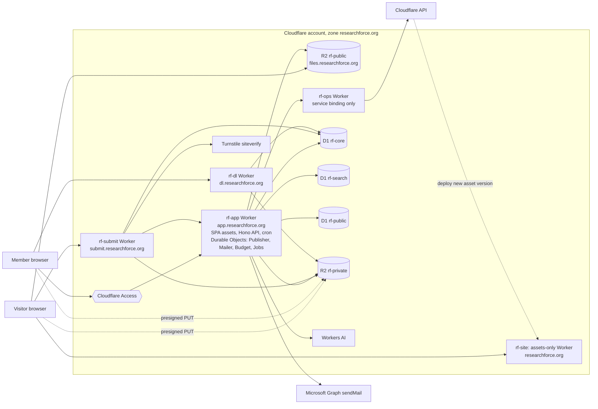
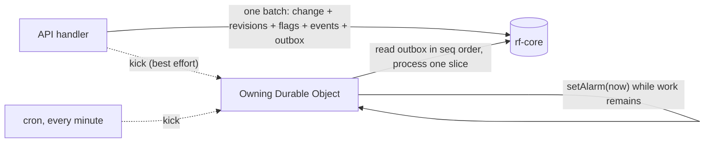
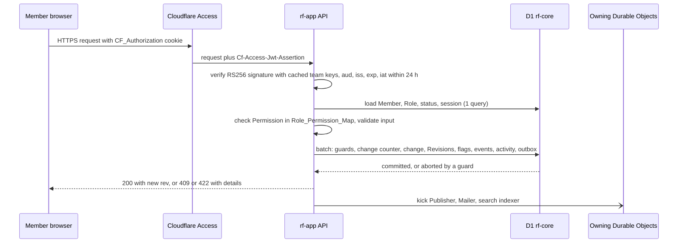
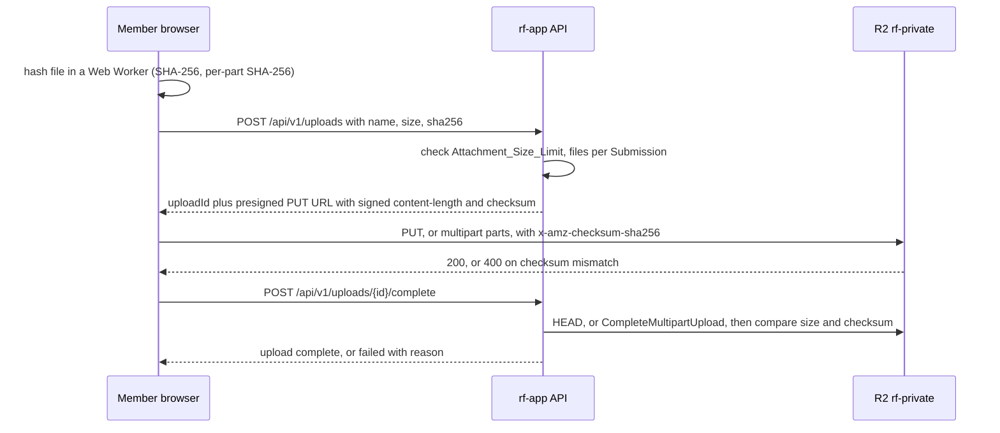
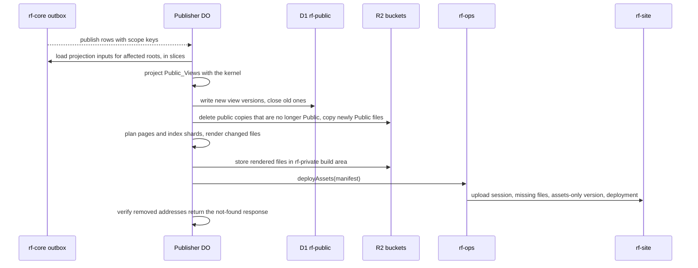

# Design Document: Research Force (research-collab-cms)

## Overview

Research Force is a private collaborative research Workspace and the source of a public archive. This design implements Requirements 1 to 60. The Cloudflare stack stays fixed; a versioned Operating_Profile selects Free_Qualified or Paid_Standard and certifies CPU, memory, storage, recovery, and abuse limits. Paid_Standard is recommended for production and requires explicit operator configuration and budget approval. No provisioning action is authorized merely by this design. A reference such as R23.6 means Requirement 23, criterion 6.

### Product and installation boundary

**Research Force** is the reusable MIT-licensed software; **ResearchForce.org** is its first installation. Each team deploys its own Workers and storage using the same architecture. A shared hosted multi-tenant service is outside scope. Existing `@researchforce/*` package names and `rf-*` resource examples remain valid.

Site display name, trusted origins and resource names, sending address, initial Project, group identity and policy statements, Responsible Person, and Content_Licence belong to validated installation configuration and bootstrap inputs. ResearchForce.org supplies the values described below. Fixed policy text remains versioned release configuration with the existing preview, revision, and publication safeguards; it must not make ResearchForce.org's organizational claims on behalf of another installation. URLs and origin checks use explicitly configured trusted origins. Shared privacy and permission rules do not become configurable exceptions.

The repository's MIT licence applies to software and development documentation. Research records, attachments, imported journals, and other instance content retain their own rights. The instance runner or owner explicitly configures the Content_Licence's name, URL, and export text before content publication or licence-agreement collection. No content licence is selected for ResearchForce.org yet, and no software licence is used as a fallback. Existing author-agreement, attachment-rights, and consent gates continue to apply. A changed content licence requires the existing current-licence checks and renewed agreements; it does not relabel earlier grants or third-party material. Public archive `LICENSE.txt` contains the configured content licence, never the software's MIT text by default.

Source distributions contain code, migrations, synthetic fixtures, and setup documentation. Private research, real personal data, uploads, backups, secrets, and instance state stay outside source history. Third-party software and assets keep their own required notices.

The design rests on four ideas.

1. **One privacy kernel.** A single pure module computes each Disclosure_Unit's Effective_Disclosure and Public_View. Every public output is rendered from those Public_View values: pages, listings, page metadata, the public search index, emails, Public_Archive_Exports, and the People page. Code that renders public output cannot import the database layer, so the rule "the public sees nothing beyond the Public_View" is enforced and tested in one place (R24.5, R24.6).
2. **A static Public_Site.** Public pages and the public search index are prerendered files, deployed as Workers Static Assets on an assets-only Worker. Static asset requests are free and do not invoke a Worker, so Visitors never use the Workers, D1, or Durable Object allowances that Member work depends on (R28). Public Attachment files are copied to a public R2 bucket and downloaded from there.
3. **Every invocation fits its certified profile.** Interactive APIs, background Durable Objects, and the browser have distinct measured budgets (R28.3, R60.7). Set-based SQL, chunked logical fields, resumable jobs, and bounded browser parsers keep work within the chosen envelope without lowering the accepted logical text limits.
4. **Atomic writes with a transactional outbox.** Each save is one D1 `batch()`, which D1 runs as a single SQL transaction. The batch writes the change together with its Revisions, flags, Notification_Events, Activity_Feed entry, and outbox rows. Background processors (the Publisher, the Mailer, the search indexer) read the outbox, so a change cannot be stored without its follow-up work being recorded (R4.1, R18.2, R22.1).

New Disclosure_Units are Not_Published (R23.2), and the publication path fails closed: when the Publisher cannot confirm that something may be public, it leaves it out, and when it cannot confirm a removal by four minutes, it initiates independently operable edge Containment and raises an operational alert; a provider outage that blocks both actions is an explicit incident, never reported as a successful removal (R24.16, R24.17).

Inside the team, a second, independent setting decides who can read a Research_Item: its Access_Level (R47). Whole_Team items are readable by every active Member; Restricted items only by their Owner, their Access_List, and Administrators. Every Workspace read goes through one SQL predicate, `canRead`, so a new read path cannot forget it, and every write that creates per-Member data (flags, Notification_Events, review addressees) selects its recipients through the same predicate. Publication is further gated by the Owner's consent (R23.17 to R23.22) and by Confidentiality_Holds (R48), and the few overrides need two Administrators (R49).

### Key decisions

| Topic | Decision | Main reason | Requirements |
|---|---|---|---|
| Public pages | Prerendered HTML deployed as Workers Static Assets on `researchforce.org` (assets-only Worker `rf-site`), redeployed by the Publisher through the Direct Upload API | Asset requests are free and unlimited; an assets-only Worker serves a Design_System 404 page for unknown and Not_Published addresses without a Worker invocation | R24.7, R28.5, R28.6, R45.1 |
| Public files | Copies of Public Attachment files in R2 bucket `rf-public` on `files.researchforce.org`; originals stay in private bucket `rf-private` | Files up to 1 GB exceed the 25 MiB asset limit; deleting the copy takes effect at once; downloads cost no Worker requests | R24.3, R25, R28.6 |
| Workspace | `app.researchforce.org` behind Cloudflare Access; one Worker `rf-app` serves the React SPA as static assets and the Hono API, and verifies the Access JWT on every API request | Access handles login and stores no passwords; the Worker re-checks identity and Member_Status | R1, R2 |
| Data | Three D1 databases: `rf-core` (all transactional data), `rf-search` (Member search index), `rf-public` (materialized Public_Views and site build state) | Profile-specific database capacity; derived data can be rebuilt; atomic batches need transactional data in one database | R28.1 |
| Background work | Transactional outbox in `rf-core` drained by Durable Objects (Publisher, Mailer, Budget, Jobs) with alarms; a one-minute cron sweeps anything missed | Follow-up work commits with the change; Queues' 10,000 operations per day would be tight | R19, R20, R24.11, R24.12 |
| Member search | D1 FTS5 with the `unicode61 remove_diacritics 2` tokenizer, prefix indexes, and query-side expansion of "ss" to "ß" | Search work runs inside D1 with logical-document semantics across physical text chunks | R21, R28.3 |
| Public search | Static, sharded inverted index shipped with the public site and evaluated in the browser; excerpts are cut from the result pages | Public search costs no Worker requests or D1 reads | R30, R28.5 |
| Email | Microsoft Graph `sendMail` (JSON form, `saveToSentItems: false`) from one Mailer Durable Object that enforces 30 attempts per 60 s and the Recipient_Cap | One serialized sending queue | R20 |
| Uploads and downloads | Browsers upload straight to R2 through presigned URLs with SHA-256 checksums that R2 verifies; protected files are delivered only through Download_Links on `dl.researchforce.org` | No file passes through a Worker request body; Download_Links can check revocation | R12, R25 |
| AI drafts | `@cf/google/gemma-4-26b-a4b-it` through the Workers AI binding, with a Neuron reservation per request | Cloudflare-hosted, available on Workers Free, about 45 Neurons for a typical draft | R44, R28.14 |
| Design_System | One token set and one markup definition (view functions that build a neutral element tree), rendered to strings for static outputs and to React elements in the Workspace; Fraunces with fallback faces for full character coverage; Temml for MathML | Same components everywhere; CPU-cheap static rendering | R45 |
| Restricted access | `access_level` on `research_items` and an `access_grants` table; one `canRead(member)` SQL fragment joined into every Workspace read and every per-Member insert; restricting sets every own level under the item to Not_Published in the same batch | One predicate for every read path; lifting a restriction can never republish anything | R2.8, R47 |
| Consent, holds, and overrides | `publication_consents`, `confidentiality_holds`, and `dual_approvals` tables; consent, hold, and restriction checks added to the kernel's `checkGates`, so previews and applies share them | The same gate code serves every path that widens a Public_View | R23.17 to R23.22, R48, R49 |
| Emailed consent | Consent_Requests reuse the Response_Link pattern: a token in the URL fragment, a static page that records nothing until the person submits, and `rf-submit` endpoints behind Turnstile; the page shows a stored snapshot of the proposed Public_View, which also limits what the consent covers | No accounts for outside people; mail scanners cannot answer for them; the archive keeps exactly what each person agreed to | R51 |
| Parsers | Pure TypeScript Journal_Parser/Printer and Manifest_Parser/Printer that keep source text verbatim; run in the Administrator's browser during imports and in tests | Exact round trips; bounded parsing outside interactive API requests | R27, R38 |

### Research findings that shaped the design

The facts below were checked in October 2026 against the cited sources. They are paraphrased. Content was rephrased for compliance with licensing restrictions.

- **Workers Free limits.** 10 ms CPU per HTTP request and per Cron Trigger, 100,000 requests per day, 50 external subrequests per request, 128 MB memory, 5 Cron Triggers per account, 20,000 static asset files per Worker version and 25 MiB per asset file. Waiting on I/O does not count as CPU time, and an isolate tolerates occasional small overruns but not consistent ones ([Workers limits](https://developers.cloudflare.com/workers/platform/limits/)). Calls to Cloudflare services such as R2 and D1 have a separate limit of 1,000 per invocation on the Free plan ([Cloudflare community announcement](https://community.cloudflare.com/t/workers-workers-are-no-longer-limited-to-1000-subrequests/896719)).
- **Durable Objects on Workers Free.** Only SQLite-backed classes are available, with 100,000 requests per day (alarm invocations count) and 13,000 GB-s of duration per day; their SQLite storage is metered in rows read and rows written with the same free limits as D1, and each `setAlarm()` counts as one row written ([Durable Objects pricing](https://developers.cloudflare.com/durable-objects/platform/pricing/)). Durable Objects document a 30-second default per-invocation CPU budget; the Resource_Profile uses a measured 2-second CPU slice target, separately from ordinary Free HTTP Workers' 10 ms limit ([Durable Objects limits](https://developers.cloudflare.com/durable-objects/platform/limits/)). Alarm handlers may run for up to 15 minutes of wall time.
- **D1.** 50 queries per Worker invocation on Free, 100 bound parameters per query, 100 KB per SQL statement, 2 MB per string, BLOB, or row, 30 seconds per query, 10 databases of 500 MB each ([D1 limits](https://developers.cloudflare.com/d1/platform/limits/)). `batch()` runs its statements sequentially as one SQL transaction and rolls back the whole sequence on any error ([D1 Database API](https://developers.cloudflare.com/d1/worker-api/d1-database/)). D1 supports FTS5 ([D1 SQL statements](https://developers.cloudflare.com/d1/sql-api/sql-statements/)). From 1 September 2026, D1 queries on Workers Free fail once the daily rows-read or rows-written limit is reached, until 00:00 UTC ([D1 changelog](https://developers.cloudflare.com/changelog/product/d1/)).
- **Workers Static Assets.** Assets can be deployed programmatically: register a manifest of path, hash, and size, upload only the files the platform lacks, then create a Worker version and deployment ([Direct Uploads](https://developers.cloudflare.com/workers/static-assets/direct-upload/)). A `_headers` file sets response headers ([Headers](https://developers.cloudflare.com/workers/static-assets/headers/)). With `not_found_handling = "404-page"` the nearest `404.html` is served ([Static Site Generation](https://developers.cloudflare.com/workers/static-assets/routing/static-site-generation/)). When a Worker script is present, unmatched requests invoke it; only without a script does the not-found handling apply directly ([routing order described in the Angular guide](https://developers.cloudflare.com/workers/frameworks/framework-guides/angular/)). This is why `rf-site` has no script.
- **Custom error pages** for responses that R2 or another origin returns need a paid zone plan ([Custom Errors GA](https://developers.cloudflare.com/changelog/2025-04-24-custom-errors-ga/)). An R2 custom domain on the Free plan therefore shows Cloudflare's generic "Object not found" page, which rules R2 out as the host of public pages (R45.1).
- **R2.** Presigned URLs grant one operation on one object for 1 second to 7 days ([Presigned URLs](https://developers.cloudflare.com/r2/api/s3/presigned-urls/)). R2 verifies SHA-256 checksums on uploads, as composite checksums for multipart uploads, and CRC-64/NVME as a full-object checksum ([S3 API compatibility](https://developers.cloudflare.com/r2/api/s3/api/)).
- **Queues** are available on Workers Free with 10,000 operations per day and 24-hour retention ([Queues on the Free plan](https://developers.cloudflare.com/changelog/2026-02-04-queues-free-plan/)). The design does not need them.
- **Cloudflare Access** adds the application token to each proxied request in the `Cf-Access-Jwt-Assertion` header; the origin must validate it against the team's public keys, which rotate every 6 weeks with the previous key valid for 7 more days, and check the application's AUD tag ([Validate JWTs](https://developers.cloudflare.com/cloudflare-one/identity/authorization-cookie/validating-json/)).
- **Microsoft Graph sendMail.** Only the JSON form accepts `saveToSentItems: false`; MIME submissions are always saved to Sent Items ([Microsoft Q&A](https://learn.microsoft.com/en-us/answers/questions/1188176/can-i-set-savetosentitems-to-false-when-sending-mi)). With `saveToSentItems: false`, Exchange can still keep a copy in the hidden Recoverable Items purges folder ([Microsoft Q&A](https://learn.microsoft.com/en-us/answers/questions/1180197/how-to-store-mail-other-than-sent-items-folder-whi)), retained for the deleted-item retention period while single item recovery is on ([single item recovery](https://learn.microsoft.com/en-us/exchange/recipients-in-exchange-online/manage-user-mailboxes/enable-or-disable-single-item-recovery)).
- **RBAC for Applications.** A scoped "Application Mail.Send" role assignment restricts the app to chosen mailboxes, but only if the organization-wide Mail.Send grant in Microsoft Entra is removed, because grants from the two systems add up; permission changes can take 30 minutes to 2 hours to apply ([RBAC for Applications](https://learn.microsoft.com/en-us/exchange/permissions-exo/application-rbac)).
- **Workers AI.** `@cf/google/gemma-4-26b-a4b-it` is marked Cloudflare-hosted ([model page](https://developers.cloudflare.com/workers-ai/models/gemma-4-26b-a4b-it/)), costs 9,091 Neurons per million input tokens and 27,273 per million output tokens ([pricing](https://developers.cloudflare.com/workers-ai/platform/pricing/)), and stays available on Workers Free, where a few large models now require Workers Paid ([changelog](https://developers.cloudflare.com/changelog/post/2026-07-28-models-require-workers-paid/)). A reported deployment limit is 128K tokens of context ([docs issue](https://github.com/cloudflare/cloudflare-docs/issues/29731)). Cloudflare does not retain inputs or outputs of standard inference, does not train on them, and does not make them available to other customers; content sent through AI Gateway to another provider falls under that provider's terms ([Your data and Workers AI](https://developers.cloudflare.com/workers-ai/privacy)). Between 27 August and 9 September 2026 a configuration bug in one model, GLM-5.3, returned other tenants' data in 155 responses to prompts longer than 681,280 tokens; Cloudflare reported that no other model was affected ([incident report](https://blog.cloudflare.com/kv-cache-exposure-remediation/)).
- **Turnstile** tokens are valid for 300 seconds and can be validated once ([server-side validation](https://developers.cloudflare.com/turnstile/get-started/server-side-validation/)); Cloudflare states that Turnstile meets WCAG 2.2 AAA ([Turnstile FAQ](https://developers.cloudflare.com/turnstile/frequently-asked-questions/)).

Facts measured in the existing material (no content is reproduced here): the journal Markdown has 5,091 lines, 89 level-3 Phase_Headings with no repeated phase number, 24 fenced code blocks, and many GFM tables. It refers to attachment files by their site path inside code spans rather than as Markdown links. Of the 23 entries in the current site's attachment metadata module, 6 are not referenced anywhere in the journal Markdown, and the journal references 1 file that the module does not describe. The existing journal site is a Vite and React single-page application; helut.org, where it was served, is offline, so the journal has no public copy.

### Scope

All of Requirements 1 to 60 are in scope, including the 27 October review revision. Work assignments, Question lifecycle, decisions, structured citations and derivations, reproducibility packages, durable drafts/proposals, navigation, research releases, and operational assurance are required features. The remaining exclusions are automatic compute execution/ingestion, a live public data API, automatic OCR and virus scanning, per-Project membership, Project deletion, end-to-end private messaging, AI drafts for other fields, public Policy_Page history, donations, a manual colour switch, and profile photographs. Interactive Work_Item and Decision_Record creation is in scope; Bulk_Import v1 rejects these new kinds explicitly until their versioned mappers are added.

## Architecture

### Deployment topology



| Address | Served by | Protection | Purpose |
|---|---|---|---|
| `researchforce.org` | `rf-site`, an assets-only Worker (no script) | Public; `_headers` sets CSP and other headers | Public_Site pages, public search index files, Design_System assets, `404.html` |
| `www.researchforce.org` | Single Redirect Rule | Public | Permanent redirect to the apex |
| `files.researchforce.org` | R2 bucket `rf-public` as a custom domain | Public; no listing; `r2.dev` access off; Cache Rule "bypass cache"; response header rule adds `Content-Security-Policy: sandbox` and `X-Content-Type-Options: nosniff` | Copies of Public Attachment files at `/f/{Item_Identifier}`, and `/status.json` |
| `submit.researchforce.org` | `rf-submit` Worker | Public; Turnstile; WAF rate-limiting rule; Public_Traffic_Budget gate | API for the Outside_Submission_Form and Response_Link forms |
| `app.researchforce.org` | `rf-app` Worker (SPA as static assets, API under `/api/*` with `run_worker_first`) | Cloudflare Access application with a 24-hour session, allow-list policy; JWT verified by the Worker on every API request | Workspace |
| `dl.researchforce.org` | `rf-dl` Worker | Download_Link tokens; WAF rate-limiting rule (shared with `submit`) | Protected files, Public_Archive_Export and Internal_Backup downloads |
| no route | `rf-ops` Worker | Reachable only through service bindings from `rf-app` | Holds the Cloudflare API tokens: asset deploys of `rf-site`, the WAF block rule, Access allow-list sync and session revocation, analytics queries |
| `<account>.r2.cloudflarestorage.com` | R2 S3 endpoint | Presigned URLs only; CORS allows the Workspace and Public_Site origins | Direct browser uploads to `rf-private` |

The `workers.dev` route and preview URLs are turned off for every Worker, so no Worker is reachable at an address that bypasses Access, the WAF rules, or the budget gate (R1.3).

Reasons for this layout:

- **Apex as assets-only Worker.** Unknown paths and the addresses of Not_Published units return the same Design_System `404.html` without running any code (R24.7, R40.10, R45.1), and page views do not count against any daily request limit (R28.5, R28.6). Pages served from R2 would show Cloudflare's generic not-found page on the Free plan.
- **Public files in R2.** Assets are limited to 25 MiB per file and Attachments go up to the Attachment_Size_Limit (R24.3). Deleting the public copy makes the file unreachable at once (R25.3), R2 has no egress fees (R25.4), and downloads keep working when the Public_Traffic_Budget is used up because they never reach a Worker (R28.6). The Cache Rule bypasses Cloudflare's cache on this host, so no cached copy outlives a deletion.
- **Workspace on its own subdomain behind Access.** Access redirects people without a session to the Identity_Provider and back to the requested address (R1.1). Unauthenticated traffic is stopped at the edge and costs no Worker requests. The Worker still validates the JWT and the Member_Status on every API request (R1.3 to R1.6, R2.3).
- **Separate `submit` and `dl` hosts.** They are the only Worker endpoints reachable without Access, so they carry the WAF rate limits and, for `submit`, the Public_Traffic_Budget block rule. Keeping them off the apex keeps the apex free of scripts.
- **`rf-ops` isolation.** The API token that can deploy Workers is account-wide. Keeping it in a Worker with no route and a narrow RPC interface (deploy `rf-site` with an assets-only version, toggle one WAF rule, sync one Access list, read analytics) limits what a fault in `rf-app` can do.

### Workers, Durable Objects, and storage

| Component | Kind | Bindings | Notes |
|---|---|---|---|
| `rf-app` | Worker with static assets, `fetch`, `scheduled` | D1 `rf-core`, `rf-search`, `rf-public`; R2 `rf-private`, `rf-public`; AI; DO namespaces; service binding to `rf-ops`; secrets | Hosts the Hono API, the SPA, the cron handler, and the Durable Object classes |
| `Publisher` | Durable Object, one instance | Same as `rf-app` | Projects Public_Views, renders the site and search index, publishes files, deploys `rf-site`, verifies removals |
| `Mailer` | Durable Object, one instance | D1 `rf-core`, `rf-public`; secrets for Graph | Owns the single sending queue, rate limits, Recipient_Cap, Graph token cache, retries (R20.15 to R20.18) |
| `Budget` | Durable Object, one instance | D1 `rf-core` | Daily counters for Public_Traffic, AI Neuron reservations, hashed network-address counters, usage snapshots for System_Alerts |
| `Jobs` | Durable Object, one instance per job | Same as `rf-app` | Imports, Bulk_Imports, Public_Archive_Exports, Internal_Backups, restores, large previews |
| `rf-submit` | Worker | D1 `rf-core`; R2 `rf-private`; DO `Budget`, `Mailer` (by script name); Turnstile secret | Public form API |
| `rf-dl` | Worker | D1 `rf-core`; R2 `rf-private`; HMAC secret | Streams files and package volumes |
| `rf-ops` | Worker, RPC entrypoint only | Cloudflare API tokens as secrets | No `fetch` route |
| `rf-site` | Assets-only Worker | none | Deployed only by the Publisher through `rf-ops` |

| Store | Contents |
|---|---|
| D1 `rf-core` | Members, Profiles, Roles, settings, value sets, Projects, all Items and Entry_Sections, labels, Parties, Cross_Links, Review_Requests, Revisions, flags, views, Activity_Feed, Notification_Events, Notifications, email batches, outbox, uploads, Outside_Submissions, jobs |
| D1 `rf-search` | Member search documents and the FTS5 index (rebuildable from `rf-core`) |
| D1 `rf-public` | Versioned Public_Views, the public search forward index, the site file manifest, publish runs (rebuildable from `rf-core` and history) |
| R2 `rf-private` | Attachment originals, Outside_Submission files, build artefacts, export and backup packages, import reports, uploaded restore packages |
| R2 `rf-public` | Public Attachment copies and `status.json` only |
| Durable Object storage | Work queues and counters (see Data Models) |

### Execution model and certified resource profiles

The versioned `packages/domain/src/resource-profile.ts` is the shared definition for validators, transport clients, jobs, previews, and acceptance tests. `tools/certify-profile.ts` records dated provider limits and evidence; it does not silently upgrade plans. On 27 October 2026, D1 documents 2,000,000-byte strings/rows and 100 bindings, with a batch counting as one invocation query, while individual statement limits still apply ([D1 limits](https://developers.cloudflare.com/d1/platform/limits/)). Durable Objects document a default 30-second CPU budget ([DO limits](https://developers.cloudflare.com/durable-objects/platform/limits/)); the old blanket 10 ms job assumption is retired.

| Budget | Free_Qualified | Paid_Standard / shared chosen limits |
|---|---|---|
| Interactive CPU | 8 ms target, below 10 ms ceiling | 50 ms target, configured ceiling at least 100 ms |
| Durable Object CPU | At most 2 seconds per slice, certified against current plan | Same chosen slice budget; runtime ceiling configured above it |
| D1 binding calls / statements | Count separately; at most 40 statements per ordinary save as an internal guard | Same default guard; raised only by explicit measured profile revision |
| Staging request JSON | At most 512,000 encoded UTF-8 bytes, including envelope | Same |
| Physical text/metadata fragment | At most 128,000 UTF-8 bytes per text or span piece; row/envelope below 512,000 bytes | Same |
| Logical rich text | Existing field code-point limits; at most 50,000 spans | Same, independent of physical chunks |
| CSV preview | 32 MiB scanned, 256 KiB per record, 2 MiB parser buffering | Same; at most 1,000 complete data rows |
| Backup freeze | 120 seconds certified maximum snapshot window | Same; 30-second renewable lease, heartbeat at most every 10 seconds |

1. **Bounded handlers.** Validate byte, binding, query, statement, CPU, and memory budgets independently; `RequestAccountant` tracks actual D1 calls as well as statements and rows. A conservative 40-statement save budget is chosen policy, not the platform's batch-query accounting rule.
2. **Logical text and atomic staging.** `packages/domain/src/text-fragments.ts` describes immutable `field_versions` and `text_fragments` keyed by logical owner/field/version and fragment ordinal. Text and spans retain global logical offsets and exact characters. Staging can split a single Entry_Section and its metadata across transport parts. Parts name their fragment kind, range, digest, base revision, and logical field manifest; the server validates each bounded piece and the complete manifest/totals. A guarded commit swaps complete field-version references for the entire save, creates Revisions referencing immutable old versions, and publishes no partial logical field. No fragment, staging row, Revision JSON, or aggregate value may exceed the physical budget. Reference counts and deletion jobs retain versions needed by history, citations, proposals, drafts, releases, and backup leases.
3. **Chunk-aware readers.** Editor, kernel projection loading, comparisons, printers, history, backup, and export consume field-version readers. FTS stores bounded physical rows and a logical document map; term intersection and phrase positions operate over the logical document, including chunk boundaries, so splitting storage never changes matching, ranking, excerpts, or access. Public rendering can emit bounded continuation pages with a canonical root URL and fixed field/fragment addresses before exceeding 20 MiB, with full navigation and no omitted text; inline serialized views likewise use bounded parts. Chunking does not manufacture new Disclosure_Units or alter section/citation identity.
4. **Resumable jobs.** Each job slice stores an owner lease, monotonic generation, cursor, and per-effect identity. Alarms resume work; a lost kick is repaired by the one-minute cron. A crash cannot advance a cursor before its effects are durably recorded or cause an effect under an older generation. Freeze expiry invalidates a backup snapshot rather than declaring it complete.
5. **Browser work.** Hash files incrementally; parse journals/manifests in a Web Worker; stream bounded previews. The server validates all authoritative inputs in bounded pieces. Revisions and backups never trust a browser checksum or completion assertion alone.
6. **Atomic saves and uncertain outcomes.** Every mutation has `(actor_id, operation_key, request_hash)` in `idempotency_results`, committed with the domain result IDs and outbox operation IDs. A same-key replay returns the recorded result; a changed payload conflicts. `GET /operations/{key}` is actor-scoped and returns pending/committed/refused/unknown without exposing another actor's operation. The client stores the key before transfer and reconciles a lost response before resubmitting. Notification grouping is logically once; ambiguous external provider sends remain uncertain and are reconciled or retried with visible duplicate risk.
7. **Measurements.** CI tests bounds locally and staging certifies provider CPU/memory, database growth, search, recovery, and Abuse_Profile behavior. Samples and maxima are recorded beside percentile statistics; averages are not substitutes for largest valid inputs.



Cron Triggers (2 of the 5 allowed per account):

| Schedule | Work |
|---|---|
| `* * * * *` | Kick every Durable Object; close due email batch windows; run due quarter-hour checks (usage alerts R19.10, Daily_Digest hours R20.4, the Responsible_Person alert R46.40); at 00:00 UTC reset daily budgets, lift the WAF block, and rewrite `status.json` |
| `7 * * * *` | Hourly sweeps: abandoned uploads (R12.8, R31.8), Follow_Up_Due reminders (R10.3), Response_Target reminders (R46.25), backup reminders (R36.7), retention erasures (R32.8, R46.26), package expiry (R35.11, R36.3), network-address counter expiry (R46.20); on the first day of a month at 00:07 UTC, start the scheduled Public_Archive_Export (R35.5) |

### Capacity, cost, and public abuse budgets

The previous free-allowance table is a baseline, not an availability proof. `infra/profiles/{profile}.json` declares current plan quotas, internal statement margins, spend target, reserved interactive/removal capacity, Reference_Archive version, and a repeatable Abuse_Profile. Free_Qualified starts with the existing 50% Member and 25% optional-public baseline fractions. Paid_Standard uses explicit monthly row/request allowances and CPU limits. Neither profile treats a subscription as a hard bill cap. New services require operator configuration/approval; no runtime path upgrades a plan.

The first Abuse_Profile must exercise 30 minutes at 100 distributed invalid public requests per second across at least 1,000 synthetic source identities, including invalid `/t` and `/x` tokens and rejected submit/consent requests, while 10 Members perform the Expected_Usage_Profile and an urgent removal is processed. The edge configuration must shed the rejected flood before invocation sufficiently to pass R28.7 and retain a measured reserve. A deployment that cannot pass this profile cannot claim production isolation: disable the affected public endpoint, use an operator-approved stronger profile/edge plan, or isolate its provider-account quota. Valid Member downloads are also exercised under flood; a rule that simply blocks them does not pass. A quota reserve inside `Budget` cannot prevent the request charge for reaching that object or Worker.

`Budget` reserves each optional public operation's maximum admitted work, settles actual D1 usage, includes all rejected/invalid-download invocation counts reported by provider analytics, and asks `rf-ops` to switch precreated edge shed rules before its certified reserve is threatened. `status.json` reports separate form, consent-view, and search availability plus current public generation. Ordinary budget shedding disables dynamic forms and admits addressed views only within their view budget; static public search, pages, and permitted file downloads remain available. Containment is a separate confidentiality action and can deny all public research hosts while leaving `app` available. Reset is idempotent and does not reopen a host still under containment.

The growth model in `tests/perf/growth.ts` includes actual initial import volume and at least 1-, 3-, and 5-year scenarios: text fragments, FTS/logical maps, revisions, citations, derivatives, manifests, flags/views, notifications, reconciled outbox, permission snapshots, originals, public copies, release/export copies, independent backup retention, and transient job copies. Assumptions and measured bytes/rows replace the earlier unsupported claim of fitting below 500 MB for years. Alerts at 80% remain; normal spend targets, independent backup costs, and projected overrun actions are visible to the operator.

### Request flows

**Workspace request and save.**



**File upload (R12).**



**Publication (R24.11, R24.12, R25.3, R30.7).**



**Download_Link (R25.5).** The SPA asks `POST /api/v1/files/{id}/link`. The API checks the Member is active and returns `https://dl.researchforce.org/t/{token}`, where the token is an HMAC-SHA-256 over (object key, Member id, issue time). `rf-dl` verifies the signature, checks that at most 15 minutes have passed, reads the Member's status (one D1 query), and streams the object with `Range` support. Any failure returns the same 404 response as a nonexistent file (R25.6).

**Notifications and email (R19, R20).** The save batch creates Notification_Events, in-app Notifications, and email batch rows for Immediate preferences with `INSERT … SELECT`. The `Mailer` object wakes at the earliest batch window end, composes each email from the current Public_Views, and sends through Graph within the rate limits. Details are in "Notification_Service" and "Mailer".

**AI draft (R44).** The editor posts the field's source text selection to `POST /api/v1/ai/drafts`. The API checks the AI_Drafting_Setting and the Permission, asks `Budget` to reserve the worst-case Neurons, calls the model with a 30-second deadline, settles the reservation with the reported token usage, and returns the draft. Nothing is stored or logged.

**Outside_Submission (R31).** The static form page shows Turnstile. On success the page calls `rf-submit` to open a submission session, requests presigned URLs for each file, uploads them to `rf-private`, and sends the fields. `rf-submit` validates, enforces the Outside_Submission_Limits, stores the Outside_Submission in one batch, queues the acknowledgement, and returns the Submission_Reference.

**Imports, exports, backups.** The Administrator's browser parses and uploads; a `Jobs` object creates records in slices (see "Migration_Service" and "Export_Service").

## Components and Interfaces

### Code organization

One npm workspace (the existing site uses npm) with TypeScript 6, Vite 8, React 19, react-router 7, and oxlint, matching the existing journal site.

| Package | Contents | May import |
|---|---|---|
| `packages/domain` | Entity types, zod validation schemas (zod 4.5 or later, as the Workers docs recommend for memory use), value-set rules, the Role_Permission_Map types, dates and time zones, the RichText span model, Item_Identifier generation, search text normalization, retention constants | nothing app-specific |
| `packages/kernel` | Effective_Disclosure and Public_View projection (pure), `PublicView` types, substitution rules | `domain` |
| `packages/markdown` | CommonMark + GFM + math parsing (micromark and mdast with source positions), label overlay, HTML rendering, Temml math, Journal_Parser and Journal_Printer | `domain` |
| `packages/manifest` | Manifest_Parser (CSV, and XLSX through SheetJS) and Manifest_Printer | `domain` |
| `packages/design` | Design tokens (CSS custom properties), font files and subsets, component view functions, the string renderer, the React adapter, email styles | `domain` |
| `packages/public-render` | Public_Site, Public_Archive_Export, and email templates that take `PublicView` values | `kernel` types, `design`, `markdown`; never `db` |
| `packages/search-public` | Static public index builder and the browser query engine | `kernel` types, `domain` |
| `packages/db` | Drizzle schemas for the three D1 databases, the guarded-batch helper, query helpers | `domain` |
| `apps/app` | `rf-app` Worker: Hono API, Durable Objects, cron; `apps/app/web` is the React SPA | all packages |
| `apps/site-shell` | Public scripts (search, forms, citation access date, status notice) and CSS, built by Vite into hashed files that each `rf-site` deploy includes | `design`, `search-public` |
| `apps/submit`, `apps/dl`, `apps/ops` | The other Workers | `db`, `domain` |
| `tools/` | One-off migration helpers, such as exporting the current site's attachment metadata module to JSON | — |

oxlint `no-restricted-imports` rules and TypeScript project references enforce the "May import" column. In particular `public-render` and `search-public` cannot reach `db`, so a public template can only show what a `PublicView` contains.

### Authentication_Service (R1)

- **JWT verification.** A Hono middleware on every `/api/*` route reads `Cf-Access-Jwt-Assertion` (not the cookie, which Cloudflare does not guarantee to forward). It verifies the token with `jose` against the team key set at `https://<team>.cloudflareaccess.com/cdn-cgi/access/certs`: algorithm RS256, `aud` equal to the application's AUD tag, `iss` equal to the team domain, `exp` in the future, and `iat` no more than 24 hours ago (R1.3, R1.8). The key set is cached in isolate memory and in the Cache API for one hour and refetched once when a token names an unknown `kid`. If no valid keys can be obtained, the request fails with 401 (R1.5).
- **Sessions.** A session is identified by the SHA-256 hash of the Access token. The middleware runs one query that joins `sessions` and `members` on that hash. When the hash is new, it looks up the Member by the verified email, compared in lower case. A Member whose status is Pending becomes Active first (R2.12). It then inserts a session row with `established_at = iat` (R1.6). If the email belongs to no Pending or Active Member, the request gets 403, and no session row or other data is written (R1.4).
- **Session end.** The Access application's session duration is 24 hours. The middleware also rejects tokens whose `iat` is older than 24 hours and sessions marked ended (R1.8). `POST /api/v1/session/logout` marks the session ended and sends the browser to `/cdn-cgi/access/logout`, which clears the Access cookie for the hostname (R1.9).
- **Acting Member.** Handlers take the acting Member only from the session context. Request bodies cannot carry owner, editor, author, or reviewer ids, and the commit helper stamps `actor_id` on every created or changed row (R1.7).
- **No secrets about people.** No table stores a password, password hash, or one-time PIN; Access handles one-time PINs and Google or GitHub sign-in (R1.2).
- **Access configuration.** One Access application covers `app.researchforce.org`. Its allow policy refers to an Access list `rf-members` holding the email addresses of Pending and Active Members. `rf-ops` adds an address to the list before an invitation email is queued, and on revocation removes it and calls Access's revoke-user-sessions endpoint. The Worker's own Member_Status check applies regardless, so a failed list sync cannot let a Revoked Member in (R2.9). Cookies are HttpOnly with SameSite=Lax and the binding cookie enabled.

### Access_Control_Service (R2, R3.2, R41.3, R41.4, R42.5, R42.6)

The Role_Permission_Map is stored in `rf-core` (`roles`, `role_permissions`). The two built-in Roles are seeded from one code constant and cannot be edited, because R2.4 and R2.5 define their Permissions exactly. An Administrator can add a Role whose Permissions are drawn from those the existing Roles grant (R2.6); every Role picker lists all Roles from the table. Each check is `can(ctx, permission, target)`, evaluated against the Role and Member_Status as they stand when the request arrives (R2.3).

| Permission key | Contributor | Administrator | Scope rule |
|---|---|---|---|
| `item.create`, `attachment.upload`, `reply.post`, `topic.create` | yes | yes | any Project |
| `item.edit`, `item.correct`, `item.withdraw`, `section.edit` | own Items | any Item | adding an Attachment version and restoring a Revision count as editing (R2.4) |
| `logSummary.write` | own Research_Items | own Research_Items | never another Member's, in any Role (R41.3, R41.4) |
| `item.delete` (permanent) | no | yes | |
| `link.add` / `link.remove` | add; remove own | add; remove any | |
| `review.request` (including Publication_Requests), `review.complete` | yes | yes | complete only as Eligible_Reviewer |
| `party.doNotName.on` / `party.doNotName.off` | on | on and off | off needs a preview (R34.9, R34.10) |
| `profile.edit` | own | own | never another Member's Profile (R3.2) |
| `dissent.attach`, `dissent.edit`, `dissent.withdraw` | attach to others' Log_Summaries; edit and withdraw own | same | never edit or withdraw another's (R42.5, R42.6) |
| `dissent.delete` | no | yes | permanent deletion (R42.11) |
| `ai.draft.logSummary` | own or being submitted | own or being submitted | |
| `ai.draft.publicSummary`, `ai.draft.disclosureLine` | no | yes | |
| `disclosure.set` (levels, Public_Presentation, Public_Summary, Disclosure_Line, Project levels) | no | yes | Contributors propose through Publication_Requests |
| `project.create`, `project.edit`, `item.move` | no | yes | |
| `moderation.decide` | no | yes | |
| `member.invite`, `member.role`, `member.revoke` | no | yes | last active Administrator guard (R2.11) |
| `role.add`, `role.edit` | no | yes | added Roles only |
| `valueSet.manage`, `rights.markPublication`, `methods.describe` | no | yes | |
| `policy.edit`, `settings.edit` | no | yes | settings include the Responsible_Person (R46.37 to R46.39) |
| `import.run`, `export.manage`, `backup.manage` | no | yes | backups are delivered only to Administrators (R36.2) |
| `access.restrict` (Whole_Team to Restricted, remove from an Access_List) | own Research_Items | any Research_Item | narrowing only (R47.6) |
| `access.widen` (add to an Access_List, Restricted to Whole_Team) | own Research_Items | own Research_Items | another Member's only through a Dual_Approval while that Owner is Revoked (R47.7) |
| `hold.place`, `hold.lift` | place on any readable Item; lift own holds and holds on own Items | same | a Hold_Override needs a Dual_Approval (R48.8, R48.10) |
| `consent.give` (approve or decline a Publication_Proposal) | addressed to the Member | addressed to the Member | the Consenting_Member only (R23.19) |
| `consent.propose` (send a Publication_Proposal) | no | yes | (R23.18) |
| `dual.propose`, `dual.approve`, `dual.decline` | no | yes | the approver differs from the proposer (R49.3, R49.4) |
| `attachment.move` | own Attachments | any Attachment | widening a Public_View needs an Administrator and the gates; leaving a Restricted item follows `access.widen` (R12.14, R12.15) |
| `consent.request` (send, remind, cancel Consent_Requests), `party.contact` (record or erase a Contact_Email) | no | yes | the Owner-consent, Restricted, and hold checks of R51.3 apply |

| `work.assign`, `work.edit` | own / existing authorized editor | any readable work | objective, assignment and due dates; no implicit ownership/access change |
| `work.progress` | responsible Member or accepted assignee | authorized editor | bounded progress/status/outcome fields, while Can_Read and Active |
| `work.accept`, `decision.acknowledge` | self only | self only | never acknowledge for another person |
| `citation.edit`, `derivation.edit`, `compute.edit` | existing item editor | existing item editor | both ends readable; history and rights gates apply |
| `draft.manage`, `proposal.create`, `navigation.manage` | own / propose on readable records | same; reasoned audited draft recovery | a proposal grants no target edit Permission |
| `proposal.accept` | existing field editor | existing field editor | preserve Log_Summary/Profile/Dissent restrictions |
| `release.manage`, `recovery.operate` | no | yes | release publication still uses normal consent and disclosure gates |

Saved_Drafts and personal navigation also apply their author-specific rules (R57, R58); administrative recovery is explicit and audited. Read access is not a map Permission. Every active Member, in every Role, reads every Project, Profile, and the Moderation_Queue, and reads every Item, Entry_Section, Dissent_Note, Revision, Attachment file, Cross_Link, and Review_Request of a Research_Item that the Member Can_Read (R2.8, R47); see "Restricted access" below. A request that needs several Permissions is checked for all of them before any statement runs, so a refusal changes nothing (R2.7). The "at least one active Administrator" rule is a guard statement inside the batch that changes a Role or Member_Status (R2.11), which also covers two Administrators demoting each other at the same moment.

**Invitations (R2.1, R2.13, R2.14).** The validator checks the Role, the length limit of 254 characters, the single `@`, the dotted domain, and that no Active Member holds the address, ignoring letter case. The batch upserts the Member as Pending with the selected Role. The API then asks `rf-ops` to add the address to the Access list and queues the invitation email in the Mailer, which sends it within 2 minutes of queue entry. If the Email_Provider refuses it after retries, the Member list shows "invitation email not sent" next to the status until a later invitation succeeds.

### Restricted access (R2.8, R47)

**Data.** `research_items.access_level` (`whole_team` or `restricted`, default `whole_team`) and `access_grants (root_id, member_id, granted_by, granted_at)` with primary key (`root_id`, `member_id`). Every other element reaches its Research_Item through `units.root_id`, so no other table carries access data (R47.3).

**One predicate.** `packages/db/src/access.ts` exports `canRead(memberId, isAdmin, rootColumn)`, an SQL fragment:

```sql
EXISTS (SELECT 1 FROM research_items ri WHERE ri.unit_id = <root> AND (
  ri.access_level = 'whole_team' OR :isAdmin = 1
  OR EXISTS (SELECT 1 FROM units ru WHERE ru.id = ri.unit_id AND ru.owner_id = :member)
  OR EXISTS (SELECT 1 FROM access_grants g WHERE g.root_id = ri.unit_id AND g.member_id = :member)))
```

It is joined into the existing visibility gate that every Workspace read already uses (item pages, Threads, history, Cross_Links and Backlinks, Review_Request queues, lists, the Project_Log, the Activity_Feed, badges, Notifications, Download_Link issue, AI_Draft input, Question_Group entries). A route that names an element the Member cannot read answers the shared `not_found` response, the same as for an element that does not exist (R47.4). Feed entries for a Submission that spans readable and unreadable Research_Items keep only the readable references and counts. Member search filters results through the same fragment on the `rf-core` side, so `rf-search` holds no access data and an access change takes effect without reindexing.

**Recipients.** Every `INSERT … SELECT` that creates per-Member rows (New_Flags, Updated_Flags, Notification_Events, Specialty and Role addressees of Review_Requests, Specialty Mentions) adds `canRead` for the recipient, so nobody is flagged or notified about what they cannot read (R47.5). The Mailer re-checks each event's root with `canRead` when it composes an email and drops events the recipient can no longer read. A Mention or Review_Request that names a Member who cannot read the item is refused with `rule: access_addressee`, listing the Members (R47.10).

**Changes (R47.6 to R47.8, R47.14).** `POST /items/{id}/access` with `{ level, add, remove }`, or `POST /access/bulk` for up to 1,000 Research_Items. A change that only narrows needs `access.restrict`; one that adds Members or lifts the restriction needs `access.widen`, and the batch carries the `access_owner` guard, which fails unless the acting Member is still the Owner, so a concurrent ownership change cannot be raced. The client first calls the preview endpoint, which lists the Members who would gain access and, when restricting, every Public or Withheld unit whose own level the change resets. Restricting writes, in the same batch, `disclosure_level = 'not_published'` for each such unit, a Disclosure_Change per unit, Item_Update events for every Administrator, and a `publish` outbox row; the kernel also receives a `restricted` flag on Research_Items and treats a restricted root like a Not_Published ancestor, as a second line of defence (R47.8, R47.9). Every change writes an `access_change` Revision with the previous level and list.

**Imports (R47.13).** The journal import and Bulk_Import screens require an access choice, Restricted preselected; the job writes it on every Research_Item it creates, except manifest rows that fill the optional `access_level` and `access_members` columns (Member display names, matched like Party names).

**Backups (R47.15).** `access_grants` and the column are backed up and restored like other `rf-core` tables.

### Records_Service (R4 to R10, R39)

All Research_Items, Entry_Sections, Attachments, Replies, and Dissent_Notes are rows of one `units` table, with kind-specific detail tables (see Data Models). Every save follows one pipeline:

1. **Validate** the input with the kind's zod schema plus cross-field rules. The result lists every failing field with the rule it breaks (R4.7, R5.8, R6.6, R7.8, R7.9, R8.9, R9.5, R10.6, R10.7, R16.9, R39.5).
2. **Load** the current revision and run checks that need data, such as "a superseding Finding is linked" (R5.4) or "the Party name is ambiguous".
3. **Build the batch:** guard statements, the change-counter increment, the writes, one Revision per Revision_Kind involved, automatic consequences (below), Mention and other Notification_Events, flags, the Activity_Feed entry, and outbox rows for the Publisher and the search indexer.
4. **Commit** with `batch()`. A guard failure aborts the whole batch, and the API maps it to 409 (conflict) or 422 (rule).

**Guards.** D1 runs a batch as one transaction but has no interactive transactions, so each precondition is re-checked inside the batch. A guard is `INSERT INTO _g_<code>(x) SELECT NULL WHERE NOT (<condition>)` into a one-column table declared `x INTEGER NOT NULL`. When the condition holds, nothing is inserted; when it fails, the NOT NULL violation aborts the batch, and the error names the table, which tells the API which rule failed. Guard codes include `rev` (optimistic concurrency), `evidence` (R5.3, R8.2), `superseding` (R5.4, R5.9), `last_admin` (R2.11), `chain_tip` (R13.7), `decision_open` (R32.16), `preview_fresh` (R23.14), `log_summary_owner` (R41.4), `dissent_unique` (R42.2), `access_owner` (R47.7), `consent_valid` and `hold_free` (R23.17, R48.4), `dual_open` and `dual_distinct` (R49.3, R49.4), and `consent_link_open` (R51.6, R51.12).

**Optimistic concurrency.** Units, Projects, Policy_Pages, Profiles, and Moderation_Decision state carry a `rev` integer. An edit sends the `rev` it started from, and the `rev` guard rejects it when another save came first. The 409 response lists the Revisions saved since, with the editing Member and time, and the editor keeps the unsaved input (R4.9, R22.10, R42.16, R46.28).

**Change sequence.** The second statement of every write batch increments `counters.change`. Every changed row sets `updated_seq` to that value, and outbox rows carry it. The Publisher processes changes in sequence order, and previews use it as a watermark (R23.14).

**Automatic consequences inside the same save:**

- An External_Party whose Consent_Status is not Granted, added to a Public Correspondence, or a consent change that leaves such a Party on one: the Correspondence becomes Withheld with the pre-filled Disclosure_Line, a Disclosure_Change attributed to the saving Member is recorded, and every Administrator gets an Item_Update event (R9.6, R34.3).
- A Rights_Status that does not permit publication set on a Public Attachment: the Attachment becomes Withheld with a Disclosure_Line holding only the file kind and the upload date (R33.5).
- A Finding set to Withdrawn: a Withdrawal Revision with the reason (R5.5, R22.6).
- An Eliminated Hypothesis reopened: a Status_Change Revision holding the reason and the previous Elimination_Scope (R8.4).

**Kind rules.**

| Kind | Required and limits | Special rules |
|---|---|---|
| Journal_Entry | Title 1 to 200; 1 to 5,000 Entry_Sections and at most 2,000,000 characters when submitted; parser-created entries may hold any number, and an edit may not grow beyond the greater of the caps and the size before the edit (R4.4, R4.7) | Optional Campaign_Status, phase identifier (at most 200), start and end dates, related Members (R4.2, R4.3); editing keeps each surviving section's Disclosure_Level, Classification_State, Revisions, and Cross_Links (R4.8) |
| Finding | Title 1 to 200; claim and Scope_Caveat 1 to 2,000 (R5.8) | Default Finding_Status Open (R5.1); Confirmed needs an Evidence_Link; Superseded needs a Cross_Link to the designated superseding Finding (R5.3, R5.4); removal of the last such link is refused (R5.9) |
| Source | Title 1 to 200, Source_Kind, reliability rating (R6.6) | Document date is a single date or range at day, month, or year precision with an optional approximate mark, stored as given (R6.7); a range whose end falls entirely before its start is refused |
| Run | Title, tool name, tool version, compute resource 1 to 200; scope and parameters 1 to 10,000; start time to the second with a time zone; Run_Outcome (R7.1, R7.8) | Up to 20 named counts stored as decimal digit strings of at most 30 digits, never converted to numbers (R7.2, R7.9); Resume_Point at most 1,000; notes at most 10,000 |
| Hypothesis | Title 1 to 200; statement 1 to 10,000 (R8.9) | Starts Open (R8.1); Eliminated needs a non-blank Elimination_Scope of at most 1,000 and an Evidence_Link with a Run or Finding (R8.2); a change of Elimination_Scope while Eliminated must be a Correction (R8.7) |
| Correspondence | Title 1 to 200, date not after today in the saver's time zone, direction, at least two Parties (R9.5) | A new External_Party whose folded name (case and diacritics removed) equals an existing one's needs explicit confirmation (R9.2); one Consent_Status per External_Party per Correspondence, initially Not_Asked (R34.1) |
| Archival_Request | Title 1 to 200, archive or desk, request text; date sent required for Sent and Replied and not in the future (R10.6) | Replied requires reply date and reply content, with date sent ≤ reply date ≤ today (R10.7); archive or desk and contact are Parties (R10.1) |
| Topic | Title 1 to 200; body 1 to 50,000 (R16.9) | Restricted Topics serve as private discussions (R47) |
| Research_Question | Title 1 to 200; question 1 to 500; introduction at most 20,000; at most 20 Question_Groups, each with a heading of 1 to 200 and at most 200 entries (R50.1, R50.6) | Entries are Cross_Links with the fixed label Addresses, unique per target within the Research_Question, ordered by `question_entries.position` within their group; targets must be live Research_Items or Attachments of the same Project; a target's move or deletion removes its entry in the same batch (R50.2, R50.7); not a Bulk_Import kind (R50.8) |
| Reply, Group_Note | Text 1 to 50,000 (R16.9, R41.8) | An empty Group_Note field at submission means no Group_Note (R41.8) |
| Attachment | Title 1 to 255 (default: file name); caption at most 2,000; Origin 1 to 5,000 (R12.2) | Rights_Status, rights holder at most 200, rights terms at most 2,000 (R33.1) |
| Work_Item | Title 1 to 200; objective 1 to 10,000; 1 responsible Member, at most 20 assignees, 100 predecessor dependencies, priority/state and optional due date (R52) | Progress is available only to current responsible/accepted actors; optional initial Log_Summary; completion requires result references or explicit no-result statement |
| Decision_Record | Title 1 to 200; question 1 to 2,000; context/rationale at most 20,000 each; 1–20 alternatives, at most 50 participants (R53) | Adoption requires rationale/outcome; personal exact-wording acknowledgements do not transfer ownership or imply consensus |
| Log_Summary | 1 to 2,000; required at submission for every kind except Journal_Entry, Topic, Research_Question, and Work_Item (R41.1, R41.2) | Can be changed but not removed (R41.5) |

Whitespace-only text counts as empty everywhere. Item_Date and Log_Date are computed on save and stored as sort keys (R43.2): a partial date sorts at the start of its period, and a range sorts by its start.

**Value sets (R3.3, R3.8, R4.6, R6.5, R6.8, R7.7, R8.8, R10.5, R33.6).** All configurable sets share one table and one rule set: names of 1 to 50 characters, unique ignoring letter case within the set; a rename changes only the displayed name; a retired value stays on records that hold it, is not offered in pickers, and is refused when newly set; the last value that is not retired cannot be retired; locked values cannot be retired (Open and Eliminated for Hypothesis_Status, Sent and Replied for Archival_Request_Status, Unknown for Rights_Status, which also cannot be renamed or marked as permitting publication). Adding a value to a set whose values are Methods_Terms requires its Public_Description in the same request (R46.13).

**Settings.** Each workspace-wide setting has a validator with its allowed range, and an out-of-range value is refused with the range shown (R10.8, R20.14, R20.25, R28.12, R44.15).

### Text model: labels, language marks, mentions (R11, R16.8, R45.6)

Long free-text fields (Entry_Sections, Reply and Topic text, claims, statements, Run scope, parameters, and notes, Correspondence content, archival request and reply text, Log_Summaries, Public_Summaries, Dissent_Notes, Policy_Sections) are CommonMark with GFM tables and LaTeX-style math. Titles and short fields are plain text. Each text field is stored as:

```ts
interface RichText {
  text: string;   // stored exactly as entered; never normalized (R45.13)
  spans: Span[];  // sorted by start
}
type Span =
  | { k: 'quote'; s: number; e: number; source: string }            // 1..300 chars
  | { k: 'paraphrase'; s: number; e: number; source: string }       // 1..300 chars
  | { k: 'source_reported'; s: number; e: number; source?: string } // <= 300 chars
  | { k: 'lang'; s: number; e: number; lang: string }               // ISO 639-1 code
  | { k: 'mention'; s: number; e: number; member?: string; specialty?: string };
```

Offsets are UTF-16 code units, half-open, and must fall on code point boundaries. A save is refused, naming each faulty span and the reason, when a Quote or Paraphrase source is blank, any source exceeds 300 characters, a character carries both a Quote and a Paraphrase, a language is not in the ISO 639-1 list, or a character carries two language marks (R11.4, R45.6). Source_Reported may overlap a Quote or Paraphrase (R11.3).

- **Editing.** The Workspace editor is CodeMirror 6 on the Markdown source, with mark decorations for labels and languages and a picker that inserts Mentions as atomic ranges. Only picker-inserted ranges are Mentions; typed `@name` text is not (R16.8). A pure function `applyEdit(richText, change)` maps spans through each text change: characters inserted between two characters of a span join it, deleted characters leave it, and a span with no characters left is removed (R11.9). Adding, changing, or removing a label never changes `text`; the server compares the stored and submitted text for label-only edits (R11.7).
- **Permissions and history.** A label change is an edit of the field that contains it, with the same Permission checks and a Revision whose previous values include the old spans (R11.8).
- **Rendering.** Markdown is parsed to mdast with source positions, and text nodes are split at span boundaries. A Quote renders as `<q>` with typographic marks supplied by CSS and a visible label "Quote · {source}" next to it, or as a numbered footnote on the same page when the span is long. Paraphrase and Source_Reported render as marked spans with visible labels and no quotation marks (R11.5, R11.6). A language mark renders as `lang="…"` on a span, and every page declares `lang="en"` (R45.6). A span crossing block boundaries renders as one marked segment per block. Edit views, Revision views, comparisons, and search excerpts use the same overlay.

### History_Service (R22, R39.8, R39.18, R41.6, R42.7, R42.10, R46.27)

- **Revisions.** Each save records one Revision per Revision_Kind it involves, holding the editing Member, the time, the kind, any reason, and the previous value of each changed field (R22.1). Projects, Policy_Pages, Dissent_Notes, and the Responsible_Person designation use the same table with their own target types (R39.8, R42.7, R46.27, R46.37).
- **Edit marks.** Content edits require the Member to choose Minor_Edit or Correction, with no default, and a reason of 1 to 1,000 characters for a Correction (R22.2, R22.9). Saves that only change status, withdrawal, or disclosure fields, and Restorations, are exempt.
- **History view.** It lists the creation and every Revision of the Item, its Entry_Sections, and its Dissent_Notes, newest first (R22.3, R42.10). The pure function `stateAt(current, revisions, point)` rebuilds the state immediately after any point by undoing later Revisions from the current state.
- **Comparison.** Two points are compared field by field; text fields use a word diff (jsdiff `diffWordsWithSpace`) with added and removed words marked (R22.4). Dissent_Note "earlier wording" comparisons use the same function (R42.9).
- **Restoration.** A pure function computes the restored field values: content and fields return to the chosen point except the fields that Status_Changes, Withdrawals, and Disclosure_Changes set, and except the Log_Summary when the restoring Member is not the Owner or the point had no Log_Summary (R22.5, R41.14). Entry_Sections that the restoration adds back get Not_Published (R23.15). The Restoration Revision names the restored point, and intermediate Revisions stay.
- **Withdrawal.** Withdrawal keeps the Item, its history, and its Disclosure_Level, and marks it withdrawn with date and reason. Before saving, the dialog states whether the Public_Site will show the reason, which is the case when the Item's Effective_Disclosure is Public (R22.6, R24.10).
- **Permanent deletion.** A `Jobs` object removes the content, fields, and Revisions of the Item and of every element under it, deletes their files from R2 within 24 hours, and writes a Deletion record holding only kind, Item_Identifier, Administrator, time, and reason (R22.7). The identifier stays in the registry. The job lists every Public_Archive_Export and Internal_Backup whose unit index contains a removed element and offers their deletion, stating that copies outside R2 are not affected (R22.8, R42.18).
- **Immutability.** No API changes or deletes a Revision. A trigger refuses `UPDATE` on `revisions`, and only the deletion job deletes Revision rows (R22.11).

### Attachment_Service (R12, R13, R14, R25, R33)

**Uploads.** Every file goes from the browser to `rf-private` through presigned URLs, so no file content passes through a Worker request body, at any size (R12.5).

- `POST /api/v1/uploads` carries name, size, and the SHA-256 that the browser computed in a Web Worker. The API refuses files above the Attachment_Size_Limit and the 101st file of a Submission before any transfer, naming the file and the limit (R12.4, R12.9).
- Files up to 64 MiB use one presigned PUT that signs `content-length` and `x-amz-checksum-sha256`. Larger files use multipart upload with 16 MiB parts, each part's URL signing that part's SHA-256. R2 refuses any part or object whose bytes do not match.
- `POST /api/v1/uploads/{id}/complete` makes the API compare the stored size and the R2-reported checksum with the values the browser sent (R12.10). For multipart files the compared value is the composite checksum.
- The SPA persists draft metadata, upload/group IDs and operation keys across reload; explicit Saved_Drafts also survive tab closure. It revalidates uploaded objects, requests hash-matching File reselection when needed, and retains every other input. Attachment metadata lists never record file views (R18.13, R28.10, R57).
- The SPA shows each file's percentage at least once per second from XHR progress events. A file is marked failed when no bytes move for 60 seconds, R2 reports an error, the check fails, or the sweeper removed it, and the Member can retry or remove that file without losing the rest of the Submission (R12.6, R12.7).
- The Submit button stays disabled, with reasons, while any file is uploading, has failed, or has invalid metadata (R12.11).
- The hourly sweep deletes objects of uploads that started more than 24 hours ago and are not part of a completed Submission, which keeps deletion within 24 to 48 hours of the start (R12.8). An R2 lifecycle rule also aborts incomplete multipart uploads after one day.

**File kinds (R12.3).** The kind is a function of the text after the last dot of the file name, in lower case:

| Kind | Extensions |
|---|---|
| PDF | pdf |
| image | jpg, jpeg, png, gif, webp, tif, tiff, bmp, heic, svg |
| archive | zip, tar, gz, tgz, bz2, xz, 7z, rar |
| spreadsheet | xlsx, xls, ods |
| CSV | csv |
| structured data | json, jsonl, ndjson, xml, yaml, yml |
| text log | log, txt |
| video | mp4, mov, webm, mkv, avi |
| other | anything else, including names without a dot |

**Versions (R13).** A new version is a new Attachment on the same Parent with `supersedes_unit_id` set. A unique index on that column, and the `chain_tip` guard that refuses a version of an Attachment that already has a successor, keep each Version_Chain linear (R13.1, R13.3, R13.7). When the guard fails, the dialog names the current last version and offers to attach the file there instead. The superseded Attachment is unchanged and stays usable (R13.2). A new version starts Not_Published with Rights_Status Unknown (R13.5, R33.2). Adding a version needs edit Permission on the target (R13.8). The chain view lists all versions with position, upload time, and Owner, marking the viewed one and the last one (R13.4), and every display of a superseded Attachment carries a supersession notice with a link to its successor (R13.6).

**Moves (R12.12 to R12.15).** `POST /attachments/{id}/move` with the new Parent moves the whole Version_Chain (`chain_id`) in one batch by updating `parent_id`, `root_id`, and `project_id` of each Attachment and everything under it; identifiers, files, rights, levels, Classification_States, holds, and Cross_Links stay as they are. Each moved Attachment gets a Revision holding the previous Parent, and the move is one Activity_Feed entry. The preview endpoint computes the views before and after with the kernel: a move that widens any Public_View needs `disclosure.set`, a fresh preview token, and the gates of "Disclosure changes and previews" (Owner consent, holds, rights, consent, Licence_Agreements); a move out of a Restricted Research_Item to a Root_Item that more Members can read needs `access.widen` on the source item, with the `access_owner` guard. Question_Group entries that point at a moved Attachment and would cross Projects are removed in the same batch (R50.7). Moving files out of the Unassigned_Attachments_Source uses the same endpoint.

**Previews (R14).** All previews run in the SPA from bytes fetched through a Download_Link, and renders controlled canvases, typed raster images, and escaped text in the Workspace. Isolation depends on the non-executable rendering path and parser sandboxing, not a claim that SPA rendering occurs on another origin:

- PDF: self-hosted PDF.js without scripting, eval, interactive annotations or external resource loading, range transport through renewable Member-bound Download_Links, bounded page caches and decoded allocations, page n of N, previous/next and go-to controls. The current PDF.js version has removed the former eval path; pin and security-test the chosen build (R14.1, R14.10).
- JPEG, PNG, GIF, WebP: displayed from a `blob:` URL created with the explicit image type, fitted to the viewport, with zoom up to 400% of actual size and keyboard and pointer panning (R14.2).
- Text log: a `Range` request for the first 1 MB, decoded and shown as preformatted text, with "showing X of Y" (R14.3).
- CSV: stream into Papa Parse incrementally; retain only header plus 1,000 complete data rows and one-row lookahead, cancel the reader when sufficient, and enforce 32 MiB scanned/256 KiB record/2 MiB parser-buffer budgets. Record known-more/end-of-file/unknown-remainder distinctly. A cut quoted row is not a complete record; reaching a resource budget gives a named notice with full download retained (R14.4, R14.7, R14.10).
- Every Attachment page shows its metadata and a download link (R14.5).
- If the file is damaged, password-protected, does not match its kind (checked against magic bytes), or cannot be fetched, the preview area names the cause, and metadata and download stay available (R14.7).
- Moderation_Queue files use the same previews (R14.8). Renderings exist only in the requesting Member's browser memory (R14.9).

**File isolation (R14.6, R25).** `rf-dl` serves every file with `Content-Disposition: attachment`, `Content-Type: application/octet-stream`, `X-Content-Type-Options: nosniff`, `Content-Security-Policy: sandbox; default-src 'none'`, `Cross-Origin-Resource-Policy: same-site`, and CORS limited to the Workspace origin. A file therefore never runs as a document, and a script inside one cannot read Workspace data or send requests as the Member. The Workspace API also refuses state-changing requests that lack the `X-RF-CSRF` header or whose `Origin` is not `https://app.researchforce.org` (see "Security and Privacy Controls"). `rf-private` has no public access, no `r2.dev` address, and no custom domain, and no presigned GET URL is ever issued for it (R25.2).

**Download_Links (R25.1, R25.5, R25.6).** A token is `base64url(objectKey, memberId, issuedAt, purpose) + HMAC-SHA-256` with a Workers secret. `rf-dl` accepts it only when the signature is valid, at most 15 minutes have passed since issue, and the Member is Active at request time. Range and HEAD requests are supported. Every refusal returns the same 404 response as an unknown path.

**Public copies (R24.3, R25.3, R25.7).** When an Attachment's Effective_Disclosure becomes Public, the Publisher copies the original to `rf-public` at `f/{Item_Identifier}` with a server-side S3 `CopyObject`, before any page links to it. The copy carries a content type derived from the file kind (`application/octet-stream` for HTML, SVG, XML, and other script-capable types) and `Content-Disposition` naming `{Item_Identifier}.{ext}`, so no original file name reaches the public. When the Attachment stops being Public or is deleted, the Publisher deletes the copy in its next slice. R2 is strongly consistent and the host bypasses the cache, so the file is unreachable as soon as the delete returns. Five minutes after the change, the Publisher checks that `HEAD https://files.researchforce.org/f/{id}` returns 404 and that R2 has no such object. If either check fails, it creates a System_Alert for every Administrator within one more minute, naming the Attachment (R25.7).

**Rights (R33).** Rights fields are validated with their limits (R33.1). Files added to a Source copy the Source's rights, using Unknown in place of a retired value, and stay editable before submission (R33.3). Making an Attachment Public is refused when its Rights_Status does not permit publication, whether the change is direct, part of a set, through a Publication_Request, or by restoration; the dialog lists each such Attachment and offers Withheld (R33.4). Marking a Rights_Status value as not permitting publication first shows how many Public Attachments hold it, then, after confirmation, downgrades them in the same batch, records a Disclosure_Change for each, and creates one Item_Update event per Administrator listing them (R33.8). Rights_Status and whether it permits publication appear on Source pages, Attachment pages and previews, Attachment lists, the overview of R23.8, and the preview of R23.6 (R33.7).

### Identifiers and Cross_Links (R15)

- **Item_Identifier (R15.1, R15.6).** Twelve random Crockford base-32 characters from `crypto.getRandomValues` (60 bits) in groups of four, for example `K7QM-3XRW-9DPA`: 14 characters from `[0-9A-Z-]`. It is inserted into the `identifiers` registry, whose primary key is the lower-case form; a collision retries. Registry rows are never deleted, so an identifier is never reissued, even after permanent deletion, and it says nothing about creation time, order, or count. Restores keep identifiers (R36.5).
- **Public_URLs (R29.6 to R29.8).** `https://researchforce.org/r/{Item_Identifier}` for Research_Items and `https://researchforce.org/a/{Item_Identifier}` for Attachments. Nothing else goes into the address.
- **Cross_Links (R15.2, R15.4, R15.7).** Each Cross_Link records origin, target, an optional relation label, the adding Member, and the time, whatever the Disclosure_Levels and withdrawal states of the ends. A partial unique index on (origin, target, label) over links that are not removed, plus validation, refuses self-links, unknown or permanently deleted ends, unknown or retired labels, and duplicates, and a Submission holding such a link stays unsubmitted. Removal by the adder or an Administrator sets `removed_at` and `removed_by`, which the origin's history shows.
- **Display (R15.3, R15.5, R15.8).** Each view of an end shows the link or Backlink with relation label, the other end's kind, title, and Item_Identifier (for an Entry_Section or Reply, its Root_Item's), and a withdrawal notice while the other end is withdrawn. Backlinks come from an index on `target_id`, one per active Cross_Link, paginated at 100 with no upper bound. When one end has been permanently deleted, the other end shows the deleted end's kind, Item_Identifier if any, and a deletion notice with the date, taken from the Deletion record.
- **Evidence_Links.** An Evidence_Link is a Cross_Link labelled Evidence_For, in either direction, between a Finding or Hypothesis and a Source, Run, Attachment, Entry_Section, or Finding. Citing evidence when saving a Finding records the link from the cited element to the Finding (R5.2).

### Discussion_Service (R16, R41.7, R41.8)

- Topics and Replies are units. A Reply's Parent is a Research_Item, an Attachment, or another Reply, at any depth, including withdrawn ones (R16.2, R16.3). Replies can carry Attachments (R16.5).
- A Thread renders as a tree: each Reply under its Parent, siblings oldest first by posting time, and each Reply that carried the viewer's New_Flag or Updated_Flag when the page opened is marked (R16.4). The Group_Note is the first Reply of its Research_Item's Thread and is labelled as the Group_Note (R41.7, R41.9).
- Mentions: when a save adds Mentions that the previous saved version did not have, one Mention event goes to each newly mentioned active Member, and one to each active holder of a newly mentioned Specialty who is not already notified by that save. The author is never notified (R16.6, R16.7).
- Permanent deletion of a Reply leaves a placeholder at its position with the deletion date, and its children stay where they were (R16.10).

### Review_Service (R17, R23.10 to R23.12)

- A Review_Request records the Item or Entry_Section, the requesting Member, addressees (active Members, Specialties, and Roles in any mix, each at most once), an optional note of at most 2,000 characters, and the time (R17.1, R17.2). It is created Needs_Review and becomes Reviewed once, never back (R17.3).
- Eligible_Reviewers are computed when needed: active, not the requester, and addressed by name, Specialty, or Role. Creation inserts one Review_Requested event per Member who is eligible at that moment (R17.4). A request with no Eligible_Reviewer is refused, and its Submission stays unsubmitted (R17.9).
- Marking Reviewed records the reviewer, time, and optional note, and notifies the requester (R17.5, R17.6). Attempts by non-eligible Members, or on already Reviewed requests, are refused with the reason, and nothing changes (R17.10).
- The review queue lists the Needs_Review requests for which the viewer is currently eligible, oldest first (R17.8). Items with an open request carry a pending-review marker in the Workspace; the projection has no field for it, so it can never reach the Public_Site (R17.7). An Item's page lists all its requests and its Entry_Sections' requests (R17.11).
- A Publication_Request is a Review_Request addressed to the Administrator Role, carrying a proposed Disclosure_Level and optional Public_Summary, Public_Presentation, or Disclosure_Line within the limits of R23.4 and R23.5 (R23.10). Applying it pre-fills the disclosure dialog, which goes through the same preview and checks as a direct change, and marks the request Reviewed with outcome Applied and the applied values (R23.11). Declining requires a note of 1 to 2,000 characters and changes no disclosure value (R23.12). A Publication_Request is marked Reviewed only by applying or declining it (R17.5).

### Activity_Service (R18, R39.11, R39.17, R42.12, R46.31)

- **Visibility gate (R18.2, R18.11).** Every unit has a `submission_id`. Workspace queries show a unit to other Members only when its Submission has `completed_at` set. A normal Submission sets `completed_at` in the same batch that creates its units, so all its Items appear in one step. Imports and acceptances create units first and complete the Submission in a final batch. A Submission that never completes is never shown, has no flags, and has no feed entry.
- **New_Flags (R18.1, R18.6).** The completing batch inserts a `flags` row (`new`) for each Item of the Submission and each other Member who is Active or Pending and whose account was created before completion: `INSERT INTO flags SELECT m.id, u.id, 'new', … FROM members m JOIN units u … WHERE u.submission_id = ? AND m.id <> ? AND m.status IN ('active','pending') AND m.created_at <= ?`. An invited Member's `created_at` is the invitation time.
- **Clearing (R18.3, R18.12).** Opening a Research_Item page, opening or downloading an Attachment, or opening a page that shows a Reply calls `POST /api/v1/views` with those units. That call deletes the viewer's flags on them and upserts `views` rows. Listings, search results, Notifications, emails, feed entries, and Attachment lists never call it. If the call fails, for example at a daily limit, the page still shows the Item, and the flags stay.
- **Updated_Flags (R18.4).** A Correction, Withdrawal, or Status_Change on an Item or one of its Entry_Sections inserts an `updated` flag for every other active Member with a `views` row for that Item, in the same batch as the Revision.
- **Mark all seen (R18.5).** The feed request records the time the feed page was opened. "Mark all as seen" deletes the viewer's flags on Items concerned by feed entries that match the current filter (or all flags without a filter), set no later than that time, and upserts `views` rows for them.
- **Counts (R18.7).** Each Workspace page asks `GET /api/v1/me/badges`, which counts the viewer's flags grouped by Research_Item kind, Attachment, and Reply over units that are not deleted, in one indexed query. It also returns the unread Notification count (R19.12).
- **Activity_Feed (R18.8, R18.9).** One `activity` row per Submission, Correction, Withdrawal, Status_Change, and Disclosure_Change, including Project disclosure changes, Dissent_Note events, and Policy_Page changes (R39.11, R42.12, R46.31). The row stores up to 10 Item references, or per-kind counts and the Submission id for the full list when there are more. `activity_tags` rows hold the Root_Item kinds and Project ids for filtering. Pages of 50 use keyset pagination on the row id, so no entry is skipped. Filters are kind (any concerned Root_Item of that kind), acting Member, the acting Member's current Specialty, date range (both ends inclusive in the viewer's time zone), and Project (R39.14). Each entry marks the viewer's flags on its Items.
- **Muted Projects (R39.17).** Muting never changes flags or feed visibility.

### Notification_Service (R19, R39.9, R39.10, R42.4, R46.36)

Notification_Events and in-app Notifications are written in the batch of the action that causes them, with `INSERT … SELECT` over Members, preferences, mutes, and Thread participants. In-app delivery is therefore immediate, well within the 1 minute of R19.5. Each event stores the recipient's email mode (Immediate, Daily_Digest, or Off) at creation, so preference changes apply only to later events (R19.8). Initial preferences are in-app On and email Immediate for every Event_Type (R19.9).

| Event_Type | Created when | Recipients | Not sent to |
|---|---|---|---|
| New_Submission | A Submission completes, including an accepted Outside_Submission (R32.5) and a Bulk_Import (R37.10); not a journal import (R26.9) | Every other active Member (R19.1) | Members who mute every Project of the Submission's Items (R39.9) |
| Item_Update | Correction, Withdrawal, Status_Change, or Disclosure_Change on an Item or its Entry_Sections (R19.2) | The Item's Owner and every Member who posted a Reply in the Thread that contains or is rooted at the Item | Members muting the Item's Project |
| Item_Update (administrative) | Automatic downgrades (R9.6, R33.5, R33.8, R34.3); a non-Administrator's save that alters a Public_View (R23.13) | Every Administrator | Mutes do not apply (R39.9) |
| Item_Update (owner) | An Administrator changes the Disclosure_Level of another Member's Item (R23.7) | The Owner | Mutes do not apply |
| Reply | A Reply is posted (R19.3) | Owner of the Thread's root Item and every Member who posted in that Thread | Members muting the Project |
| Mention | R16.6, R16.7 | Newly mentioned Members and Specialty holders | The author |
| Review_Requested / Review_Completed | R17.4 / R17.6 | Eligible_Reviewers at creation / the requester | |
| Outside_Submission | Queue entry or Response_Link reply (R32.3, R32.7) | Every Administrator; for Removal_Requests also the Responsible_Person, once even when that person is an Administrator (R46.36) | |
| Reminder | Follow_Up_Due (R10.3), backup due (R36.7), Response_Target overdue (R46.25) | Owner / every Administrator / every Administrator | |
| System_Alert | Usage at 80% (R19.10), final email failure (R20.10, R32.12), unconfirmed file removal (R25.7), export or backup problems (R35.8, R36.6), Responsible_Person revoked (R46.40), publication lag | Every Administrator (the requester for a requested export, R35.8) | The acting Member is not excluded (R19.4) |
| Dissent | A Dissent_Note is attached, changed, withdrawn, re-classified, or deleted (R42.4) | Owner of the Research_Item; for disclosure changes and deletions also the Dissent_Note's author | |

The acting Member is excluded from every event except System_Alerts (R19.4). All events that one Submission causes for one recipient with in-app On form a single Notification (R19.6). The Notification_Centre lists Notifications newest first with Event_Types, acting Member, time, read state, and what each concerns (R19.11). Opening one marks it read and shows its Root_Item, its list of Root_Items, or the Outside_Submission (R19.7). When a Root_Item has been permanently deleted, its kind and the Deletion record's time and reason replace title and content (R19.13). Notifications for a Submission with a Group_Note say so and open the Research_Item scrolled to the Group_Note (R41.10, R41.11). Each Member can add and remove Muted_Projects, effective for events created afterwards (R39.10).

### Mailer and email pipeline (R20, R2.1, R2.14, R31.5, R32.6, R32.9, R32.12, R45.21)

Every email (invitations, notification emails, Daily_Digests, emails to Submitters) goes through the one `Mailer` Durable Object, which owns the single sending queue (R20.17).

**Batching (R20.1 to R20.3, R20.12).** An event with Immediate email joins the recipient's open `email_batches` row for its group key, or opens one. The group key is `root:{Root_Item}`, except that the events of one Submission spanning several Root_Items share `sub:{Submission}`, the events about one Outside_Submission share `os:{id}`, and a recipient's System_Alerts share `alert`. A batch's window starts at its first event and its length is copied from the Email_Batch_Window setting at that moment, so later setting changes do not stretch it. An event arriving after the window ends opens a new batch. Every event therefore belongs to exactly one email. `Mailer` sets an alarm for the earliest window end and enqueues each closed batch.

**Daily_Digest (R20.4, R20.5, R20.13).** The quarter-hour check covers every real time zone offset. It finds Members whose local time, computed with `Intl` and the Profile's IANA time zone, has passed their digest hour since their last digest. It collects their Daily_Digest events that occurred before that hour and that no earlier digest listed, groups them by Root_Item, and enqueues one email. Nothing is enqueued when no event qualifies.

**Sending loop.** `Mailer` keeps a log of send attempts with times and recipient counts in its SQLite storage. Before each attempt it checks that fewer than 30 attempts happened in the last 60 seconds and that the recipients addressed in the last 24 hours plus this one stay within the Recipient_Cap in force at that moment (R20.15, R20.16). If either check fails, it sets an alarm for the earliest moment both would pass and keeps the queue order, oldest first (R20.17). For each attempt it:

1. checks that a notification email's recipient is still an active Member (R20.8);
2. composes the email from the Public_Views current at that moment (R20.6), so a unit that became Not_Published since the event is described only by kind;
3. calls the configured Email_Provider;
4. on acceptance, marks the email sent; on a 429 response it honours `Retry-After`; on other failures it retries at about 2, 10, 25, and 50 minutes after the first failure, which gives at least 3 retries within the hour (R20.9);
5. after the final failed retry, creates a System_Alert for every Administrator naming the intended recipient and time, unless the email held only System_Alert events (R20.10). A failed email to a Submitter is shown on the Outside_Submission and also raises a System_Alert (R32.12). A failed invitation is shown next to the Member's status (R2.14).

In-app Notifications are never affected by email failures (R20.9). Each email records when it became sendable and how long the rate limits held it, so the time limits of R20.3, R20.4, R2.1, R31.5, and R32.12 are measured without queue time (R20.18).

**Email_Provider.** An interface `send(message): Promise<Result>` with one implementation for Microsoft Graph. The configured provider is read at each attempt, so retries after a change go through the new one (R20.11). The Graph implementation:

- obtains a token with the client-credentials flow from `https://login.microsoftonline.com/{tenant}/oauth2/v2.0/token`, scope `https://graph.microsoft.com/.default`, preferring a certificate client assertion signed with WebCrypto over a client secret;
- keeps the token only in the memory of the `Mailer` instance (R20.20). Changing a Workers secret deploys a new version and restarts the object, so the next attempt uses the replacement credentials with no code or data change (R20.21);
- posts `POST https://graph.microsoft.com/v1.0/users/{Sending_Address}/sendMail` with a JSON body: one recipient in `toRecipients`, an HTML body, and `saveToSentItems: false` (R20.8, R20.24). The MIME form is not used, because Graph always saves MIME submissions to Sent Items.

The credentials, tokens, and Graph responses never appear in logs, D1, R2, pages, emails, exports, or backups; the log redactor strips `Authorization` headers and token-shaped strings (R20.20).

**Content (R20.6, R20.7, R41.12, R42.15, R45.21).**

- The sender's display name is ResearchForce, and the subject starts with "ResearchForce:".
- An Item is described only by its current Public_View (title or Public_Summary when Public, the Disclosure_Line when Withheld, nothing when Not_Published), its kind, the Event_Type, the acting Member's display name, and the time in the recipient's time zone.
- Each item link is `https://app.researchforce.org/go/{ref}` with an opaque reference that resolves after login, so Item_Identifiers of Not_Published items do not travel through the Email_Provider.
- Group_Notes, Log_Summaries, and their Dissent_Notes appear only as far as their Public_Views go. A Hypothesis shown as Eliminated carries its Elimination_Scope right after the status (R8.3).
- An Outside_Submission is described only by Event_Type, Submission_Type, time, the days since receipt for Response_Target reminders, and a login link.
- Every Member email ends with a link to the Notification_Preferences.

Emails are composed plain-text first. The HTML version is generated from the same structure with the Design_System's email components, using inline styles limited to Design_System typefaces and colours, and every link's visible text is its full address. The Graph JSON request carries one body, so the plain-text part comes from Exchange Online's conversion: with the default remote-domain setting (MimeHtmlText), messages to external recipients go out as multipart/alternative with a plain-text part derived from the HTML. Because each link's text is its full address, that part shows full addresses. A launch test inspects the received MIME structure (see Open Questions).

### Search_Service (R21, R42.13)

- **Index.** `rf-search` holds one document per Item and Entry_Section. A Research_Item's document has its title plus Item_Identifier, and every free-text and name field (claims, Scope_Caveats, Party names, archival references, tool names, and so on). Entry_Sections and Replies are indexed with their text. An Attachment is indexed by title, Item_Identifier, caption, Origin, and file name, never file contents. A Dissent_Note's document points at its Research_Item. Withdrawn Items and superseded Attachments stay indexed with markers; units of incomplete Submissions are flagged and filtered out (R21.1).
- **FTS5.** One external-content FTS5 table with columns `title` and `body`, tokenizer `unicode61 remove_diacritics 2` (case- and diacritic-insensitive), and prefix indexes for 2, 3, and 4 characters. The document key is a creation sort key, the creation time in milliseconds times 1,024 plus a discriminator, so `ORDER BY rowid DESC` means newest first. Entry_Sections use their Journal_Entry's creation time (R21.5).
- **Indexer.** A permanent instance of the `Jobs` class, named `indexer`, drains the `search` outbox topic. It applies each Submission, import, and Revision within seconds, well inside the 1 minute of R21.6, and deletes documents of permanently deleted Items.
- **Queries (R21.3, R21.4, R21.9).** The query is split into words and double-quoted phrases. A query with no letter or digit, or longer than 200 characters, is refused with the reason, keeping the input. Each word becomes the FTS5 string `"word"*` (whole word or word start), and each phrase becomes `"w1 w2"` (consecutive whole words). Because unicode61 does not fold "ß" to "ss", the query first rewrites "ß" as "ss" and then expands each "ss" into the alternatives "ss" and "ß" with `OR`, capped at 16 alternatives per term. "Schlussel" thus matches "Schlüssel" and "SCHLÜSSELZETTEL" but not "SPRUCHSCHLÜSSEL", whose token starts with "spruch".
- **Ranking (R21.8).** Two queries: first the documents whose own title matches every term (`{title} : (…)`), then the rest; each ordered by document key descending. Entry_Sections and Replies have no own title, so they are always in the second group. Pages hold 20 results; the count of the first group fixes the offset into the second (R21.2).
- **Filters (R21.5, R39.14).** Root kind, Credit person, Specialty (resolved first in `rf-core` to the Members who currently hold it), own Disclosure_Level, Project, and creation date range. The range's ends are converted from the viewer's time zone into UTC instants, both days inclusive.
- **Results (R21.7).** The page reads titles, Credits, creation dates, withdrawal and supersession markers, and Effective_Disclosure from `rf-core` for the 20 results. Excerpts use FTS5 `snippet()` to find the best window. The window is located in the stored original text with `indexOf`, cut to at most 300 characters, given the labels that cover it, and the matched terms are highlighted. Dissent_Note matches are marked as such and name the author (R42.13).
- **Failure (R21.10).** The SPA waits at most 10 seconds and then shows "search is unavailable". When the API reports a daily limit, it adds that search resumes at 00:00 UTC. The query and filters stay in the form.

### Disclosure kernel: Effective_Disclosure and Public_View (R23, R24, R34.5, R46.9)

`packages/kernel` is the only definition of what the public may see.

```ts
type Level = 'public' | 'withheld' | 'not_published';
type UnitType = 'project' | 'research_item' | 'attachment' | 'entry_section' | 'reply' | 'dissent_note';

interface DNode {
  key: string; type: UnitType; own: Level; unclassified: boolean;
  presentation?: 'summary_only' | 'full_content';  // Research_Items only
  parent?: DNode; root?: DNode; project?: DNode;    // absent for Projects
  withdrawnDissent?: boolean;
}

function effective(n: DNode): Level {
  if (n.type === 'project') return n.own;
  const own: Level = n.unclassified ? 'not_published' : n.own;               // R26.5
  for (const a of ancestors(n)) if (effective(a) !== 'public') return 'not_published';
  const needsFull = n.type === 'entry_section' || n.type === 'reply' || n.type === 'dissent_note';
  if (needsFull && n.root!.presentation !== 'full_content') return 'not_published';
  return own;
}
```

`ancestors(n)` is the Parent chain up to the Root_Item followed by the Project. An Attachment on a Reply is therefore Not_Published whenever the Reply is, and an Attachment on a Research_Item stays visible under Summary_Only.

`project(input): Map<UnitKey, PublicView>` returns a view only for units whose Effective_Disclosure is Public or Withheld:

| Unit | Public view | Withheld view |
|---|---|---|
| Project | Name, short description, Project_Slug, Project_Accent | Disclosure_Line only, without name or slug (R40.1, R40.7) |
| Research_Item, either presentation | Kind, title, Public_Summary with labels, Item_Date, Credit, Item_Identifier, status (with Scope_Caveat for Findings, Elimination_Scope for Eliminated Hypotheses, Run_Outcome, tool name and version for Runs, Source_Kind and reliability for Sources), withdrawal notice with date and reason, Project reference, first-public date, Public Attachments, Cross_Links (R24.1, R24.10, R29.2 to R29.4, R6.3) | Disclosure_Line (R24.4) |
| Research_Item, Full_Content | Additionally every field of its kind, the Log_Summary with labels, Entry_Sections in order, the Reply tree, and non-withdrawn Dissent_Notes on the Log_Summary, each child by its own view (R24.2, R40.5, R42.14) | — |
| Attachment | Title, file kind, size, caption, Credit, Origin, Item_Identifier, Rights_Status, rights holder and terms, licence coverage statement, download address, supersession notice for the last later Public version, Parent reference (R24.3, R24.9, R29.11, R29.12) | Disclosure_Line |
| Entry_Section | Text with labels and language marks | Disclosure_Line in its position |
| Reply | Text with labels, author display name, posting date, its Attachments | Disclosure_Line in its position |
| Dissent_Note (not withdrawn) | Text marked as a Dissent_Note, author display name, last-saved date, earlier-wording mark without the comparison (R42.14) | Disclosure_Line in its position; a withdrawn Dissent_Note has no view at all (R42.8) |

The kernel also applies the substitutions:

- every Party field of an External_Party marked Do_Not_Name shows the Generic_Label, including Party labels in Disclosure_Lines (R34.5);
- every occurrence of a registered Member email address, matched ignoring letter case, in any text becomes "[email address removed]", and previews mark each replacement (R46.9);
- Credits become display names; an outside Credit is the Submitter's name and affiliation; an imported Attachment's Credit is the crediting contributor's name.

Hidden fields of a view are never computed into it: Summary_Only views have no slot for Entry_Sections, Replies, Log_Summaries, or other free text (R24.13), and no view has a slot for review state, flags, Submitter email addresses, or Consent_Status.

The kernel also has defensive rules for states that the save path makes impossible: a Public Correspondence with an External_Party whose consent is not Granted, or a Public Attachment whose Rights_Status does not permit publication, is projected as Withheld, and the Publisher raises a System_Alert because such a state means a bug.

**Who uses the kernel.** The Publisher (pages, listings, metadata, search index, public files), the disclosure preview, the email composer (through the stored current views), the Export_Service (through stored views as of the export start), and the People page (`projectProfile`, which exposes exactly display name, Specialties, affiliations, and biography, R46.5). The only code that turns raw rows into kernel input is `loadProjectionInput` in `apps/app`.

### Disclosure changes and previews (R23, R26.6, R26.7, R26.14, R33.4, R34.2, R34.9, R39.13, R46.17)

- **Preview.** `POST /api/v1/disclosure/preview` takes a change set: levels, presentations, Public_Summaries, and Disclosure_Lines for one unit or a selected set of up to 1,000 units, a Project's level, a Project move, or turning Do_Not_Name off. The server loads the affected roots, projects the current state and the changed state with the kernel, and returns:
  - every unit whose Public_View differs, with the resulting view, including descendants whose ancestors change (R23.6);
  - every Party name those views show (R23.6);
  - each non-withdrawn Dissent_Note on a presented Log_Summary or Public_Summary that will not be Public, with author, text, and resulting Effective_Disclosure (R23.16);
  - each credited Member's Licence_Agreement state (R46.16);
  - every gate failure;
  - a preview token, which is an HMAC over the change set and the list of dependency rows with their `updated_seq` values.

  Changes that touch more than a few hundred units are previewed by a `Jobs` object with a progress indicator, and the result is paged.
- **Gates.** The whole change is refused, listing each unit and reason, when an Attachment would become Public with a Rights_Status that does not permit publication (offering Withheld, R33.4); a Correspondence would become Public while an External_Party's consent is not Granted (offering Withheld when it is Not_Published, R34.2); newly public work is credited to a Member without a Licence_Agreement for the current Content_Licence, or the requesting Administrator lacks one while setting a Public_Summary or Disclosure_Line (R46.17); a Disclosure_Line misses its kind of material or date or exceeds a limit (R23.5); the set holds more than 1,000 units (R26.14); a unit's own values would widen its Public_View, at once or once its ancestors are Public, without a Publication_Consent from its Consenting_Member that covers them (offering a Publication_Proposal, R23.17); a widened unit is covered by a Confidentiality_Hold (listing each hold, R48.4); or the unit belongs to a Restricted Research_Item (R47.9). The kernel's `checkGates` receives consents, holds, and access levels from `loadProjectionInput`, so the preview, the apply, Publication_Request application, moves, and restorations share one implementation.
- **Apply.** `POST /api/v1/disclosure/apply` re-checks the token. Its batch starts with the `preview_fresh` guard, which compares every dependency's current `updated_seq` with the value recorded in the token (one statement using `json_each`). If any Public_View shown in the preview could have changed, nothing is applied and the dialog asks for a new preview (R23.14). The batch then re-checks rights and consent with guards, writes the values, sets Classification_State Classified on exactly the selected Unclassified units (R26.6), records one Disclosure_Change Revision per unit, notifies Owners of changed Items they own (R23.7), writes an Activity_Feed entry, and adds an outbox row for the Publisher.
- **Classification.** Units created by imports and acceptances stay Not_Published while Unclassified, even when an ancestor changes (R26.5). The Unclassified list shows counts per Root_Item, per import, and per accepted Outside_Submission (R26.8). One action can classify 1 to 1,000 units with the same checks per unit (R26.7).
- **Proposals and notices.** Contributors propose changes through Publication_Requests (R23.10). When a non-Administrator's save changes a field that belongs to the current Public_View of a Public or Withheld unit, every Administrator gets an Item_Update event (R23.13).
- **Workspace display.** The overview of every Public or Withheld unit (R23.8) reads the current views in `rf-public` and states the time of the last projection. Every Workspace page that shows a unit shows its own Disclosure_Level and its Effective_Disclosure, computed with the kernel's `effective` over the ancestors loaded with the page (R23.9).

### Publication consent, Confidentiality_Holds, and Dual_Approvals (R23.17 to R23.22, R48, R49)

**Widening test.** The kernel gains `widens(before, after, unit)`: true when the unit's own values after the change would present material its view did not present before, evaluated both with the real ancestors and with every ancestor treated as Public and Full_Content. The second evaluation stops a level from being set quietly under a Not_Published Project and exposed later by a Project change, which itself needs no consent (R23.17). Narrowing values never widen.

**Consents.** `publication_consents` holds `id, unit_id, member_id, values_json, approved_view_hash, approved_snapshot_version, dependency_manifest_hash, source, source_id, given_at, withdrawn_at, used_at`. `approval_snapshots` and bounded dependency rows store the exact canonical proposed view and content revisions, file IDs/hashes, relevant rights/naming/licence records, and projection inputs, including the prospective-public ancestor evaluation. Approving a Request, Proposal, or consent-on-behalf action signs off that snapshot, not just level/summary values (R23.23, R23.24). `consent_valid` rechecks dependency revisions and hashes inside the apply transaction, rejects stale or withdrawn/used consent, and compares a narrower output as omission of approved fields without substituting new text/files. On application it records the actual material digest and `used_at`. A changed dependency requires re-preview and renewed Owner approval. The Owner's subsequent own edits to already-public work retain the stated policy but external grant scope, holds, and rights still gate them. Self-publication by the acting Consenting_Member needs no separate proposal; imported/accepted ownership rules remain unchanged.

**Holds.** `confidentiality_holds (id, unit_id, member_id, note, placed_at, lifted_by, lifted_at, lift_note, override_id)` with a partial unique index on (`unit_id`, `member_id`) where neither lifted nor overridden (R48.1). A hold covers its Item's subtree, found through `units.root_id` and `parent_id` (R48.2). Placing a hold uses the same preview as restricting: it lists the Public or Withheld units whose own levels the hold resets to Not_Published, and the batch writes them with Disclosure_Changes, Item_Update events for every Administrator and the Owner, and a `publish` outbox row (R48.3). The `hold_free` guard in every apply batch refuses a widening of any covered unit (R48.4). Lifting needs the placer or the Owner (R48.6, R48.10); neither lifting nor overriding changes any level (R48.7). Each placement, lift, and override writes an `access_change` Revision.

**Dual_Approvals.** `dual_approvals` retains action, target/effect canonical digests, content/dependency manifest, proposer/time/reason, state, and decider/time/reason. The guarded approval checks the exact effect and current preconditions, two different currently Active Administrators including the proposer, snapshot-bound consent where relevant, and an unused open proposal. A changed effect, lifted hold, restored Owner, or ineligible proposer lapses it; another action needs another proposal. Both reasons and personal identities remain immutable history. An account count alone does not prove proposer eligibility (R49.8).

### Permission evidence and addressed Consent_Requests (R51)

`permission_evidence` stores grantor Party/claimed authority, source method (emailed/letter/call/email/other), immutable evidence reference, covered unit/version/file hashes and snapshot, permitted uses/licence/naming and optional expiry, recorder, time, withdrawal, and superseding evidence. Coverage is computed from these fields for manual and emailed grants alike; setting a status alone never produces unlimited permission. A denial is not overridden without new evidence and a recorded reason. Withheld names require a current element-scoped naming grant and Do_Not_Name off; otherwise the projection uses a neutral role label without leaking the withheld name. Evidence participates in preview dependencies, consent guards, release preflight, backup and post-restore suppression.


People outside the team answer by email, with no account. The design reuses the Response_Link pattern: a random token in the URL fragment, only its SHA-256 stored, a static page on the Public_Site, and `rf-submit` endpoints behind the `Budget` gate and Turnstile.

**Sending (R51.2 to R51.4).** `POST /consent-requests/preview` takes the External_Party, the kind (`publication` or `rights`), 1 to 50 units with their proposed values, and the message. It runs the checks of R51.3 (Restricted roots through `canRead`'s data, active holds, Owner consent through `publication_consents` as in "Publication consent", the Contact_Email, and at most 5 requests per Party in 30 days), then renders, with `public-render` and the kernel, each unit's Public_View under the proposed values and every other value as it stands. That rendering is the Consent_Page snapshot: plain HTML from the public templates plus, for publication requests, the Party's name as it would appear. For rights requests the snapshot holds public fields plus stable document/record/version identity, archive reference when known, exact file size/SHA-256, proposed use/licence and asserted rights-holder authority, never the file bytes. This addressed capability does not grant generic file access. The preview returns the email text, the snapshots, and a preview token over their hashes. `POST /consent-requests` with that token stores the request, one `consent_request_items` row per unit with the snapshot and its SHA-256, the token hash, and `expires_at` (sending plus 30 days); sets Consent_Status Requested on each named Correspondence for that Party unless Granted; and queues the email through the `Mailer` as a non-Member email, counted against the Recipient_Cap.

**Answering (R51.5 to R51.8, R51.12).** The `/consent` page reads the token from the fragment and calls `POST /v1/consent/view`, which returns the stored snapshots and answer options only for an open, unexpired, unanswered request, and otherwise the one fixed "no longer valid" response; viewing writes nothing, because mail scanners open links. `POST /v1/consent/answer` needs a Turnstile token, the answers for every item, an optional comment, and optional Generic_Label. Its batch, built by `packages/db/src/consent/answer.ts`, starts with the `consent_link_open` guard and then writes the `consent_answers` rows; the Consent_Status, Do_Not_Name, Generic_Label, and Rights_Status changes, each with a Revision attributed to the requesting Administrator and naming the Consent_Answer; the downgrades of R33.5 and R34.3 when a Public unit loses its consent or permission; Item_Update events for the requesting Administrator and each Owner; a `publish` outbox row when a Public_View changes; and the confirmation email with a Change_Link valid for 12 months. The snapshot stays the evidence of what the person saw.

**What a consent covers (R51.9).** A Consent_Status set to Granted or a Rights_Status set to Permission_Granted through a Consent_Answer records the answer's item id. The disclosure gates treat such a consent as covering a change only when `widens(snapshotView, after, unit)` is false, using the kernel's widening test with every ancestor treated as Public; otherwise the change is refused with the element, the answer, and an offer of a new request. Values set by hand carry no answer id and are not limited.

**Withdrawal, reminders, expiry (R51.10, R51.11).** `/consent/change` and `POST /v1/consent/change` work the same way with the Change_Link token, writing `consent_withdrawals` rows and the same status changes and downgrades; Do_Not_Name stays on. The hourly sweep sends the one reminder at 14 days, marks requests expired at 30 days, and deletes token hashes 30 days after their links expire. Administrators cancel open requests with `POST /consent-requests/{id}/cancel`.

**Confinement.** The Consent_Page is the only public channel that shows a proposed rather than a current Public_View, and it shows it only to the holder of an addressed token. `packages/testing/src/public-channels.ts` registers it as an addressed channel: Property 5 checks it against the snapshot of its own request instead of the current Public_Views, and Property 107 checks that no other content appears.

### Publisher and Public_Site generation (R24, R25.3, R25.7, R29, R30.7, R30.8, R34.6, R40, R45.3, R45.4, R46.7, R46.30, R46.34, R46.38)

The `Publisher` Durable Object turns outbox rows into a deployed site. Outbox rows carry scope keys:

| Scope key | Written by | Affected roots |
|---|---|---|
| `unit:{id}`, `root:{id}` | Any save that changes a unit | Its root, the roots of its Cross_Link neighbours, and its Parent's page |
| `project:{id}` | Project changes | Every root in the Project, the home page, the projects listing |
| `party:{id}` | External_Party name, Do_Not_Name, or Generic_Label changes | Roots that name the Party |
| `member:{id}` | Display name, Specialties, affiliations, biography, Public_Profile setting, status | Roots crediting the Member, Dissent_Notes they wrote, the People page, the Privacy page if the Member is the Responsible_Person |
| `emails` | A Member is added (R46.34) | Roots whose current view text contains the address, Policy_Pages, the People page |
| `value:{set}:{id}` | Value renames and retirements, Public_Description changes | Roots holding the value, the Methods page |
| `policy:{page}`, `site` | Policy_Section and setting changes, Design_System releases | That page, or every page |

Each run has a durable generation/lease and an observed publication epoch. Any confidentiality-affecting save increments that epoch in the same transaction as its outbox row. An urgent invalidation interrupts older addition work at the next bounded slice; epoch checks fence every file copy, render manifest, and deploy/verify transition. Each valid run goes through these steps:

1. **Project.** Expand scope keys into root keys, load projection input for at most about 500 KB of text per slice, compute views, compare their hashes with the current versions in `rf-public`, and write new versions while closing old ones.
2. **Plan.** Map changed views to outputs: the unit's page, its Parent's and root's pages, every page of the affected kind listings, public Project_Log, and Disclosure_Line listing (inserting an entry shifts all later pages), the Project page, the home page, the projects listing, the People and Policy pages, the public search index files, and public file operations.
3. **Classify urgency.** A run is urgent when any existing view changed or disappeared, because removals and edits of material already public must be live within 5 minutes (R24.11, R30.7, R34.6, R42.8, R46.7, R46.30, R46.38). An urgent run deploys as soon as its slices finish, targeting 2 minutes after the save. A run that only adds views waits for 30 seconds without new changes, and at most 5 minutes, before deploying, targeting 10 minutes (R24.12, R30.8, R40.9, R45.4).
4. **Files.** Delete public copies first for removals, and copy new public files before the deploy that links them.
5. **Render.** The string renderer produces the HTML, `_headers`, `robots.txt`, `sitemap.xml` (only Public and Withheld addresses, R24.5), and index files. Each file's hash is computed as the Direct Upload API specifies, and new content is stored in `rf-private/build/{hash}`.
6. **Deploy.** The manifest of every path, hash, and size lives in `rf-public.site_files`. `rf-ops.deploySite()` streams the manifest to the upload-session endpoint, uploads only the files the platform reports missing, creates an assets-only version (`html_handling: auto-trailing-slash`, `not_found_handling: 404-page`), and deploys it to 100%. Uploads can span invocations because the upload token is valid for an hour.
7. **Verify.** After an urgent deploy, HEAD each removed page and file address and expect the not-found response. A removal unverified at four minutes initiates precreated edge Containment and independent alerting; by five minutes removal or containment is verified where provider control paths are available. If both control paths fail, an incident records unconfirmed exposure rather than asserting success; for Attachments this is R25.7.

Only one generation may commit a deploy at a time. Additions may queue, but urgent removals invalidate an older generation immediately and preempt it at its next bounded yield. A retry of an old generation must not copy back or redeploy removed material. `rf-ops` serializes epoch-labelled deployment operations, rechecks the authoritative expected epoch immediately before and after promotion, and keeps containment in force while a stale promotion or provider race is unresolved. While an Internal_Backup restore runs, the Publisher processes no `rf-core` changes, so the deployed site shows nothing of the restored data until the restore completes and a full rebuild runs (R36.9). An alert fires when the site reaches 16,000 of the 20,000 files a version may hold. Growth beyond that requires a tested multi-assets-worker layout or smaller continuation outputs before the certified file-count ceiling is crossed; no silent routing change is permitted.

### Public_Site structure (R24, R29, R40, R45, R46)

| Address | Page | Requirements |
|---|---|---|
| `/` | Featured Projects in Project_Order: Public ones with name, description, and link; Withheld ones as Disclosure_Line only; or the "no Project is featured" notice with a link to `/projects` | R40.1, R40.11 |
| `/projects`, `/projects/page/{n}` | Every Public or Withheld Project in Project_Order, 50 per page | R40.2 |
| `/p/{slug}` | Project page with its Public Research_Questions first, in the Administrator-set order with title, question, and link (R50.5), then links to the kind listings, Project_Log, Disclosure_Line listing, search, and form; for a Withheld Project only its Disclosure_Line, and every other `/p/{slug}/…` address is not found | R40.3, R40.7, R40.10, R50.5 |
| `/p/{slug}/{kind}`, `…/page/{n}` | One listing per kind (journal, findings, sources, runs, hypotheses, correspondence, archival-requests, topics, questions), newest first by Item_Date, 50 per page | R29.1 to R29.4, R29.13, R29.14 |
| `/p/{slug}/log`, `…/page/{n}` | Public Project_Log, newest first by Log_Date then creation time | R40.4 to R40.6 |
| `/p/{slug}/withheld`, `…/page/{n}` | Disclosure_Lines of Withheld units, newest first by their date | R29.5 |
| `/p/{slug}/search`, `/search` | Public search, limited to the Project by default from its section | R30, R30.12 |
| `/r/{Item_Identifier}` | Research_Item page, or its Disclosure_Line when Withheld | R24.1, R24.2, R24.4, R24.8 to R24.10, R24.13, R24.15, R29.9 to R29.12, R42.14 |
| `/a/{Item_Identifier}` | Attachment page with download link to `files.researchforce.org/f/{Item_Identifier}` | R24.3, R24.9, R24.14, R29.11, R29.12 |
| `/submit`, `/p/{slug}/submit`, `/submit/general`, `/submit/correction`, `/submit/removal`, `/submit/removal/general` | Outside_Submission_Form with the preselections of R31.13, R46.18, R46.21 baked into each static variant | R31.1, R31.13 |
| `/respond` | Response_Link form; the token is in the URL fragment so it never reaches a server log | R32.7 |
| `/consent`, `/consent/change` | Consent_Page and Change_Link page; static shells that fetch their content from `rf-submit` with the token from the URL fragment | R51.5, R51.10 |
| `/about`, `/people`, `/methods`, `/licence`, `/privacy`, `/corrections` | Policy_Pages | R46 |
| `/404.html` | Design_System not-found page | R24.7, R45.1 |

- **Every page** has the ResearchForce header link to `/` (R45.2) and the footer with the Group_Statement, the short copyright statement with the Content_Licence name and link, and links to the six Policy_Pages and the form (R29.10, R46.2). Pages in a Project's section, and its Items' and Attachments' pages, use the Project_Accent (R45.3) and name the Project with a link (R24.15, R30.13).
- **Methods links.** Every status value, rating, Source_Kind, Rights_Status, relation label, label kind, Withheld label, Scope_Caveat, Elimination_Scope, and Resume_Point field label, and withdrawal and supersession notice links to its Methods page entry (R46.14).
- **Citation_Line (R29.9).** Title, Credit, Project, date first Public, Item_Identifier, Public_URL, and the access date. The access date is the Visitor's local date, filled in by a 1 KB script; without scripts the line reads "accessed [date of access]".
- **Metadata (R45.10, R45.11).** In the HTML, before any script runs: `citation_title`, one `citation_author` per Credit name in page order, `citation_publication_date` (first-public date, `YYYY/MM/DD`), Open Graph title, description (only when a Public_Summary is set), URL, type `article`, and site name ResearchForce, and JSON-LD with the same values plus Item_Identifier, Project name, and licence URL. Every value comes from the page's own view or fixed text. Withheld pages carry neither citation tags nor JSON-LD.
- **Scripts.** Item pages load only the citation-date script. The search and form pages load their modules.
- **Print (R45.9).** A print stylesheet hides navigation, the search box, pagination, buttons, and form fields, keeps link texts, wraps wide tables, code, and display math inside the page width, prints the page address in full from a `data-url` attribute, and keeps the footer statements. It always uses the light colour scheme.
- **Times (R45.23).** Times on public pages are in UTC and marked "UTC", so every Visitor gets the same file.
- **Research_Questions (R50.4, R50.5).** A Public Research_Question's page at `/r/{Item_Identifier}` shows the title, question, Public_Summary, and its Question_Groups in order, each entry rendered like the other end of a Cross_Link (a link when Public, the Disclosure_Line when Withheld, omitted when Not_Published, R24.8), and under Full_Content the introduction. The order on the Project page is stored as `projects.question_order` (a JSON array of Research_Question ids that an Administrator edits); Research_Questions missing from it follow, newest first. A change to any entry's target view re-renders the question page through the normal Cross_Link neighbour expansion.

### Public search: static index (R30)

- **Normalization.** One function shared by the builder and the browser: NFKD, remove combining marks, lower case, "ß" and "ẞ" to "ss", and tokens as runs of Unicode letters and digits.
- **Documents.** One per Public or Withheld Research_Item and Attachment, keyed by Item_Identifier. A Public Research_Item's text is everything its Public_View shows, in display order: title, Public_Summary, and under Full_Content the free text, Log_Summary, and the views of its Entry_Sections, Replies, and non-withdrawn Dissent_Notes, including Disclosure_Lines of Withheld children (R30.1). An Attachment's text is its title, caption, Origin, and Credit, never the file contents. A Withheld unit's text is only its Disclosure_Line, and its result kind is Withheld (R30.4, R30.9).
- **Files** (part of each `rf-site` deploy, content-hashed names):
  - `/idx/manifest.json`: normalization version, a map from term prefix to bucket file, and the document shard names;
  - `/idx/t/{prefix}.{hash}.json`: every term starting with a 2-character prefix (split to 3 characters when a bucket would exceed 256 KB; 1-character terms in `_1`), each with its postings (document key and token positions);
  - `/idx/d/{shard}.{hash}.json`: 64 document shards holding kind, title or Disclosure_Line, display date and sort key, address, Project, status label, withdrawal flag, and the normalized title tokens.
- **Query engine** (browser, in a Web Worker):
  1. Validate the query: at least one letter or digit, at most 200 characters, start date not after end date (R30.11).
  2. Normalize and fetch the buckets for its terms. A term of 2 or more characters matches whole words and word starts; a 1-character term matches whole words only. A phrase must appear as consecutive positions (R30.2, R30.3).
  3. Intersect the postings, apply kind, date-range (inclusive, on the displayed date), and Project filters, and rank documents whose title contains every term first, then newest first.
  4. Show 20 per page. Excerpts are cut from the result pages themselves (same-origin static files): the script finds the first match in the page's main content, takes at most 300 characters around it with its label markup, and highlights the terms (R30.5). Withheld results show only the Disclosure_Line and address, with highlighting (R30.9).
- **Budget.** At 50 MB of public text the index is roughly 20 to 25 MB in about 1,300 files. A typical query downloads the manifest, 1 to 4 bucket files of 10 to 300 KB, 1 to 4 document shards, and up to 20 result pages in parallel, about 1 second at 10 Mbit/s. A CI test on a synthetic 50 MB corpus checks the 2-second target at the 95th percentile (R30.6).
- **Privacy.** The builder reads only views, so text outside every Public_View cannot reach the index files (R30.10). Removals deploy urgently (R30.7).
- **Budget notice.** When `status.json` says search is unavailable, the page shows the notice instead of the search form (R28.11).

### Moderation_Service and the public API (R31, R32, R46.20 to R46.26, R46.33, R46.36)

`rf-submit` endpoints:

| Endpoint | Behaviour |
|---|---|
| `POST /v1/sessions` | Verifies the Turnstile token with `siteverify` (one use, 300 seconds), then opens a submission session with a random 128-bit id that expires after 2 hours. No upload or submission is accepted without such a session (R31.3) |
| `POST /v1/sessions/{id}/files` | Checks the Public_Upload_Size_Limit, at most 10 files and 500 MB per Outside_Submission, and the 1 GB daily total, then returns a presigned PUT to `rf-private/outside/{session}/{file}` that signs length and SHA-256 (R31.4) |
| `POST /v1/sessions/{id}/files/{file}/complete` | Confirms size and checksum; a failed file can be retried or removed (R31.10) |
| `POST /v1/sessions/{id}/submit` | Validates fields (R31.2); checks the Project or General_Choice (R31.14); checks 5 complete Outside_Submissions per hour per network address, 3 per day per email address, 20 per day in total (R31.4, R31.12); requires every added file to be complete; stores everything in one batch; returns the Submission_Reference and time |
| `POST /v1/respond/check` | Says only whether a Response_Link token is usable |
| `POST /v1/respond/sessions`, `…/files`, `POST /v1/respond/submit` | Same pattern for answers through Response_Links (R32.7, R32.14) |
| `POST /v1/consent/view`, `POST /v1/consent/answer` | Return the stored Consent_Page snapshot for a usable Consent_Link token, and record a Consent_Answer after the Turnstile check (R51.5 to R51.8, R51.12) |
| `POST /v1/consent/change/view`, `POST /v1/consent/change` | The same for Change_Links and withdrawals (R51.10, R51.12) |

- **Responses.** Every response and email to a Visitor or Submitter is assembled only from fixed text, the Submission_Reference, the submission time, the Visitor's own validation errors and limits, the Moderation_Decision, the Response_Link, and Administrator text that was confirmed (R31.7). Page references are stored as text and never looked up, so the response does not depend on whether they name existing Items (R31.6). A nonexistent Project and a non-Public Project get the same refusal (R31.14). The submit response arrives well within 5 seconds (R31.5), and the acknowledgement email is queued at once, stating the Response_Target for Corrections and Removal_Requests (R46.22).
- **Submission_Reference.** `RS-` followed by ten random Crockford characters in two groups, for example `RS-7K2MQ-X9DAB`, from which nothing about other Outside_Submissions can be inferred (R31.5).
- **Network addresses (R46.20).** `Budget` stores only HMAC-SHA-256(address, key of the day) together with hourly counts. The key rotates daily, keys and counts are deleted within 24 hours, nothing links them to an Outside_Submission, and neither appears in backups or exports.
- **Moderation_Queue.** The Workspace lists Outside_Submissions with type, Project or General, state, receipt date, Response_Target end date (receipt plus 14 days), and an overdue mark (R46.24), with the same file previews as Attachments (R14.8). Queue entries notify Administrators, and the Responsible_Person for Removal_Requests (R32.3, R46.36).
- **Decisions** (R32.4 to R32.18, R46.23, R46.33):
  - **Accept (Material, Correction, Comment).** The Administrator selects at least one Item to create: Research_Items of any kind, Replies, or Attachments on Parents chosen from existing Items or Items created in the same acceptance. Every unit is created Not_Published and Unclassified, credited to the Submitter's name and affiliation, in the Outside_Submission's Project unless the Administrator picks another (for the General_Choice, choosing a Project is required). Research_Items need Log_Summaries (R41.2). The acceptance is one Submission by the accepting Administrator, and it is all-or-nothing.
  - **Accept or reject a Removal_Request.** Requires a statement of 1 to 5,000 characters, records the Items, Entry_Sections, Dissent_Notes, External_Parties, or Policy_Pages named as changed, and creates no Item. After acceptance the files are deleted within 24 hours and the email address is erased 90 to 91 days later (R46.26).
  - **More_Information_Requested.** Sends the confirmed message with a Response_Link valid for 30 days (R32.6).
  - **Reject.** Deletes the files within 24 hours and erases the Submitter's email address 90 to 91 days later (R32.8).
  - Every decision shows the exact email text and is applied only after confirmation (R32.10). It is recorded with Administrator, time, text, and created Items, without changing earlier decisions (R32.13). The `decision_open` guard refuses a decision on an Outside_Submission that already has a final one, including one recorded by another Administrator a moment earlier (R32.16). Emails go only to the address given in that Outside_Submission (R32.11).
- **Timers.** Erasure dates are stored at decision time and applied by the hourly sweep. Response_Target reminders go to Administrators at 10, 14, 21, 28, … days while no decision exists (R46.25).
- **Contact_Reviews (R32.19 to R32.22).** Accepting an Outside_Submission other than a Removal_Request sets `contact_review_due_at` to the acceptance time plus 12 months. The hourly sweep marks Outside_Submissions whose due time has passed and whose email is still held, and once a day creates one Reminder per Administrator listing those that became due that day, plus a repeat for each that has been due for a further 30 days (R32.19, R32.21). `POST /moderation/{id}/contact-review` with `{ choice: 'keep' | 'erase', reason }` appends a `contact_reviews` row (never updated); Keep moves `contact_review_due_at` 12 months on, Erase sets `email_erase_after` to now so the sweep erases it within 24 hours (R32.20). `POST /moderation/{id}/contact` corrects the name, affiliation, or email, or erases the email at once, with a reason; the previous values go into a `submitter_corrections` row (the erased email is not kept), and a corrected name or affiliation is rewritten into the Credit of every Item created from the Outside_Submission in the same batch, with a Revision per Item (R32.22). The Moderation_Queue has a "due for contact review" filter.

### Migration_Service: journal and attachment import (R26, R27)

**Flow.**

1. The Administrator creates the P1030680 Project, then opens "Import journal" and selects the journal Markdown file and the attachments folder, together with a JSON export of the current site's attachment metadata (title, kind, credit, credit line, caption, size label, Origin, site path). A small script in `tools/` produces that JSON from the existing TypeScript module.
2. In the browser, the Journal_Parser builds the Journal_Entries and Entry_Sections. The Journal_Printer prints them back, and both Markdown texts are rendered with the same renderer and compared (R27.7). The import report preview lists entries, sections, unassigned spans, attachments with their Parents, and files that no entry references, which will go to the Unassigned_Attachments_Source. The Administrator chooses the Access_Level for the imported Research_Items, with Restricted preselected (R47.13).
3. The browser uploads each attachment file with its SHA-256, which R2 verifies; the server then compares stored size and checksum with the source values before it creates the Attachment (R26.3).
4. A `Jobs` object commits one Journal_Entry per batch with all its Entry_Sections, so an interrupted import never leaves a partial entry (R26.13). Attachments follow. Every unit is Not_Published and Unclassified (R26.4). No Findings and no labels are created from imported text (R26.1). Rights_Status is Unknown (R26.2).
5. At the end, the job writes one Activity_Feed entry with the counts, sets no New_Flags, and creates no Notification_Events (R26.9). The import report lists created, skipped, and failed entries and files with reasons, and includes the Journal_Printer output as a downloadable Markdown file, whether it passes the comparison, and the title and line range of each entry that fails the comparison against its own source lines (R26.11, R27.8).

**Re-imports (R26.10).** Journal_Entries are matched by phase identifier, the front-matter entry by the import key `front-matter`, and attachments by original file name. Matches are skipped and left untouched, including their disclosure, classification, and edits.

**Attachments (R26.2, R26.12, R26.15).** An attachment's Parent is the first Journal_Entry, in source order, whose content references the file. A reference is a Markdown link or image destination, an autolink, or a path token in text or a code span that equals the file's site path or ends with `/{file name}`. This rule is needed because the journal refers to files by path inside code spans. The import keeps title, original file name, file kind, size label, caption, and Origin, and records the crediting contributor as the Credit. Where the metadata has no Origin, the Origin is the fixed text "No origin recorded in the source journal", and the report flags the file for curation. A file whose stored copy does not match, or that cannot be read or stored, is not imported, any stored copy is deleted, and the report lists it as failed (R26.12). A file that no entry references is attached to the Project's Unassigned_Attachments_Source, which the job creates on first need (Source "Unassigned legacy attachments", Primary, reliability Unknown, Rights_Status Unknown, Not_Published, Unclassified, with the import's Access_Level) and records with the import key `unassigned-attachments` so that re-imports reuse it; the file's Origin is the metadata Origin followed by, or in its absence, "Not referenced in the source journal; provenance unknown", and the report lists the file as unassigned (R26.15). `resolveAttachmentParent()` keeps its signature; the job treats its `undefined` result as the Unassigned_Attachments_Source. Today this would place the 6 metadata entries that the journal does not reference.

**Journal_Parser (R27.1 to R27.4).**

```ts
interface ParsedEntry {
  phaseId: string | null;      // "0", "86", "51.12"; null for the front-matter entry
  headingText: string | null;  // the Phase_Heading's full text
  headingRaw: string | null;   // the exact heading line
  title: string;               // headingText cut to 200 characters, or the front-matter title
  importKey: string;           // phaseId, or "front-matter"
  sections: ParsedSection[];
  trailing: string;            // whitespace after the last block
  lines: [number, number];
}
interface ParsedSection {
  text: string;                // exact source slice
  sepBefore: string;           // exact whitespace before the slice
  group?: { kind: 'list' | 'table'; id: number };
  lines: [number, number];
  unassigned?: true;           // R27.4
}
```

The parser uses micromark with the GFM table extension and a math extension, and builds mdast with source offsets. It walks the top-level blocks in order:

- A level-3 ATX heading whose text starts with `\d+(\.\d+)*` is a Phase_Heading and starts a new entry. Only top-level headings count.
- Each top-level list yields one section per list item, including everything nested in the item.
- Each table yields one section for the header row together with the delimiter row, and one section per body row.
- Every other top-level block is one section.
- Blocks before the first Phase_Heading form the front-matter entry. Its title is the text of its first non-blank level-1 heading, cut to 200 characters, or "Journal front matter" (R27.2).

Every section's text is the exact source slice, so code spans, LaTeX math, and HTML are preserved character for character. The parser then checks coverage: the text between consecutive slices must be whitespace, and is stored as `sepBefore` or `trailing`. Any non-whitespace text that no block covers becomes an `unassigned` section at its position, and its line numbers go into the import report (R27.4). As a result, concatenating each entry's heading line, the separators, and the slices gives back the input exactly. Character limits count Unicode code points everywhere in the system.

**Journal_Printer (R27.5).** For each entry in order: the heading line (the stored raw line, or `### ` plus the heading text for edited headings) when the entry has a phase identifier, then each section preceded by its `sepBefore`, then `trailing`. A section added by a Member has no stored separator and gets a blank line before it, or a single line break when it follows a member of the same list or table group. The printer includes every section whatever its Disclosure_Level. For an unedited import, the output equals the source byte for byte, which makes the round trip of R27.6 and the HTML comparison of R27.7 hold by construction. The tests still check both properties directly on generated Markdown.

**Old journal site (assumption 18).** helut.org, where the existing journal was served, is offline, so the journal has no public copy during migration, nothing needs withdrawing from the old site, and the Migration_Service generates no redirect map. Nothing migrated is public on researchforce.org until an Administrator classifies it. If helut.org is ever pointed at the new site, a map from phase identifiers to Public_URLs can be added then.

### Bulk import: Manifest_Parser and Manifest_Printer (R37, R38, R33.9, R33.10)

**Columns.** The header names the columns: `row_key`, `kind`, `title`, `date`, `parties`, the Source fields (`archive`, `archival_reference`, `source_kind`, `recovered_by`, `reliability`, `reliability_note`), `rights_status`, `rights_holder`, `rights_terms`, `origin`, `files`, `caption`, `credit`, `versions`, and the kind-specific columns of R37.15 (`claim`, `scope_caveat`, `statement`, `scope`, `parameters`, `tool_name`, `tool_version`, `compute_resource`, `run_outcome`, `end_time`, `resume_point`, `notes`, `direction`, `channel`, `content`, `archive_or_desk`, `request_text`, `archival_request_status`, `contact`, `reply_date`, `reply_content`, `body`, `log_summary`). Several values in one cell, such as Parties or file names, are separated by line breaks inside the cell. `versions` lists chains as `a.pdf > a-v2.pdf > a-v3.pdf`, one chain per line (R37.7).

**Manifest_Parser (R38.1 to R38.3, R38.6 to R38.9).**

- CSV: UTF-8 decoded with `TextDecoder('utf-8', { fatal: true })` after removing an optional byte order mark. RFC 4180 records with comma separators, double-quoted fields, doubled quotes, and CRLF or LF line ends; line breaks inside quoted values are kept. Invalid UTF-8 or an unclosed quote returns no rows and an error naming the row where the problem starts (R38.7).
- XLSX: SheetJS reads the first worksheet and takes each cell's formatted text (`cell.w`), so a date appears in its displayed format. Other worksheets with non-empty cells are listed in the validation report (R38.8). An unreadable workbook returns one error.
- Values are kept exactly, including diacritics, letter case, leading and trailing spaces, and inner line breaks (R38.3). Rows whose cells are all empty are skipped. Row numbers are the ones a spreadsheet shows, with the header as row 1.
- Header errors (a missing required column, a repeated name, a value under an unnamed column identified by position) and row errors (empty or repeated Row_Key, an invalid kind, a Rights_Status that is not a current value) return no rows and every error with row number, column, and reason (R38.2, R38.6). A kind-specific column that a present kind requires but the header lacks is an error naming the column and the kind (R38.9).

**Manifest_Printer (R38.4).** CSV in UTF-8 with a byte order mark, CRLF line ends, the header in the original column order, and every field quoted with inner quotes doubled. Quoting every field keeps leading and trailing spaces and line breaks, so parsing the printed text gives back the same rows (R38.5).

**Validation before creation (R37.2, R37.3, R37.8, R37.16, R33.10).** The browser runs the parser and the per-row rules; the server re-runs them and adds the checks that need data: each Party name, archive or desk, and contact matches at most one Member or External_Party; each named file exists in the uploaded folder, is named by only one row, and is within the Attachment_Size_Limit; version marks form no branch or cycle and name only the row's files; kind-specific columns are filled for the row's kind and empty for other kinds, and the date column is empty for Findings, Hypotheses, and Topics; values pass the same checks as an interactive submission of that kind, except that the Log_Summary may be empty and is only length-checked. Any error means no Item is created, and the report lists every error with row, column, file name, and reason. Files in the folder that no row names are listed as not imported without being errors (R37.4).

**Creation (R37.5 to R37.7, R37.9 to R37.18).**

- A `Jobs` object creates one row at a time in one batch per row: a Research_Item of the row's kind in the chosen Project (R37.17), with Findings and Hypotheses Open (R37.18), and one Attachment per file with the row's Origin, caption, Credit, and rights (R33.9). Parties link to existing Members or External_Parties of the same name, or to new External_Parties (R37.12).
- A row whose Row_Key matches a Research_Item from an earlier or concurrent Bulk_Import is skipped. A unique index on `import_row_key` decides the race (R37.6).
- A file that fails to store or to match its checksum fails the whole row, and no Item of that row is kept (R37.9, R37.13).
- Every unit is Not_Published and Unclassified (R37.5).
- The job meters its D1 writes against an import allowance, initially 30,000 rows per UTC day, and pauses until the next day when the allowance is used, so other Member_Operations stay within their budget (R37.14).
- The created Items stay invisible until the final step, which writes their New_Flags and the New_Submission events in chunks and then sets the Submission complete in one statement, so the import counts as one Submission (R37.10).
- The report lists created, skipped, and failed rows and Attachments with row number, Row_Key, and reason (R37.11).

### Export_Service (R35, R36, R22.8, R42.18)

**Public_Archive_Export (R35.1 to R35.4, R35.12).** A `Jobs` object builds the package under `rf-private/exports/{id}/` from the Public_Views in `rf-public` as they stood at the start time T, read with `valid_from_at <= T < valid_to_at`, limited to the Export_Scope:

```
index.html                         start time, Export_Scope, links to everything
projects/{slug}/index.html         Project pages and their kind listings, logs, Disclosure_Line listings
r/{Item_Identifier}.html           Research_Item pages
a/{Item_Identifier}.html           Attachment pages
files/{Item_Identifier}.{ext}      files of Public Attachments (server-side copies of the originals)
about.html, methods.html, licence.html   as of T, with last-updated dates
assets/                            CSS, fonts, and the licence notices fonts and icons require (R45.20)
data/archive.json                  JSON data
data/research-items.csv, data/attachments.csv
LICENSE.txt                        Content_Licence text
MANIFEST.json, SHA256SUMS          Export_Manifest: every file with size and SHA-256
```

- **HTML.** Pages come from the same templates as the Public_Site with relative links, and every resource is inside the package, so they open from local storage with no network connection (R35.3). The search page is left out because browsers block `fetch` on `file:` addresses.
- **JSON.** `archive.json` holds, for every exported unit, each value its view shows, with the same characters, dates in ISO 8601 at their recorded precision (R45.12), the Cross_Links the view presents, each Research_Item's Project, and each child's Parent and position (R35.4).
- **Scheduling and retention.** The cron starts the monthly export on the first day of the month at 00:07 UTC (R35.5). An export is complete when every manifest entry exists with its listed size and checksum; otherwise it is marked incomplete and its download page lists the missing or mismatched files (R35.7). An incomplete export, or one not complete within 24 hours, raises a System_Alert for every Administrator (scheduled) or for the requester (requested) (R35.8). The 3 most recent complete scheduled exports are kept, and older scheduled ones are deleted (R35.6). Requested exports are deleted 7 days after their start (R35.11).
- **Delivery.** Download_Links issued to active Members; `rf-dl` streams the package as POSIX tar volumes (pax headers for UTF-8 names), each with at most 900 objects to stay within the per-invocation limit on calls to Cloudflare services (R35.9). Tar needs no per-file checksum computation, unlike ZIP's CRC-32.
- **Staleness (R35.10, R46.34).** Each package stores an index of its units with their exported levels, the External_Parties it names, and the email-like strings it contains. The export list compares these with the current state and labels a package that contains material that is no longer public, a Party now marked Do_Not_Name, or a registered Member's email address, naming the affected units and offering deletion.
- **Deletions.** When an Item or Dissent_Note is permanently deleted, the same indexes find the packages that contain it (R22.8, R42.18).

**Internal_Backup and independent recovery (R36).** `apps/app/src/jobs/backup.ts` produces a snapshot sequence under `write_freeze_leases(job_id, generation, acquired_at, expires_at, snapshot_seq)`. A 30-second lease is renewed at most every 10 seconds and has a certified maximum total snapshot window of 120 seconds; every mutating API, raw SQL helper, cron and outbox consumer uses the same live-lease predicate. Only the owning lease renewal and bounded job-control/checkpoint writes have an audited exception; that exception cannot write snapshotted research rows. Losing the lease makes the snapshot incomplete. A separate watchdog and authenticated recovery command release expired leases with an incident record; normal saves then resume, never treating mixed-time data as a valid snapshot.

Under the lease, the job reads all authoritative tables in bounded pages and writes immutable JSONL fragments; after sealing row counts/digests it releases the lease and copies hash-identified immutable files. A per-file retention/read lease prevents a concurrent deletion job from destroying the required source before copy; if privacy policy requires immediate destruction instead, the backup is invalidated and excluded from recovery coverage. A manifest is signed/authenticated with `format_version`, `schema_version`, source installation, snapshot sequence/time, table/row counts, logical-field manifests and file IDs/sizes/SHA-256. Do not embed plaintext recovery/data keys, credentials or arbitrary SQL; the selected encryption format may carry wrapped data-key envelopes.

`packages/manifest/src/backup/` defines the parser and migration interfaces. `apps/app/src/recovery/destinations.ts` uses a configured independent account/storage endpoint or an operator-run offline transfer command. A maintained authenticated-encryption library seals packages; use per-backup random data keys wrapped for configured independent recovery custodians, not hand-written cryptography. The signer/fingerprint trust root and recovery key material are recoverable outside production. Provisioning and the first successfully decrypted fresh restore are prerequisites for sole-copy research custody. Manual exports remain available but a successful download alone never verifies the RPO.

Schedule snapshots at least every 12 hours so a completed independently verified point stays within 24 hours. The scheduler certifies completion time/volume against the Reference_Archive; it warns at 18 hours and declares an RPO breach at 24 hours. Independent retention keeps 14 daily, 8 weekly and 12 monthly complete points; shared points count toward multiple tiers. Remove older points only after validating successor coverage. Requested staging artifacts and incomplete packages expire after seven days. Keys, immutable destination controls where supported, and an independently verified inventory prevent production-account loss from deleting every recovery point. Record actual costs and operator consent for any storage purchase.

Back up every authoritative research/identity/policy table, permissions/holds/approvals/evidence, draft and personal-navigation visibility, field versions, citations/derivations, work/decision states, compute packages, and release manifests. Rebuildable flags, views, notifications/events, mail batches, sessions, raw outbox, transient stages, and network counters stay out. Preserve actor-scoped idempotency result identities for retained research, never pending external email sends that could replay after restore. Export a minimal authenticated deletion/revocation/suppression ledger independently with the same 24-hour recovery envelope; it contains opaque IDs, invalidation generations and time, not deleted bodies.

**Restore (R36.4–R36.17).** `POST /restores` is an idempotent audited Administrator operation. Preflight authenticates/decrypts the manifest, validates all bytes, format/schema versions, chunk bounds, row digests and references, supported transforms, and destination eligibility before inserting research. Accept the current and two prior released schemas; older packages use an explicit maintained migration tool. Reconcile a temporary bootstrap Administrator by verified identity and expected source Member ID in one bootstrap transaction, retaining backed-up IDs and all attribution; conflicting identities fail preflight.

A quarantined restore owns `(restore_id, table, key, payload_hash)` checkpoints. It inserts a new intended row, or skips only an identical row owned by the same restore; any other conflict is reported, never hidden by unconditional `INSERT OR IGNORE`. Cursors advance only with durable row effects. Seeded configuration is explicitly replaced in the documented transform, and every expected count/reference/hash is checked at completion. A crash resumes without duplicate records, flags, notifications or external sends.

Keep restored research unavailable to public projection until validation, current credentials/active administrator recovery, independent post-snapshot suppression reconciliation, and a fresh disclosure/consent preflight succeed. If the latest suppression state cannot be established, public research remains denied until an authorized review revalidates the restored material. Rebuild derived search/public data while public hosts remain under containment; an Administrator explicitly releases the validated generation. Do not automatically republish a revoked permission from an older snapshot. The old package's manifest is evidence of historic state, not authorization to override a known later withdrawal. Quarterly and pre-breaking-change isolated rehearsals must demonstrate the 24-hour RPO and 8-hour RTO with independent keys/materials; record failures and corrective work.

### AI drafting (R44, R28.14, R28.15)

- **Model.** `@cf/google/gemma-4-26b-a4b-it` (Cloudflare-hosted, multilingual, available on Workers Free) through the `AI` binding, with `@cf/meta/llama-3.1-8b-instruct-fp8-fast` as the configured fallback. The model id and a catalog version string are configuration values recorded with every draft (R44.6). Only models on an allow-list of Cloudflare-hosted `@cf/` models are accepted, and AI Gateway, logging, caching, and the batch API are not used, so no content goes to another provider or is stored by a stateful feature (R44.9).
- **Input (R44.1 to R44.3, R44.18).** For a Log_Summary: the Research_Item's fields, its Entry_Sections, any Group_Note, and its Attachments' metadata (never file contents), in Workspace display order, using the editor's unsaved text where open and the saved text elsewhere. For a Public_Summary or Disclosure_Line: the unit's own text, chosen the same way. The input is cut to the first AI_Input_Limit characters, and the draft says whether text was left out. Empty input sends nothing and shows "no text to draft from".
- **Prompt.** A fixed system prompt asks for a neutral summary in English within the field's limit, forbids invented facts, and forbids quotation marks except for exact source wording. Disclosure_Line drafts return only the kind of material (at most 100 characters) and the note (at most 200 characters) (R44.2). Reasoning output is disabled where the model's chat template allows it, and `max_tokens` is 800 for summaries and 200 for lines.
- **Neuron budget (R28.14, R44.10, R44.17).** Byte-level tokenizers produce at most one token per UTF-8 byte, so the worst case of a request is `inRate × (promptBytes + 64) + outRate × max_tokens`. `Budget` reserves that amount before the call and refuses when used plus reserved plus the new reservation would exceed the day's 10,000 Neurons minus a 300-Neuron margin, which absorbs differences between this estimate and Cloudflare's metering. Editors ask `GET /api/v1/ai/status` when they open; the request control is offered only while the remaining Neurons cover one worst-case draft at the current AI_Input_Limit (4 bytes per character). The reservation is settled with the token counts the response reports. A typical draft (10,000 characters in, 600 tokens out) costs about 45 Neurons, so 50 drafts a day use about a quarter of the allocation (R28.15).
- **Timing and errors (R44.12).** The call has a 30-second deadline. An error, empty output, or timeout shows "no AI_Draft was produced", and a late answer is discarded.
- **Output (R44.7, R44.8, R44.14).** The draft is cut at the last sentence or word boundary within the field's limit (2,000, 100, or 200 characters), Markdown headings are removed, and no label is added. A notice appears next to the draft, and after acceptance next to the field until it is saved, when the draft contains a quotation mark (`" “ ” „ « »` or `' ‘ ’ ‚ ‹ ›`) at its start or right after a space, line break, or opening bracket.
- **Editor (R44.4, R44.5, R44.16).** The draft lives only in the editor's memory in that tab. Accepting places it in the field, asks before replacing existing text, and leaves the field unsaved. Discarding, or requesting a new draft, removes the old one. The API stores and logs neither prompts nor drafts.
- **Provenance (R44.6).** When a field that received a draft is saved, the client sends the model id and version and the draft's SHA-256. The server records them in the creation or Revision, together with whether the saved text's hash differs from the draft's. History views show these details.
- **Availability (R44.11, R44.13).** Requests are offered only to active Members for fields their Role allows, never to Public_Traffic, imports, or restores. While the AI_Drafting_Setting is Off, editors offer no request, and the API refuses any that arrive (R44.17).

### Projects (R39, R40)

- **Creation (R39.4, R39.5).** Name (1 to 100 characters, unique ignoring letter case), short description (1 to 500), and Project_Slug (1 to 40 characters from `a-z`, `0-9`, and `-`, starting with a letter or digit, unique, not one of the reserved names shown next to the field). A new Project starts Not_Published, not featured, and last in the Project_Order.
- **Slug (R39.6, R40.8).** The disclosure batch that first gives a Project Public or Withheld sets `slug_fixed_at`. After that, any save that changes the slug is refused as a whole. Section addresses therefore never change.
- **Order and featuring (R39.7).** Moving a Project rewrites the positions of the Projects between its old and new place in one batch, so the order stays a permutation and the others keep their relative order. Any number of Projects can be featured.
- **History (R39.8, R39.18).** Every change is recorded as a Revision of the Project: Disclosure_Change for level and Disclosure_Line, Minor_Edit for everything else. A Project disclosure change appears in the Activity_Feed as one entry naming the Project, with a link to its history (R39.11).
- **Choosing the Project (R39.1 to R39.3).** A new Research_Item needs a Project. The choice is preselected from the page where the Submission started (the Root_Item's Project, a Project_Log, a Project's history, or a list filtered to one Project), or set to the only Project when exactly one exists. With no Project, the form explains that an Administrator must create one first.
- **Moving an Item (R39.12, R39.13).** Moving a Research_Item updates `project_id` on it and every element under it in one statement and records a Revision holding the previous Project (Disclosure_Change if a Public_View changes, otherwise Minor_Edit). Identifiers, Public_URLs, levels, links, reviews, and Revisions are unchanged. A move that alters a Public_View goes through the disclosure preview.
- **Lists (R39.14 to R39.16).** List filters accept several Projects. The Project list shows name, description, slug and whether it is fixed, featured flag, level, Effective_Disclosure, whether the viewer mutes it, and the number of Research_Items, counting withdrawn ones and excluding deleted ones and those of incomplete Submissions.

### Log_Summaries, Group_Notes, Dissent_Notes, and the Project_Log (R41, R42, R43)

- **Log_Summary (R41.1 to R41.6, R41.13).** A RichText field of the Research_Item, edited in its own section of the item page and labelled with the Owner as author (R41.9). The `log_summary_owner` guard refuses any change by another Member, even inside a request that changes other fields (R41.4). An Owner's edit that would empty an existing Log_Summary is refused with "a Log_Summary can be changed but not removed" (R41.5). Changes are Revisions marked Minor_Edit or Correction (R41.6). When an Administrator opens an empty Public_Summary, the editor pre-fills it with a copy of the Log_Summary's text and labels; the saved Public_Summary is a separate value (R41.13).
- **Group_Note (R41.7, R41.8, R41.12, R41.15).** Posted in the same batch as its Research_Item as a Reply flagged `is_group_note`, owned and credited by the submitter, placed first in the Thread, and subject to every Reply rule. Emails about the Submission carry a login link to it and its Public_View.
- **Dissent_Notes (R42).**
  - Attaching records text, author, time, and a snapshot of the Log_Summary's text and labels; the note starts Not_Published (R42.1). The `dissent_unique` guard allows one non-withdrawn note per Member per Log_Summary, and the Owner cannot dissent from their own (R42.2).
  - Notes appear directly after the Log_Summary wherever Members see it, oldest first by attachment time, with author and last-saved time; where only an excerpt is shown (search results), their count appears instead (R42.3).
  - Only the author edits or withdraws a note; Administrators change its disclosure or delete it permanently (R42.5, R42.6, R42.11). Restorations and Log_Summary changes never touch notes. Each save stores a new snapshot of the Log_Summary (R42.7).
  - A note whose snapshot differs from the current Log_Summary is marked "written about an earlier wording", with a link to the word diff (R42.9). The editor's save is refused when the Log_Summary or the note changed after the editor opened (R42.16).
  - A withdrawn note stays on the item page and in history, marked with date and reason, and disappears from the Project_Log, previews, Publication_Requests, emails, and the Public_Site (R42.8).
- **Project_Log (R43).** A query over Research_Items of one Project, excluding incomplete Submissions, ordered by Log_Date then creation time, newest first or reversed, in pages of 50 with links that keep order and filters (R43.1, R43.2). A Log_Date that is a creation date must be shown and ordered in the viewer's time zone. A viewer's local date differs from the UTC date by at most one day, so the database orders by a UTC key, the API reads the page together with the neighbouring entries within one day of its boundaries, and the Worker applies the exact time-zone ordering before cutting the page. Each entry shows the R43.3 fields, the Log_Summary in full with labels, its non-withdrawn Dissent_Notes, and Deletion records of deleted notes. Filters are kind, Member (Owner or Credit), Specialty (current), and an inclusive Log_Date range, with a refusal when the end precedes the start (R43.4, R43.8). A permanently deleted Research_Item appears as its Deletion record, dated at the deletion (R43.7). Pages read live data, so any saved event shows on the next page load (R43.5). The SPA waits at most 10 seconds and then shows "the Project_Log is unavailable", adding the 00:00 UTC note for daily limits (R43.9).

### Policy_Pages and group identity (R46)

- **Fixed texts.** The Group_Statement, the About page status section, the footer copyright statement, the People and Licence statements, the Corrections statement of the Response_Target, and the Privacy statement template naming the Responsible_Person are code constants in `packages/design`. Changing them is a release, and each has a version date (R46.1, R46.2, R46.6, R46.15, R46.21, R46.35).
- **Policy_Sections (R46.32).** The fixed list per page is also a code constant: "About the group"; "Introduction"; "Evidence standards", "Provenance labels", "Statuses and outcomes", "Withheld and private material", "Corrections and withdrawals"; "Further notes"; "Members", "Submitters and requesters", "People named in records", "Visitors", "Services that process data", "Your requests"; "Asking for a correction", "Asking for a removal or about personal data", "What happens next". Required sections are seeded with non-empty initial text. The Workspace has no control to add, remove, rename, or reorder sections.
- **Editing (R46.27, R46.28, R46.30, R46.31).** The editor previews the page exactly as the Public_Site would render it, applies the change only after confirmation, and records a Revision marked Minor_Edit or Correction. It refuses saves with no mark, an invalid reason, an empty required section, more than 20,000 characters, or a conflicting Revision. Each change creates one Activity_Feed entry linking to the page's history and an urgent or normal publish run.
- **Generated content.** The People page shows active Members with Public_Profile On, sorted by display name ignoring case and diacritics, with exactly four fields, or the fixed "no public profiles" statement, plus the affiliation statement and the form link (R46.5, R46.6). Public_Profile changes take effect after the Member confirms a preview (R46.4). Display names in Credits and Dissent_Notes link to the People page while the Member's profile is shown (R46.8). The Methods page lists every Methods_Term under its heading, except retired values that no public page shows (R46.11). Every Methods_Term has a Public_Description from the start, seeded for initial values and required for new ones (R46.12, R46.13).
- **Licence (R46.15 to R46.17).** The Licence page names the Content_Licence. A Licence_Agreement is a Profile action with a checkbox that is never preselected; it records the UTC date and the licence name and cannot be withdrawn. The publication gate of R46.17 is part of the disclosure checks.
- **Privacy (R46.18, R46.19, R46.35 to R46.40).** The Privacy page begins with the Responsible_Person statement. Its Retention_Table is generated from `packages/domain/retention.ts`, the same constants the sweepers use, so the page cannot drift from behaviour. Changing the Responsible_Person is an Administrator setting limited to active Members, recorded as a Privacy page Revision and an Activity_Feed entry, and published urgently, so the page names exactly one person at every moment. While the Responsible_Person is Revoked, a System_Alert goes out within 15 minutes and every 7 days.
- **Corrections (R46.21, R46.22).** The Corrections page carries the fixed Response_Target statement and links to the preselected form variants.
- **Last-updated date (R46.29).** The latest of: Policy_Section change dates, the fixed texts' version dates, and the dates on which the page's generated content last changed. The Publisher detects the last by comparing hashes of the generated parts.
- **Contact and money (R46.3, R46.10).** No donation or payment feature exists, and no fixed or generated text contains an email address, telephone number, or postal address. Lint tests scan the fixed texts and templates for both.

### Design_System (R45)

- **Tokens (R45.1).** CSS custom properties for colours (light and dark), the type scale, spacing, radii, and breakpoints. A stylelint rule refuses any raw colour, size, spacing, or font value outside the token file. There are eight Project_Accents, each checked by a test for at least 4.5:1 contrast for text and 3:1 for interface elements in both colour schemes (R45.4, R45.22).
- **Typefaces (R45.13, R45.17, R45.20).** Fraunces (the variable font the current site already uses) for display and body text, Inter for interface text, JetBrains Mono for code and ciphertext, STIX Two Text as fallback for Greek, Cyrillic, and extended Latin, and STIX Two Math for mathematics and symbols. All are under the SIL Open Font License, self-hosted, and split by `unicode-range`, so most pages load only the Latin subsets. A test reads every font file's character map and checks that each graphic character (Unicode categories L, M, N, P, S, and Zs, at a pinned Unicode version) of the blocks R45.13 lists is covered by some face of each stack.
- **Markup (R45.1).** Presentational components (header, footer, navigation, buttons, form fields, notices, status labels, label marks, citation block, Attachment list, tables, pagination, Disclosure_Line block, Dissent_Note block) are view functions in `packages/design` that return a neutral element tree. `renderToString` turns it into escaped HTML for the Public_Site, exports, and emails; `toReact` turns it into React elements for the Workspace. Interactive Workspace widgets compose the same trees and classes. Visual regression tests capture every component in both colour schemes, at 320, 768, and 1,280 pixels, through both renderers.
- **Accessibility (R45.5).** WCAG 2.2 AA: landmarks and a skip link, visible focus that is never hidden by sticky headers, targets of at least 24 by 24 CSS pixels, button alternatives to every drag action (reordering Entry_Sections), consistent help placement, no re-entry of information within a process, labelled form errors with suggestions, reduced motion, MathML for mathematics, and keyboard-operable preview controls. Turnstile runs in managed mode.
- **Layout (R45.7).** Fluid layout from 320 to 2,560 CSS pixels; wide tables, code blocks, display mathematics, and previews scroll inside their own containers.
- **Performance (R45.8).** Static HTML from the edge; one CSS file; fonts preloaded with `font-display: swap` and fallback faces adjusted with `size-adjust` so swapping does not shift layout; about 1 KB of script on item pages; images with explicit dimensions. Lighthouse CI runs 20 loads per representative page under the Reference_Mobile_Profile and checks the 75th percentiles.
- **Colour schemes (R45.16).** `prefers-color-scheme` media queries switch the token values live, and nothing is stored.
- **Dates and times (R45.12, R45.23).** `packages/domain/dates.ts` formats dates as "5 May 1943", "May 1943", or "1943", with any approximate mark; ISO 8601 at the recorded precision in exports; and each metadata format's own form. Entered dates and times are shown as entered. Recorded times are shown in the viewer's Profile time zone (UTC while the Profile has none) in the Workspace and in emails to Members, and in UTC, marked "UTC", everywhere else.
- **Text (R45.13, R45.14).** Stored text is never normalized, and rendering escapes only `<`, `>`, `&`, and quotes. A copy lint requires typographic quotation marks and apostrophes in all fixed and generated text.
- **Mathematics (R45.15).** A micromark extension implements the delimiter rules: `$…$` opens only before a non-space character and closes only after a non-space character that is not followed by a digit; `$$…$$` is display mathematics; code spans and blocks are excluded. Temml renders MathML when the page is generated, and an expression that fails to render shows its source with delimiters.
- **Privacy of Visitors (R45.17 to R45.19).** No cookies or browser storage on the Public_Site, except Turnstile's own storage on form pages and unsent form input kept in `sessionStorage` (R28.10). Bot Fight Mode and challenge pages are never used on the apex. The CSP allows no third-party origin except Turnstile on form pages. Cloudflare Web Analytics, which is cookieless, stays off at launch; if turned on, it is named on the Privacy page.
- **Email (R45.21).** Covered under "Mailer".

### Usage monitoring and System_Alerts (R19.10, R28.9, R28.10)

- **Sources.** Every 15 minutes `rf-ops` queries the Cloudflare GraphQL Analytics API for the account's Worker requests, D1 rows read and written and storage per database, R2 storage and Class A and B operations, and Workers AI Neurons. `Budget` supplies exact figures for the Public_Traffic_Budget, AI reservations, and the Recipient_Cap use reported by `Mailer`.
- **Threshold crossing.** For each allowance and period (UTC day or month), a small state machine raises one System_Alert when usage rises from below 80% to 80% or more, naming the allowance and the percentage (R19.10).
- **Daily caps (R28.9).** D1 daily-limit errors map to API error `DAILY_LIMIT`. When the Workers daily request limit is reached, no Worker can answer; the SPA, which is static and still loads, recognizes the platform's limit response. In both cases every page shows "saving is unavailable until 00:00 UTC". Saved data is untouched, because every save is atomic.
- **Unsent input (R28.10).** The SPA and the public forms keep unsent field values in `sessionStorage` for the tab until the input is sent, discarded, or the tab is closed.

### API surface

| Area | Routes (all under `https://app.researchforce.org/api/v1` unless noted) |
|---|---|
| Session and profile | `GET /me`, `PATCH /me/profile`, `PUT /me/preferences`, `PUT /me/mutes`, `POST /me/licence-agreement`, `GET /me/badges`, `POST /session/logout` |
| Members and Roles | `POST /members/invite`, `PATCH /members/{id}/role`, `POST /members/{id}/revoke`, `GET/POST /roles` |
| Projects | `GET/POST /projects`, `PATCH /projects/{id}`, `POST /projects/{id}/move-position`, `GET /projects/{id}/log`, `GET /projects/{id}/history` |
| Items | `POST /items/{kind}`, `GET /items/{id}`, `PATCH /items/{id}`, `POST /items/{id}/withdraw`, `POST /items/{id}/restore`, `DELETE /items/{id}`, `POST /items/{id}/move`, `GET /items/{id}/history`, `GET /items/{id}/compare` |
| Staged saves | `POST /stages`, `PUT /stages/{token}/parts/{n}`, `POST /stages/{token}/commit` |
| Files | `POST /uploads`, `POST /uploads/{id}/parts`, `POST /uploads/{id}/complete`, `POST /files/{id}/link` |
| Discussion, links, reviews | `POST /topics`, `POST /replies`, `POST/DELETE /links`, `POST /reviews`, `POST /reviews/{id}/complete`, `GET /reviews/queue` |
| Activity | `POST /views`, `GET /feed`, `POST /feed/mark-seen`, `GET /notifications`, `POST /notifications/{id}/read` |
| Search | `GET /search` |
| Disclosure | `POST /disclosure/preview`, `POST /disclosure/apply`, `GET /disclosure/public-units`, `GET /disclosure/unclassified` |
| Parties | `GET/POST /parties`, `PATCH /parties/{id}` |
| Dissent | `POST /dissent`, `PATCH /dissent/{id}`, `POST /dissent/{id}/withdraw`, `DELETE /dissent/{id}` |
| Moderation | `GET /moderation`, `POST /moderation/{id}/decision` |
| Imports, exports, backups | `POST /imports/journal`, `POST /imports/bulk`, `GET /jobs/{id}`, `POST /exports`, `GET /exports`, `POST /backups`, `POST /restores` |
| AI | `GET /ai/status`, `POST /ai/drafts` |
| Settings and policy | `GET/PUT /settings`, `GET/POST/PATCH /value-sets`, `GET/PUT /policy/{page}` |
| Email links | `GET https://app.researchforce.org/go/{ref}` (SPA route behind Access) |
| Public form API | `https://submit.researchforce.org/v1/…` (see Moderation_Service) |
| Downloads | `https://dl.researchforce.org/t/{token}` (files), `/x/{token}` (package volumes) |

Every state-changing route requires the `X-RF-CSRF` header and an `Origin` of `https://app.researchforce.org`. Every route returns errors in one shape: `{ "error": code, "fields"?: [{ field, rule }], "details"?: … }`.

### Research collaboration components (R50.9–R50.11, R52–R59)

All components use the existing records pipeline, Can_Read predicate, privacy kernel, immutable history, outbox, and item identifiers; none introduces a parallel publication or authorization system. Work_Item and Decision_Record are new Research_Item kinds in domain schemas, adapters, filters, search, templates, history, exports and migration checks. Research_Question and Run remain their existing kinds. Bulk_Import v1 explicitly rejects the two new interactive kinds until a versioned mapper exists. Forms and manifests expose limits rather than letting a D1 JSON row become the effective limit.

| Component | Authoritative tables / immutable identities | API and behavior |
|---|---|---|
| Work coordination | `work_items(unit_id, objective_version, responsible_id, due_date, priority, state)`, `work_assignees` with pending/accepted/declined state, `work_dependencies`, `work_outcomes` | Existing `/items/work-item` create/edit; `POST /work/{id}/assignments`, `/accept`, `/progress`, `/dependencies`; `/work` list. At most 20 assignees and 100 dependencies. `work.progress` permits the current responsible Member or accepted assignee to change only progress/status/outcome while readable; objectives, assignments and due dates use normal editing. Cycle checks and a graph revision guard run in the save transaction. Completion needs exact result references or a no-result statement; reopen/cancel has a reason. |
| Question lifecycle | Add `lead_id, investigation_state, assessment_version` and ordered uncertainty/next-action rows to `research_questions` | Extend normal Question create/edit; `/questions/{id}/assessment` records evidence versions and a reason. Answered requires assessment and supporting evidence. Workspace links work/decisions and omits unreadable context. Public state is part of the Question view; assessment/introduction are Full_Content fields, never implicitly exposed by a dashboard. |
| Decisions | `decisions` and versioned `decision_alternatives`, `decision_evidence`, `decision_participants`, `decision_acknowledgements` | `/items/decision-record`, `/decisions/{id}/adopt`, `/acknowledgements`, `/supersede`. Bounds: question 2,000, context/rationale 20,000 each, up to 20 alternatives and 50 participants. Acknowledgements bind the content digest and are personal; changed wording makes them earlier-wording evidence, not current agreement. Team status never invents consensus. |
| Citations | `source_bibliography` with ordered creators/identifiers; `evidence_citations` and typed locator rows referencing immutable field/file versions | `/citations` create/edit on an authorized citing record; `/citations/{id}` and target backlink queries use Can_Read on both ends. At most 1,000 citations per record, locator text 1,000 characters, image coordinates in [0,1], numeric pages/folios bounded and validated. RichText spans optionally name a citation ID while preserving legacy source strings. A changed target marks the exact older version; unresolved imports stay unresolved. JSON and CSL-JSON export use source creators separately from Member Credit. |
| Derivations | `artifact_derivations(input_version, output_version, kind, method_version, language, uncertainty, creator, created_at, review_state)` plus personal reviews | `/derivations` validates both ends and a graph epoch in the batch, rejects cycles and records method/uncertainty. At most 100 input edges per output and 2,000-character uncertainty notes. File originals stay immutable; transcript/OCR/translation text is an explicitly stored version under its own root permissions. No automatic OCR service is provisioned. |
| Compute packages | `compute_packages(run_id, package_version, manifest_hash, reproducibility_state)`, bounded `compute_artifacts`, `compute_configuration`, `compute_scopes`, `reproduction_attempts` | `/runs/{id}/package`, `/runs/{id}/reproductions`, `/projects/{id}/coverage`. At most 1,000 artifact references and 256 KiB canonical configuration per package, stored as bounded rows/fragments. Code commit, environment, inputs, seeds and outputs are exact typed values. Never execute code or fetch arbitrary URLs; unheld external references stay unverified. Compatible project scope schemas define exact integer/range semantics; generic scopes remain explicitly incomparable. |
| Drafts/proposals | `saved_drafts(author_id, target_id, base_rev, field_manifest, upload_group, pinned, updated_at)`, `edit_proposals` with immutable diff/dependencies/state | `/drafts` is author-scoped, explicit durable save with local fallback and idempotent status; `/proposals/edits` supports submit/rebase/accept/decline/withdraw. Accept requires every resulting field's current Permission and unchanged base. Status/disclosure/access/rights changes use their own gated workflows. Normal APIs never list another person's drafts; `/ops/drafts/{id}/recover` requires Administrator, reason and audit. Drafts expire after 90 inactive days with an 83-day warning unless pinned, using a separately recorded author lifecycle event. |
| Navigation | `bookmarks`, `saved_searches`, `follows` keyed by Member; no materialized private result cache | `/me/work`, `/me/bookmarks`, `/me/searches`, `/me/follows`, `/projects/{id}/work`. Bounds: 100 bookmarks, 50 searches, 1–100-character labels. Follows intersect current access, per-event preferences and muting; mandatory policy alerts retain existing exceptions. Recipients union before grouping, so participation plus a follow produces one event/group. |
| Research releases | `research_releases(id, snapshot_seq, state, manifest_hash, licence_version)`, exact `release_artifacts`, public delivery generation and suppression index | `/releases` create/validate/seal; Administrator publication uses the normal preview/consent gate. A sealed manifest and revision/hash citations are immutable; changes create a successor release. Public release assets live only in the current allowed static manifest and public bucket, and are indexed for urgent suppression. Internal snapshot manifests never enter public output. Offline JSON/HTML/CSL and reproducibility manifests round-trip without executing content. DOI deposits are an explicit external action. |

**Cross-feature invariants.** Every relationship validates the actor and both endpoints before display/write and guards their relevant revisions at commit. New public fields must first enter kernel input/view types and canary generators, never be rendered from raw rows. Citation/derivation/work graph reachability does not grant access; counts and projected edges include only readable/public ends. Deletion leaves permitted tombstones, invalidates referring previews and releases, and retains only permitted opaque suppression evidence. Moves preserve identity and re-evaluate all new relationships and public dependencies atomically. All authoritative new rows and exact versions are in backup/export schemas and upgrade tests. Personal navigation is included only in encrypted backup/personal export; drafts never count as completed research or enter public releases.

**Proposed edits and authorship.** Contributors can improve another Member's work by an attributed proposal, while acceptance still requires the existing field editor. An Administrator cannot use acceptance to change another Member's Log_Summary, Profile, or Dissent_Note. Proposal authorship, personal decision acknowledgements and actual accepting editor remain separate in history. New notification types (`work_assigned`, `work_changed`, `decision_requested`, `decision_changed`, `edit_proposed`, `edit_resolved`, `follow_update`) have migration-defined preference defaults and deduplicate with related review/participation events. Assigned Members may accept/decline only as themselves. Responsibility, lead and acknowledgement do not transfer Ownership.

## Data Models

### Conventions

- Internal ids are ULIDs (26 characters). Item_Identifiers are separate and public (see "Identifiers and Cross_Links").
- Timestamps are ISO 8601 UTC strings with milliseconds, which sort correctly as text.
- A partial date is stored as text of the form `1943-05-05`, `1943-05`, or `1943`, with an `approx` flag. A range has a start and an end. Sort keys pad a partial date to the start of its period.
- Booleans are integers 0 and 1.
- A RichText field is a logical text/spans value backed by an immutable `field_version_id`, bounded text fragments and span manifests. Small legacy `{field}` / `{field}_spans` columns remain readable during expand/contract migration; they do not define the storage format for large accepted fields.
- Every mutable row has `rev` (optimistic concurrency) and `updated_seq` (the change sequence of its last write).
- Character limits count Unicode code points; stored text is never normalized.

### D1 `rf-core`

| Group | Table | Key columns and notes | Requirements |
|---|---|---|---|
| Identity | `members` | `id`, `email`, `email_lc` (unique), `role_id`, `status` (pending, active, revoked), `created_at` (the invitation time for invited Members), `invited_by`, `activated_at`, `revoked_at`, `invite_email_state` | R2.1, R2.2, R2.9, R2.14 |
| | `sessions` | `token_hash` (PK), `member_id`, `established_at`, `ended_at` | R1.6, R1.8, R1.9 |
| | `roles`, `role_permissions` | The Role_Permission_Map; `roles.builtin` marks the two seeded Roles | R2.3 to R2.6 |
| | `profiles` | `member_id` (PK), `display_name`, `display_name_key` (unique, case-folded), `bio`, `time_zone`, `digest_hour`, `public_profile`, `licence_name`, `licence_given_on` | R3.1, R20.13, R46.4, R46.16 |
| | `profile_specialties`, `profile_affiliations` | Specialties (value ids); up to 5 affiliations with positions | R3.1 |
| | `notification_prefs`, `muted_projects` | Per Event_Type `in_app` and `email`; muted Project ids | R19.8, R39.10 |
| Configuration | `config_values` | `id`, `set_key`, `name`, `name_key` (unique per set), `retired`, `locked`, `permits_publication` (Rights_Status only), `position`, `public_description` | R3.3, R4.6, R6.5, R7.7, R8.8, R10.5, R33.6, R46.12 |
| | `methods_terms` | Fixed Methods_Terms (Disclosure_Levels, label kinds, Source_Kinds, Scope_Caveat, and so on) with Public_Descriptions | R46.11, R46.12 |
| | `settings` | `key`, `value` (JSON), `updated_by`, `updated_at` | R2.5, R46.37 |
| | `counters` | `k` (PK), `v`: the change sequence and other counters | |
| Projects | `projects` | `id`, `name`, `name_key` (unique), `short_description`, `slug` (unique), `slug_fixed_at`, `featured`, `position` (unique), `accent`, `disclosure_level`, `disclosure_line`, `question_order` (JSON array of Research_Question ids), `created_by`, `created_at`, `rev`, `updated_seq` | R39, R40, R45.3, R50.5 |
| Units | `units` | Every Disclosure_Unit except Projects (see below) | R23, R39.1 |
| | `research_items` | `unit_id`, `kind`, `item_identifier` (unique), `project_id`, `title`, `status_value_id`, `item_date_key`, `log_date_key`, `log_date_is_creation`, `log_summary` and spans, `public_summary` and spans, `public_presentation`, `first_public_at`, `import_key`, `import_row_key` (unique when set), `access_level` (`whole_team` or `restricted`) | R24.1, R29.9, R41, R43, R47.1 |
| | `access_grants` | (`root_id`, `member_id`) primary key, `granted_by`, `granted_at`; the Access_List of a Restricted Research_Item | R47 |
| | `research_questions`, `question_groups`, `question_entries` | Question and introduction with spans; groups with `position` and heading; entries with `group_id`, `position`, `cross_link_id`, and a unique (`question_id`, `target_id`) | R50 |
| | `journal_entries`, `je_members` | `phase_id`, `heading_text`, `heading_raw`, `start_date`, `end_date`, `trailing`; related Members | R4.2, R4.3, R27 |
| | `entry_sections` | `unit_id`, `text` and spans, `sep_before`, `group_kind`, `group_id`, `src_line_start`, `src_line_end`, `unassigned` | R4.4, R27.3, R27.4 |
| | `findings`, `sources`, `runs`, `run_counts`, `hypotheses`, `correspondences`, `correspondence_parties`, `archival_requests`, `topics`, `replies` | Kind fields of R5 to R10 and R16; `run_counts.value` is a digit string; `correspondence_parties.consent_status`; `replies.is_group_note` | R5 to R10, R16, R34.1, R41.7 |
| | `attachments` | `unit_id`, `item_identifier` (unique), `title`, `file_kind`, `original_name`, `size_bytes`, `size_label`, `sha256`, `r2_key`, `caption`, `origin`, `uploaded_at`, `rights_status_id`, `rights_holder`, `rights_terms`, `chain_id`, `supersedes_unit_id` (unique) | R12.2, R13, R26.2, R33.1 |
| | `dissent_notes` | `unit_id`, `author_id`, `text` and spans, `attached_at`, `last_saved_at`, `concerned_summary` and spans | R42 |
| | `identifiers` | `identifier_lc` (PK), `identifier`, `unit_id`, `issued_at`; never deleted | R15.6, R29.7 |
| | `deletions` | `unit_id` (PK), `unit_type`, `kind`, `item_identifier`, `root_id`, `project_id`, `deleted_by`, `deleted_at`, `reason` | R15.8, R16.10, R22.7, R43.7 |
| Parties | `external_parties` | `id`, `name`, `name_fold` (case- and diacritic-folded, indexed), `do_not_name`, `generic_label`, `contact_email`, `rev`, `updated_seq` | R9.2, R34.4, R51.1 |
| | `consent_requests`, `consent_request_items`, `consent_answers`, `consent_withdrawals` | Requests with kind, party, Administrator, message, Contact_Email sent to, times, state, and token hashes; one item per named unit with the proposed values, the Consent_Page snapshot, and its SHA-256; answers per item (immutable rows); withdrawals per item | R51 |
| Links and reviews | `cross_links` | `id`, `origin_id`, `target_id`, `relation_value_id`, `added_by`, `added_at`, `removed_by`, `removed_at`; partial unique index on (origin, target, label) where not removed; index on `target_id` | R15 |
| | `review_requests`, `review_addressees` | State, requester, note, reviewer, review note, type (review, publication request, Publication_Proposal), proposal entries, outcome, applied values; addressees by type and id | R17, R23.10 to R23.12, R23.18 |
| Consent and holds | `publication_consents` | `id`, `unit_id`, `member_id`, `values_json`, `approved_view_hash`, `approved_snapshot_version`, `dependency_manifest_hash`, `source` (request, proposal, dual), `source_id`, `given_at`, `withdrawn_at`, `used_at`; bounded `approval_snapshots` and dependency rows | R23.17 to R23.24 |
| | `confidentiality_holds` | `unit_id`, `member_id`, `note`, `placed_at`, `lifted_by`, `lifted_at`, `lift_note`, `override_id`; partial unique (`unit_id`, `member_id`) while active | R48 |
| | `dual_approvals` | `action`, `target_json`, `effect_json`, `effect_hash`, `dependency_manifest_hash`, `proposed_by`, `proposed_at`, `proposal_reason`, `state`, `decided_by`, `decided_at`, `decision_reason`; current distinct Active Administrator checks at execution; never deleted while the element exists | R49 |
| History | `revisions` | See Drizzle excerpt; an `UPDATE` trigger refuses all changes | R22, R39.8, R42.7, R46.27 |
| | `policy_pages`, `policy_sections` | `page_key`, `section_key`, `text` and spans, `rev`; last change dates | R46 |
| Activity | `submissions` | `id`, `member_id`, `kind` (member, outside acceptance, bulk import, journal import), `started_at`, `completed_at`, per-kind counts | R18.2, R18.11 |
| | `flags`, `views` | (`member_id`, `unit_id`) primary keys; `flags.flag` is new or updated; `flags.bucket` is the badge group | R18 |
| | `activity`, `activity_tags` | Feed entries and their kind and Project tags | R18.8, R18.9, R39.11 |
| Notifications | `notification_events` | `member_id`, `event_type`, `at`, `actor_id`, `root_id`, `submission_id`, `outside_submission_id`, `alert_key`, `notification_id`, `email_mode`, `email_batch_id`, `digest_sent_at` | R19, R20 |
| | `notifications` | `member_id`, `created_at`, `read_at`, `group_key`, `summary` | R19.6, R19.11, R19.12 |
| | `email_batches` | `member_id`, `group_key`, `window_start`, `window_minutes`, `window_end`, `state`; unique open batch per (member, group key) | R20.1 to R20.3, R20.12 |
| | `outgoing_emails` | Invitations and Submitter emails: kind, recipient, payload reference, state, attempts | R2.1, R31.5, R32.6, R32.9 |
| Work | `outbox` | See Drizzle excerpt | |
| | `staging_rows` | `token`, `part`, `payload`; deleted on commit and after 24 hours | |
| | `uploads` | `id`, owner (Member or outside session), `r2_key`, `file_name`, `size_bytes`, `sha256`, `mode`, `multipart_id`, `created_at`, `completed_at`, `attached_at` | R12, R31.8 |
| | `jobs`, `import_rows` | Type, state, cursor, progress, report key; manifest rows with outcome | R26, R37 |
| | `exports` | Type (public or backup), scope, scheduled flag, requester, times, state, incomplete details, volume list, unit index key, staleness, delivered-to-Administrator time | R35, R36 |
| Outside | `outside_sessions` | `id`, `purpose`, `created_at`, `expires_at`, `outside_submission_id` | R31.3 |
| | `outside_submissions` | `id`, `reference` (unique), `type`, `project_id` or `general`, `message`, `name`, `email`, `affiliation`, `page_ref`, `licence_agreed`, `received_at`, `state`, `email_erase_after`, `email_erased_at`, `files_deleted_at`, `contact_review_due_at` | R31, R32, R46.24 |
| | `contact_reviews`, `submitter_corrections` | Append-only Contact_Reviews (choice, reason, Administrator, time) and corrections (previous name and affiliation, whether the email was erased, reason, Administrator, time) | R32.19 to R32.22 |
| | `outside_files`, `outside_responses`, `moderation_decisions`, `response_links` | Files per submission or response; responses; decisions (immutable rows); Response_Link token hashes with expiry and use | R32.7, R32.13, R32.14 |
| Logical fields | `field_versions`, `text_fragments`, `span_manifest_parts`, `field_read_leases` | Immutable text/spans with logical global offsets, bounded physical parts, content hashes and retention references | R4.10, R4.11, R11.10 |
| Collaboration | `work_items`, `work_assignees`, `work_dependencies`, `work_outcomes`, `question_assessments` | Work and Question lifecycle, current actor/access checks, attributed transitions | R50.9–R50.11, R52 |
| | `decisions`, `decision_alternatives`, `decision_evidence`, `decision_participants`, `decision_acknowledgements` | Exact-wording acknowledgements, individual responses and supersession | R53 |
| Evidence | `source_bibliography`, `evidence_citations`, `artifact_derivations`, `compute_packages`, `compute_artifacts`, `compute_configuration`, `compute_scopes`, `reproduction_attempts` | Version/file hashes, locator and scope validation; bounded immutable manifests | R54–R56 |
| Drafts and proposals | `saved_drafts`, `edit_proposals`, `edit_proposal_events` | Author-private draft retention; revision-bound proposals with atomic authorized acceptance | R57 |
| Navigation | `bookmarks`, `saved_searches`, `follows` | Personal records, current-access query evaluation and deduplicated recipient union | R58 |
| Research releases | `research_releases`, `release_artifacts`, `release_artifact_index` | Immutable internal manifest and currently authorized public subset; suppression dependencies | R59 |
| Permission evidence | `permission_evidence`, `permission_evidence_scope` | Immutable exact scope/use/naming grants and withdrawals, manual or emailed, linked to approved snapshots | R51.9, R51.15–R51.18 |
| Retry and recovery | `idempotency_results`, `external_operations`, `write_freeze_leases`, `file_read_leases`, `backup_points`, `restore_checkpoints`, `suppression_events` | Actor/digest-bound result identity, uncertain provider effects, leased freeze and authenticated independent recovery inventory | R36.12–R36.17, R60.2, R60.6, R60.8 |
| Guards | `_g_rev`, `_g_evidence`, `_g_superseding`, `_g_last_admin`, `_g_chain_tip`, `_g_decision_open`, `_g_preview_fresh`, `_g_log_summary_owner`, `_g_dissent_unique`, `_g_frozen`, `_g_access_owner`, `_g_consent_valid`, `_g_hold_free`, `_g_dual_open`, `_g_dual_distinct`, `_g_consent_link_open`, and the other codes in `GUARD_CODES` | One column `x INTEGER NOT NULL` each; never hold rows | |

The following Drizzle excerpt illustrates the original central row and guard conventions; it is not a complete schema. The table inventory and component contracts above govern the additive field-version, collaboration, approval and recovery migrations. Large text and Revision payloads use immutable version references rather than the excerpt's legacy inline JSON. A schema task must update domain unions, projection types, migration checks and the backup registry together.

Central table conventions in Drizzle:

```ts
import { sqliteTable, text, integer, index, uniqueIndex, primaryKey } from 'drizzle-orm/sqlite-core';
import { sql } from 'drizzle-orm';

export const units = sqliteTable('units', {
  id: text('id').primaryKey(),
  unitType: text('unit_type', { enum: ['research_item', 'entry_section', 'attachment', 'reply', 'dissent_note'] }).notNull(),
  projectId: text('project_id').notNull(),
  rootId: text('root_id').notNull(),
  parentId: text('parent_id'),
  position: integer('position').notNull().default(0),
  ownerId: text('owner_id').notNull(),
  credit: text('credit', { mode: 'json' }).notNull(),           // CreditEntry[]
  submissionId: text('submission_id').notNull(),
  createdAt: text('created_at').notNull(),
  disclosureLevel: text('disclosure_level', { enum: ['public', 'withheld', 'not_published'] }).notNull().default('not_published'),
  classificationState: text('classification_state', { enum: ['unclassified', 'classified'] }),
  classifiedBy: text('classified_by'),
  classifiedAt: text('classified_at'),
  disclosureLine: text('disclosure_line', { mode: 'json' }),     // { kind, date, partyIds, note }
  withdrawnAt: text('withdrawn_at'),
  withdrawnBy: text('withdrawn_by'),
  withdrawalReason: text('withdrawal_reason'),
  rev: integer('rev').notNull().default(1),
  updatedSeq: integer('updated_seq').notNull(),
}, (t) => [
  index('units_root').on(t.rootId, t.unitType),
  index('units_parent').on(t.parentId, t.position),
  index('units_project').on(t.projectId, t.unitType),
  index('units_submission').on(t.submissionId),
  index('units_seq').on(t.updatedSeq),
]);

export const revisions = sqliteTable('revisions', {
  id: text('id').primaryKey(),
  targetType: text('target_type', { enum: ['unit', 'project', 'policy_page'] }).notNull(),
  targetId: text('target_id').notNull(),
  rootId: text('root_id'),
  kind: text('kind', {
    enum: ['minor_edit', 'correction', 'status_change', 'withdrawal', 'disclosure_change', 'access_change', 'restoration', 'deletion'],
  }).notNull(),
  memberId: text('member_id').notNull(),
  at: text('at').notNull(),
  reason: text('reason'),
  prev: text('prev', { mode: 'json' }).notNull(),               // previous values of the changed fields
  restoredPoint: text('restored_point'),
  ai: text('ai', { mode: 'json' }),                             // per field: { model, version, differs }
  seq: integer('seq').notNull(),
}, (t) => [
  index('rev_target').on(t.targetType, t.targetId, t.at),
  index('rev_root').on(t.rootId, t.at),
]);

export const flags = sqliteTable('flags', {
  memberId: text('member_id').notNull(),
  unitId: text('unit_id').notNull(),
  flag: text('flag', { enum: ['new', 'updated'] }).notNull(),
  bucket: text('bucket').notNull(),                             // Research_Item kind, 'attachment' or 'reply'
  setAt: text('set_at').notNull(),
}, (t) => [
  primaryKey({ columns: [t.memberId, t.unitId] }),
  index('flags_badges').on(t.memberId, t.bucket),
]);

export const outbox = sqliteTable('outbox', {
  seq: integer('seq').primaryKey({ autoIncrement: true }),
  topic: text('topic', { enum: ['publish', 'search', 'mail', 'jobs'] }).notNull(),
  scope: text('scope').notNull(),                               // 'root:…', 'member:…', 'party:…', 'site', …
  changeSeq: integer('change_seq').notNull(),
  createdAt: text('created_at').notNull(),
  doneAt: text('done_at'),
}, (t) => [index('outbox_pending').on(t.topic, t.doneAt, t.seq)]);

export const emailBatches = sqliteTable('email_batches', {
  id: text('id').primaryKey(),
  memberId: text('member_id').notNull(),
  groupKey: text('group_key').notNull(),                        // 'root:…' | 'sub:…' | 'os:…' | 'alert'
  windowStart: text('window_start').notNull(),
  windowMinutes: integer('window_minutes').notNull(),           // copied from the setting at window start
  windowEnd: text('window_end').notNull(),
  state: text('state', { enum: ['open', 'queued', 'sent', 'failed'] }).notNull(),
}, (t) => [
  uniqueIndex('batch_open').on(t.memberId, t.groupKey).where(sql`state = 'open'`),
  index('batch_due').on(t.state, t.windowEnd),
]);
```

Guards and immutability in SQL:

```sql
CREATE TABLE _g_rev (x INTEGER NOT NULL);
-- inside a batch: aborts the whole batch when the edited unit's rev has moved on
INSERT INTO _g_rev (x) SELECT NULL WHERE NOT EXISTS (SELECT 1 FROM units WHERE id = ?1 AND rev = ?2);

CREATE TRIGGER revisions_immutable BEFORE UPDATE ON revisions
BEGIN SELECT RAISE(ABORT, 'revisions are immutable'); END;

-- second statement of every write batch
UPDATE counters SET v = v + 1 WHERE k = 'change';
```

### D1 `rf-search`

```sql
CREATE TABLE search_docs (
  doc_key INTEGER PRIMARY KEY,           -- creation time in ms * 1024 + discriminator
  unit_id TEXT NOT NULL UNIQUE,
  result_unit_id TEXT NOT NULL,          -- a Dissent_Note's Research_Item
  root_id TEXT NOT NULL,
  root_kind TEXT NOT NULL,
  project_id TEXT NOT NULL,
  unit_type TEXT NOT NULL,
  disclosure_level TEXT NOT NULL,
  created_at TEXT NOT NULL,
  completed INTEGER NOT NULL,            -- 0 while the Submission is incomplete
  withdrawn INTEGER NOT NULL DEFAULT 0,
  superseded INTEGER NOT NULL DEFAULT 0,
  title TEXT NOT NULL,
  body TEXT NOT NULL,
  spans TEXT NOT NULL DEFAULT '[]'       -- labels mapped to body offsets, for excerpts
);
CREATE VIRTUAL TABLE search_fts USING fts5(
  title, body,
  content = 'search_docs', content_rowid = 'doc_key',
  tokenize = 'unicode61 remove_diacritics 2',
  prefix = '2 3 4'
);
-- AFTER INSERT/UPDATE/DELETE triggers keep search_fts in step with search_docs
CREATE TABLE search_credits (
  member_id TEXT NOT NULL,
  doc_key INTEGER NOT NULL,
  PRIMARY KEY (member_id, doc_key)
);
CREATE INDEX docs_filters ON search_docs (project_id, root_kind, created_at);
```

### D1 `rf-public`

```sql
CREATE TABLE public_views (
  unit_key TEXT NOT NULL,               -- 'p:<projectId>' or 'u:<unitId>'
  valid_from INTEGER NOT NULL,          -- change sequence that produced this version
  valid_from_at TEXT NOT NULL,
  valid_to_at TEXT,                     -- NULL while current
  effective TEXT NOT NULL CHECK (effective IN ('public', 'withheld')),
  project_id TEXT NOT NULL,
  root_key TEXT NOT NULL,
  path TEXT,                            -- Public_URL path when the unit has one
  view_json TEXT NOT NULL,
  view_hash TEXT NOT NULL,
  PRIMARY KEY (unit_key, valid_from)
);
CREATE INDEX pv_current ON public_views (project_id, unit_key) WHERE valid_to_at IS NULL;
CREATE INDEX pv_asof ON public_views (valid_from_at, valid_to_at);

CREATE TABLE search_forward (doc_key TEXT PRIMARY KEY, terms_hash TEXT NOT NULL, terms TEXT NOT NULL);
CREATE TABLE site_files (path TEXT PRIMARY KEY, hash TEXT NOT NULL, size INTEGER NOT NULL, updated_at TEXT NOT NULL);
CREATE TABLE publish_runs (id TEXT PRIMARY KEY, started_at TEXT, finished_at TEXT, seq_to INTEGER,
                           urgent INTEGER, version_id TEXT, verified_at TEXT);
```

A unit that becomes Not_Published gets its current version closed and no new row, so no current view exists for it. Closed versions older than 30 days are pruned unless an export in progress started before them.

### R2 buckets

| Bucket | Key | Contents | Access |
|---|---|---|---|
| `rf-private` | `files/{uploadId}` | Attachment originals; immutable | Workers bindings; presigned PUT for the upload only |
| | `outside/{session}/{file}` | Outside_Submission and Response_Link files | same |
| | `build/{hash}` | Rendered site files waiting for upload; deleted after deploy | Publisher |
| | `exports/{id}/…`, `backups/{id}/…` | Packages and their unit indexes | Export_Service; delivered by `rf-dl` |
| | `imports/{job}/…`, `restore/{job}/…` | Manifests, reports, printer output, uploaded restore packages | Migration_Service |
| `rf-public` | `f/{Item_Identifier}` | Copies of Public Attachment files | Public through `files.researchforce.org` |
| | `status.json` | Availability of forms and search | Public |

`rf-private` has no public access and no `r2.dev` address. Its CORS policy allows `PUT` from `https://app.researchforce.org` and `https://researchforce.org`, with the checksum headers. A lifecycle rule aborts incomplete multipart uploads after one day.

### Durable Object storage

| Object | SQLite tables | Notes |
|---|---|---|
| `Publisher` | `dirty_scopes` (scope, first seen, urgent), `run_state` (cursor, phase), `pending_verifications` | The manifest itself is in `rf-public` |
| `Mailer` | `queue` (email id, ready time, held time, attempts, next attempt), `attempt_log` (time, recipients) | Graph token in memory only |
| `Budget` | `day_counters` (date, requests, rows read, rows written), `ai_ledger` (reservations, settlements), `addr_counts` (hashed address, hour, count) | Daily HMAC key in memory and storage, deleted after 24 hours |
| `Jobs` (per job) | `job_state` (phase, cursor, counts) | The `indexer` instance keeps its outbox cursor |

### Domain types

```ts
type CreditEntry =
  | { member: string }                                    // shown as the Member's display name
  | { outside: { name: string; affiliation?: string } }   // accepted Outside_Submission
  | { imported: string };                                 // crediting contributor of an imported file

interface DisclosureLine { kindOfMaterial: string; date: PartialDate; partyIds: string[]; note?: string }

type PublicView =
  | { tag: 'withheld'; key: string; path?: string; line: DisclosureLineView }
  | { tag: 'project'; key: string; name: string; description: string; slug: string; accent?: string }
  | { tag: 'research_item'; key: string; path: string; kind: ItemKind; title: string;
      publicSummary?: RichText; itemDate: PartialDate; credit: string[]; identifier: string;
      status?: StatusView; withdrawal?: { date: string; reason: string }; project: ProjectRef;
      firstPublicOn: string; attachments: ChildRef[]; links: LinkView[];
      full?: { fields: FieldView[]; logSummary?: RichText; sections: ChildRef[];
               replies: ChildRef[]; dissent: ChildRef[] } }
  | { tag: 'attachment'; key: string; path: string; title: string; fileKind: FileKind; size: number;
      caption?: string; credit: string[]; origin: string; identifier: string; rights: RightsView;
      download: string; supersededBy?: { path: string; uploadedOn: string }; parent?: ChildRef }
  | { tag: 'entry_section'; key: string; text: RichText }
  | { tag: 'reply'; key: string; text: RichText; author: string; postedOn: string; attachments: ChildRef[] }
  | { tag: 'dissent_note'; key: string; text: RichText; author: string; savedOn: string; earlierWording: boolean };
```

`DisclosureLineView` carries Party labels already resolved to names or Generic_Labels. `StatusView` carries the companion fields (Scope_Caveat, Elimination_Scope, tool name and version, Source_Kind and reliability).

### Retention constants (R46.19)

`packages/domain/retention.ts` defines these values once. The sweepers and the Privacy page's Retention_Table both read them.

| Data | Kept |
|---|---|
| Sessions | Until 24 hours after establishment or logout; records deleted 7 days later |
| Download_Links | Not stored; valid for 15 minutes |
| Outside_Submission uploads that never became part of a complete Outside_Submission | Deleted 24 to 48 hours after upload |
| Network addresses for the Outside_Submission_Limits | Deleted within 24 hours |
| Outside_Submission without a final decision: text, files, name, email, affiliation | Until a final decision |
| Rejected Outside_Submission or accepted Removal_Request: files and email address | Files deleted within 24 hours; email erased 90 to 91 days after the decision |
| Rejected Outside_Submission or accepted Removal_Request: text, name, affiliation | No time limit, as the record of the decision |
| Accepted Outside_Submission of another type: text, name, affiliation | While the Outside_Submission or a credited Item exists, as the Submitter_Attribution |
| Accepted Outside_Submission of another type: email address | Reviewed 12 months after acceptance and every 12 months after that; kept with a reason or erased (R32.19) |
| Response_Links | Valid 30 days; token hashes deleted 30 days after expiry |
| External_Party Contact_Emails | Until an Administrator erases the address or the External_Party is deleted (R51.1) |
| Consent_Requests, Consent_Answers, and withdrawals | As long as the External_Party exists; Consent_Link and Change_Link token hashes deleted 30 days after the link expires (R51.13) |
| Public_Archive_Exports | Requested: 7 days; scheduled: the 3 most recent complete ones |
| Internal_Backups | Independent complete points: 14 daily, 8 weekly, 12 monthly; requested staging/incomplete artifacts: 7 days |
| D1 Time Travel | Provider/profile-specific (dated baseline: Free 7 days, Paid 30); supplementary to independent recovery |
| Files of permanently deleted Items | Deleted within 24 hours |
| Member accounts and Profiles | No time limit; Revoked Members stay for attribution |
| Operational payloads/checkpoints | Reconciled/closed + 30 days; aggregate incident metadata 90 days; scholarly/evidence retention remains separate |
| Saved_Drafts | Warn at 83 inactive days, expire at 90 unless pinned; includes author recovery metadata |
| External_Parties named in records | No time limit while records name them |

### Size and row estimates

- **Text.** The existing journal is about 415 KB, and the requirements plan for at most 50 MB of indexed text. Revisions store previous values of changed fields only, so they grow with edits rather than with content.
- **D1 sizes.** Capacity is certified against measured 1-, 3- and 5-year growth scenarios, including chunk maps, indexes, revision and approval history, new workflow objects and cleanup; the former unsupported assertion of years below 500 MB is retired.
- **Rows written per Submission.** A one-Item Submission with a Group_Note writes about 40 rows: units and kind rows, identifier, labels, flags for up to 9 other Members, Notification_Events, Notifications, email batches, activity, outbox, and search documents. At the Expected_Usage_Profile of 100 Items a day, that is about 4,000 rows, under a tenth of the Member write budget.
- **Monitoring.** D1 storage per database is watched by the 80% alerts (R19.10).

## Correctness Properties

*A property is a characteristic or behavior that should hold true across all valid executions of a system-essentially, a formal statement about what the system should do. Properties serve as the bridge between human-readable specifications and machine-verifiable correctness guarantees.*

The original prework classified the earlier acceptance criteria. The review revision adds explicit operational and cross-feature acceptance cases and Properties 109 to 126; current task traceability and release gates, rather than the old prework alone, define their evidence. Criteria about Cloudflare, Microsoft 365, timing, layout, and performance are integration, smoke, or example tests (see Testing Strategy). The properties below cover the rest. Overlapping criteria were merged: one validator property covers every field rule, one output-confinement property covers every public channel, one list property covers every Workspace list, and so on. Each property is implemented by one property-based test.

### Property 1: Effective_Disclosure follows the ancestor rule

For any workspace tree of Projects, Research_Items, Attachments, Entry_Sections, Replies, and Dissent_Notes with arbitrary Disclosure_Levels, Public_Presentations, and Classification_States, the kernel's Effective_Disclosure of each unit equals its own level when every ancestor's Effective_Disclosure is Public (and, for Entry_Sections, Replies, and Dissent_Notes, the Root_Item is Full_Content), and Not_Published otherwise; Unclassified units are Not_Published, and so is every unit whose Root_Item is Restricted; consequently no unit is more public than an ancestor, and every unit of a non-Public Project is Not_Published.

**Validates: Requirements 23.1, 23.3, 24.5, 26.5, 47.9**

### Property 2: Own Disclosure_Levels are independent of ancestors

For any sequence of ancestor level changes, Public_Presentation changes, Journal_Entry edits, and Project moves, every descendant's own Disclosure_Level and Classification_State stay as they were.

**Validates: Requirements 4.8, 9.3, 23.3, 39.12**

### Property 3: New Disclosure_Units start Not_Published

For any creation path other than restoring an Internal_Backup (Member submission, Attachment version, Group_Note, Dissent_Note, Project creation, journal import, Bulk_Import, Outside_Submission acceptance, Entry_Section re-added by a Restoration), the new unit's Disclosure_Level is Not_Published, imported and accepted units are Unclassified, and new Sources and Attachments without a supplied value have Rights_Status Unknown.

**Validates: Requirements 13.5, 23.2, 23.15, 26.4, 32.4, 33.2, 37.5, 39.4, 42.1**

### Property 4: Unclassified units stay Not_Published and classification is selective

For any sequence of disclosure actions on any mix of Classified and Unclassified units, an Unclassified unit keeps Disclosure_Level Not_Published, and each action marks Classified exactly the units it selected, leaving unselected descendants of selected units unchanged.

**Validates: Requirements 26.5, 26.6, 26.7**

### Property 5: Public outputs contain only Public_View content

For any workspace state in which every field of every unit, Member, Party, and Outside_Submission holds a unique canary token, every artifact of every public channel (public pages, listings, Project_Logs, home and projects pages, People and Policy pages, page metadata, public search index files, `status.json`, Public_Archive_Export HTML, JSON, and CSV, emails to Members and Submitters, and every `rf-submit` and `rf-dl` response to a non-Member) contains a canary only when that canary's field is part of the Public_View of a Public unit or of the Disclosure_Line of a Withheld unit; the one exception is a Consent_Page, which may also contain the canaries of its own Consent_Request's stored snapshot and of no other request.

**Validates: Requirements 17.7, 20.6, 24.5, 24.6, 24.13, 30.10, 31.7, 31.9, 35.2, 40.6, 41.12, 42.8, 42.15, 51.5**

### Property 6: Withheld units appear only as their Disclosure_Line

For any Withheld unit other than a withdrawn Dissent_Note, every public representation of it (its page, its position in its Parent's page, a Withheld Project's page and home-page entry, the listing of Disclosure_Lines, public search results) consists of its Disclosure_Line and Public_URL only, and its page has no citation tags or JSON-LD.

**Validates: Requirements 24.4, 29.5, 30.9, 40.1, 40.2, 40.7, 45.11**

### Property 7: Not_Published and nonexistent are indistinguishable

For any public address form (Research_Item and Attachment Public_URLs, Project_Section addresses, public file addresses, Download_Link addresses with any invalid token, page references and Project choices in Outside_Submissions), the response for a unit or Project that is Not_Published, including one that was public before, is byte-identical to the response for one that never existed.

**Validates: Requirements 24.7, 25.6, 31.6, 31.14, 40.10**

### Property 8: Summary_Only exposes only the allowed fields

For any Public Research_Item with Summary_Only presentation, its public page, listing entries, public Project_Log entry, and public search document contain no Entry_Section, Reply, Dissent_Note, Log_Summary, or other free text except title, Public_Summary, Scope_Caveat, and Elimination_Scope (plus the status and tool fields the listings require), and with Full_Content the Project_Log entry shows the Log_Summary followed by its non-withdrawn Dissent_Notes' views.

**Validates: Requirements 24.13, 40.5, 40.6**

### Property 9: Companion fields are rendered together

For any rendering, by any Workspace, public, email, or export renderer, of a Finding claim, a Superseded Finding, a Source, a Run with Run_Outcome Partial, Suspended, or Stopped, a Hypothesis_Status Eliminated, or a Project_Log entry, the companion fields appear in the same block: Finding_Status and Scope_Caveat; the link to the superseding Finding; Source_Kind and reliability rating; the Resume_Point or the notice that none is recorded; the full Elimination_Scope immediately after the status; and the entry fields of R43.3.

**Validates: Requirements 5.6, 5.10, 6.3, 7.4, 8.3, 29.2, 29.3, 29.4, 43.3**

### Property 10: Do_Not_Name substitution

For any Public_View, public search result, or pre-filled Disclosure_Line that names an External_Party in a Party field, the output shows the Generic_Label and not the name while the Party is marked Do_Not_Name, and the name otherwise.

**Validates: Requirements 9.4, 34.5**

### Property 11: Member email addresses never appear publicly

For any text in a Public_View, Public_Profile, or Policy_Section that contains the registered email address of any Member in any Member_Status and any letter case, including a Member added after the text was written, the public output contains "[email address removed]" at each occurrence and the address nowhere, and the previews mark each replacement.

**Validates: Requirements 46.9, 46.34**

### Property 12: Publication gates reject the whole change

For any requested disclosure change set (direct, through a Publication_Request, a selected set, a Restoration, or a Project move), if any unit violates a gate (a non-permitting Rights_Status for a Public Attachment, a non-Granted consent for a Public Correspondence, a missing Licence_Agreement, an invalid Disclosure_Line, more than 1,000 units, or a stale preview), then no Disclosure_Level, Public_Presentation, Public_Summary, or Disclosure_Line changes and every violating unit is reported with its reason.

**Validates: Requirements 23.5, 23.14, 26.7, 26.14, 33.4, 34.2, 46.17**

### Property 13: Rights and consent invariants hold after every save

For any sequence of saves that change Rights_Status values, the publication marking of Rights_Status values, Consent_Statuses, and Party lists, after each save no Public Correspondence has an External_Party whose Consent_Status for it is not Granted, and no Public Attachment has a Rights_Status that does not permit publication; each automatic change sets Withheld with the specified Disclosure_Line, records a Disclosure_Change by the saving Member, and leaves consents of other Correspondences unchanged; Attachments added to a Source start with the Source's rights, with Unknown in place of a retired value.

**Validates: Requirements 9.6, 33.3, 33.5, 33.8, 34.1, 34.3**

### Property 14: Disclosure previews are exact diffs

For any workspace state and change set, the preview lists exactly the units whose Public_View differs between the projection before and after the change, every Party name those resulting views show, and every non-withdrawn Dissent_Note on a presented Log_Summary or Public_Summary whose resulting Effective_Disclosure is not Public.

**Validates: Requirements 23.6, 23.16, 34.9, 39.13**

### Property 15: Publisher convergence

For any sequence of changes, batched and interleaved in any way, after the Publisher has processed the outbox up to the latest change sequence, the deployed site files, the public search index files, and the key set of the public bucket equal a fresh rendering of the current Public_Views; during a restore, the deployed site contains nothing from the restore.

**Validates: Requirements 24.1, 24.2, 24.4, 24.11, 24.12, 25.2, 25.3, 29.1, 30.7, 30.8, 36.9, 40.4, 46.7, 46.30**

### Property 16: Public pages are complete

For any Public Research_Item, Attachment, or Project view, its rendered page contains every field that R24 and R29 list for it (kind, title, Public_Summary, Item_Date, Credit, Item_Identifier, status, withdrawal notice with date and reason, Project link, rights and licence coverage, Citation_Line), a supersession notice exactly when a later version in its Version_Chain is Public, pointing to the last such version, the ResearchForce header link, the footer with Group_Statement, copyright statement, Content_Licence link, and Policy_Page links, and links from Credit names to Public_Profiles exactly while those are shown.

**Validates: Requirements 24.1, 24.2, 24.3, 24.9, 24.10, 24.14, 24.15, 29.9, 29.10, 29.11, 29.12, 45.2, 46.2, 46.8**

### Property 17: Public Cross_Links follow the other end's view

For any public page, each Cross_Link and Backlink appears as a link when the other end is Public, as the other end's Disclosure_Line when it is Withheld, and is absent from the page and from every count when it is Not_Published.

**Validates: Requirements 24.8**

### Property 18: Public listings are exact, ordered, and paged

For any set of Projects and Public_Views, each kind listing, public Project_Log, listing of Disclosure_Lines, home page, and projects listing contains exactly the qualifying entries in the specified order (Item_Date or Log_Date newest first with creation-time ties, Disclosure_Line date, Project_Order), at most 50 per page with correct previous and next links, the concatenation of all pages equals the full ordered list, and the home page shows the no-featured notice exactly when no Featured_Project is Public or Withheld.

**Validates: Requirements 29.1, 29.5, 29.13, 29.14, 40.1, 40.2, 40.4, 40.11**

### Property 19: Public addresses are stable and content-free

For any sequence of edits, Withdrawals, disclosure changes (including a return to Public or Withheld after a period as Not_Published), moves, and permanent deletions, each Public_URL and Project_Section address names only the unit or Project it first named, is formed only from the Item_Identifier or Project_Slug and fixed text, and contains no title, file name, or name; a Project_Slug cannot change once the Project has been Public or Withheld.

**Validates: Requirements 29.6, 29.7, 29.8, 39.6, 40.3, 40.8**

### Property 20: Page metadata derives from the page

For any public page, every value in its title element, citation tags, Open Graph tags, and JSON-LD occurs in the page's presented content or in fixed text, the `citation_author` tags follow the Credit order, and Withheld pages carry no citation tags and no JSON-LD.

**Validates: Requirements 45.10, 45.11**

### Property 21: Identity assertions gate every Workspace request

For any request and any assertion (missing, malformed, wrongly signed, with wrong `aud` or `iss`, expired, issued more than 24 hours ago, signed by an unknown key while the key server is unreachable, or for an email that belongs to no Pending or Active Member in any letter case), the request is rejected before any handler reads or changes data, and every accepted assertion binds to exactly one Member matched ignoring letter case.

**Validates: Requirements 1.3, 1.4, 1.5, 1.6, 1.8, 2.9**

### Property 22: The acting Member is the session Member

For any request whose body names other Members as owner, editor, author, or reviewer, every created or changed record names the session's Member as the acting Member, and records created before a Member's revocation keep their attribution.

**Validates: Requirements 1.7, 2.10**

### Property 23: Permission decisions match the Role_Permission_Map

For any Role_Permission_Map (built-in plus added Roles), any Member with any Role and Member_Status, and any action on any target owned or not, the Access_Control_Service allows the action exactly when the reference table derived from R2.4 and R2.5 (with the Profile, Log_Summary, Dissent_Note, Do_Not_Name, Project_Accent, AI, and Responsible_Person rules) allows it, read access is granted to every active Member, no action exists that withdraws a Licence_Agreement, and a refused request changes nothing.

**Validates: Requirements 2.3, 2.4, 2.5, 2.6, 2.7, 2.8, 3.2, 13.8, 34.10, 41.3, 41.4, 42.5, 42.6, 44.13, 45.22, 46.16, 46.39**

### Property 24: At least one active Administrator remains

For any sequence of Role changes and revocations, including concurrent ones, the number of active Administrators never becomes zero, and refused changes leave every Role and Member_Status unchanged.

**Validates: Requirements 2.11**

### Property 25: Member identity invariants

For any sequence of invitations, activations, and revocations with arbitrary email addresses, each Member has exactly one Role, one Member_Status, and an email address that no other Member holds ignoring letter case, and an invitation is refused without any change exactly when its address or Role is invalid or belongs to an Active Member.

**Validates: Requirements 2.1, 2.2, 2.13**

### Property 26: Incomplete Profiles gate the Workspace

For any Profile missing a display name, a Specialty, or a time zone, and any Workspace route other than editing that Profile, the response is the Profile form.

**Validates: Requirements 3.6**

### Property 27: Validators accept exactly the valid inputs

For any generated input of each record kind and setting (Profile, Journal_Entry, Finding, Source with partial dates, Run, Hypothesis, Correspondence, Archival_Request, Topic, Reply, Group_Note, Log_Summary, Dissent_Note, Attachment metadata and Submission readiness, Review_Request addressees, Project, Disclosure_Line, Outside_Submission, Policy_Section, Public_Description, Removal_Request statement, edit marks and reasons, Generic_Label, and the numeric settings), the validator accepts it exactly when every documented constraint holds, and otherwise reports exactly the failing fields with their rules and stores nothing.

**Validates: Requirements 3.1, 3.7, 4.7, 5.5, 5.8, 6.6, 7.1, 7.8, 7.9, 8.9, 9.5, 10.6, 10.7, 10.8, 12.2, 12.4, 12.9, 12.11, 16.9, 17.2, 20.14, 20.25, 22.2, 22.9, 28.12, 31.2, 33.1, 34.8, 39.5, 41.8, 41.15, 42.17, 44.15, 46.13, 46.23, 46.28, 46.33**

### Property 28: Saves are all-or-nothing

For any save (submission, edit, acceptance of an Outside_Submission, import entry, or manifest row) and any failure injected at any statement, either every change of the save is stored or none is, and data saved before is unchanged.

**Validates: Requirements 4.1, 4.5, 26.13, 28.13, 32.15, 37.13**

### Property 29: Concurrent saves from one base are serialized

For any two saves based on the same revision of an Item, Entry_Section, Journal_Entry, Dissent_Note or its Log_Summary, Policy_Page, or Outside_Submission decision state, exactly one succeeds and the other is refused with the changes saved in between, leaving the stored state equal to the successful save alone.

**Validates: Requirements 4.9, 22.10, 32.16, 42.16, 46.28**

### Property 30: Status rules hold under all operation sequences

For any sequence of submissions, edits, Status_Changes, Withdrawals, and Cross_Link removals on Findings and Hypotheses, every Confirmed Finding has an Evidence_Link, every Superseded Finding has a Cross_Link to its superseding Finding, every Eliminated Hypothesis has a non-blank Elimination_Scope and an Evidence_Link with a Run or Finding, every reopening has a reason and records the prior Elimination_Scope, and every change of Elimination_Scope on an Eliminated Hypothesis is a Correction.

**Validates: Requirements 5.3, 5.4, 5.9, 8.2, 8.4, 8.6, 8.7**

### Property 31: Configurable value sets behave uniformly

For any sequence of add, rename, retire, and publication-marking operations on any value set, names stay unique ignoring letter case and within 1 to 50 characters, locked values cannot be retired (and Unknown cannot be renamed or marked as permitting publication), the last value that is not retired cannot be retired, a rename changes only displayed names, retired values stay on records but are neither offered nor accepted when newly set, and every Methods_Term value has a Public_Description.

**Validates: Requirements 3.3, 3.8, 4.6, 6.5, 6.8, 7.7, 8.8, 10.5, 33.6, 46.12**

### Property 32: Journal_Entry edits preserve surviving sections and their order

For any Journal_Entry and any edit sequence that adds, changes, reorders, and removes Entry_Sections, each surviving section keeps its Disclosure_Level, Classification_State, Revisions, and Cross_Links, and every display, including the public page, shows the sections in the order of the latest save.

**Validates: Requirements 4.4, 4.8**

### Property 33: History reconstructs every past state

For any sequence of edits, label changes, Status_Changes, Withdrawals, Disclosure_Changes, and Restorations on an Item and its Entry_Sections, Dissent_Notes, Project, or Policy_Page, reconstructing the state immediately after any creation or Revision from the current state and the stored previous values yields exactly the state recorded at that time, and each save produced one Revision per Revision_Kind it involved.

**Validates: Requirements 11.8, 22.1, 22.3, 22.6, 39.8, 41.6, 42.7**

### Property 34: Restoration changes only content fields

For any history and restore point, a Restoration sets content and other fields to their values at that point except the fields that Status_Changes, Withdrawals, and Disclosure_Changes set, keeps the current Log_Summary when the restorer is not the Owner or the point had none, never changes a Dissent_Note, gives re-added Entry_Sections Disclosure_Level Not_Published, and keeps every intermediate Revision.

**Validates: Requirements 22.5, 23.15, 41.14, 42.5**

### Property 35: Comparisons mark exactly the changed words

For any two values of a field, applying the comparison's marked additions and removals to the older value yields the newer value, and unchanged words are not marked.

**Validates: Requirements 22.4, 42.9**

### Property 36: Permanent deletion removes the subtree and leaves only a tombstone

For any tree and deleted Item or Dissent_Note, the content, fields, and Revisions of the element and of every element under it are removed, the Deletion record holds only kind, Item_Identifier, Administrator, time, and reason, Cross_Links on remaining ends show the deletion notice, children of a deleted Reply stay in place under a placeholder, a deleted Research_Item appears in its Project_Log as its Deletion record dated at the deletion, and the packages listed for deletion are exactly those whose unit index contains a removed element.

**Validates: Requirements 15.8, 16.10, 22.7, 22.8, 42.11, 42.18, 43.7**

### Property 37: Labels never change text and follow edits

For any text with labels and language marks and any sequence of label operations and text edits, label operations leave every character unchanged, and text edits keep each mark on its remaining characters and on characters inserted between two of its characters and remove a mark whose characters are all deleted, matching a character-level reference model.

**Validates: Requirements 11.7, 11.9, 45.6**

### Property 38: Label and language-mark validity

For any set of spans over any text, a save is accepted exactly when no character carries both a Quote and a Paraphrase label, each Quote and Paraphrase names a non-blank source of 1 to 300 characters, each Source_Reported source has at most 300 characters, each language is an ISO 639-1 language, and no character carries two language marks.

**Validates: Requirements 11.1, 11.2, 11.3, 11.4, 45.6**

### Property 39: Labels render exactly over their characters

For any labelled text rendered by any renderer (Workspace, public page, excerpt, Revision view, comparison), the output marks exactly the characters each label covers, shows each label's kind and named source as visible text, and adds no quotation marks around spans that are not Quotes.

**Validates: Requirements 11.5, 11.6**

### Property 40: Mentions are explicit and notify once

For any pair of saved versions of a text, Mention events go exactly to each active Member newly mentioned by a picker-inserted Mention, plus each active holder of a newly mentioned Specialty not already notified by that save, excluding the author, and typed text without a Mention span notifies no one.

**Validates: Requirements 16.6, 16.7, 16.8**

### Property 41: Item_Identifiers are well-formed, unique, and never reused

For any sequence of creations, Revisions, permanent deletions, and restores, every Item_Identifier has at most 16 characters from letters, digits, and hyphens, is unique ignoring letter case among all identifiers ever issued, and stays unchanged on its Research_Item or Attachment.

**Validates: Requirements 15.1, 15.6**

### Property 42: Cross_Links are unique and Backlinks complete

For any sequence of add and remove operations, a Cross_Link is refused exactly when it is a self-link, names a missing or deleted end, uses an unknown or retired label, or duplicates an active link; links are recorded whatever the ends' levels and withdrawal states; removals by the adder or an Administrator are kept in the origin's history; and each target shows exactly one Backlink per active Cross_Link, with the required fields, up to at least 1,000 links.

**Validates: Requirements 15.2, 15.3, 15.4, 15.5, 15.7**

### Property 43: Version_Chains stay linear

For any sequence of version submissions, including concurrent ones and ones against superseded Attachments, each Version_Chain is a single path with no cycle in which each Attachment supersedes at most one and is superseded by at most one Attachment, superseded Attachments are unchanged, a version of a superseded Attachment is refused with the last version named, and the chain view lists versions in path order with positions starting at 1.

**Validates: Requirements 13.1, 13.2, 13.3, 13.4, 13.7**

### Property 44: File kind is a total function of the extension

For any file name, the assigned file kind depends only on the lower-cased text after the last dot, is one of the nine kinds, and is "other" when no kind lists the extension.

**Validates: Requirements 12.3**

### Property 45: Download_Links authorize one file for 15 minutes

For any token, object key, Member status history, purpose, and request time, `rf-dl` delivers the object exactly when the signature is valid, the token names that object, the request comes at most 15 minutes after issue, the Member is active at request time, and, for an Internal_Backup file, the Member is an Administrator.

**Validates: Requirements 25.1, 25.5, 35.9, 36.2**

### Property 46: Previews truncate exactly

For any text file, the preview shows exactly the first min(size, 1 MB) bytes with a correct statement of shown and total size, and for a CSV file, an incremental decoder/parser shows the header and at most 1,000 data rows within the 32 MiB scan, 256 KiB record and 2 MiB parser-buffer limits. It cancels reads at a limit and reports the precise truncation/resource cause without claiming the unscanned row count or buffering the whole file.

**Validates: Requirements 14.3, 14.4, 14.10**

### Property 47: Threads are trees in posting order

For any set of Replies at any depth, the rendered Thread shows each Reply under its Parent, siblings oldest first by posting time, and the Group_Note first.

**Validates: Requirements 16.3, 16.4, 41.7**

### Property 48: Review_Requests follow their state machine

For any sequence of creations, completions, and Member changes, each Review_Request starts Needs_Review, becomes Reviewed only through an Eligible_Reviewer (a Publication_Request only by applying or declining it), never returns to Needs_Review, records reviewer, time, and note when completed, is refused at creation when it has no Eligible_Reviewer, and each Member's review queue lists exactly the Needs_Review requests for which that Member is currently eligible, oldest first.

**Validates: Requirements 17.3, 17.4, 17.5, 17.8, 17.9, 17.10**

### Property 49: New_Flags mark exactly the unseen Items of others' Submissions

For any sequence of Submissions, views, mark-seen actions, mutes, and account creations, a Member holds a New_Flag on an Item exactly when another Member's completed Submission added it after the Member's account was created while the Member was Active or Pending, and the Member has not viewed or marked it since; listings, search results, Notifications, emails, feed entries, and Attachment lists never clear flags, and muting never changes flags.

**Validates: Requirements 18.1, 18.3, 18.6, 39.17**

### Property 50: Updated_Flags mark changes after a view

For any sequence, a Member holds an Updated_Flag on an Item exactly when, after the Member last viewed or marked it, another Member recorded a Correction, Withdrawal, or Status_Change on the Item or one of its Entry_Sections.

**Validates: Requirements 18.4**

### Property 51: Submissions become visible all at once

For any Submission in any state, either all its Items are visible to other Members together with their flags and feed entry, or none of them is visible, flagged, or listed.

**Validates: Requirements 18.2, 18.11**

### Property 52: Counts match flags and Notifications

For any set of flags and Notifications, the badge counts per Research_Item kind, Attachment, and Reply equal the numbers of distinct flagged Items of each group that are not deleted, and the unread count equals the number of unread Notifications.

**Validates: Requirements 18.7, 19.12**

### Property 53: Mark-all-seen clears exactly the matching, older flags

For any flags, feed entries, filter, and feed-open time, marking all as seen clears exactly the viewer's flags on Items concerned by entries that match the filter (or all flags when no filter is set) that were set no later than the feed-open time.

**Validates: Requirements 18.5**

### Property 54: Recipients follow the event rules

For any event and workspace state, the recipients of each Event_Type equal those that the rules of R16, R17, R19, R23, R32, R39, R42, and R46.36 define, the acting Member is excluded except for System_Alerts, mutes remove only the New_Submission, Reply, and ordinary Item_Update events of muted Projects, preferences and mutes apply only to events created after they were saved, and the Responsible_Person receives exactly one Outside_Submission event per Removal_Request event.

**Validates: Requirements 17.4, 17.6, 19.1, 19.2, 19.3, 19.4, 19.8, 23.7, 23.13, 32.3, 39.9, 39.10, 42.4, 46.36**

### Property 55: One Notification per Submission per recipient

For any Submission and recipient, all Notification_Events the Submission causes for that recipient with in-app delivery On belong to exactly one Notification.

**Validates: Requirements 19.6**

### Property 56: Email batching partitions events correctly

For any stream of Immediate events with times and group keys and any changes of the Email_Batch_Window over time, every event appears in exactly one email; two events share an email exactly when they have the same recipient and group key (Root_Item, multi-root Submission, Outside_Submission, or System_Alerts) and the later one occurs within the window that started at the earliest unsent event of that key; each window's length is the setting at its start; and each email is scheduled at most 2 minutes after its window ends.

**Validates: Requirements 20.1, 20.2, 20.3, 20.12**

### Property 57: Daily_Digests list each event once

For any Daily_Digest events, digest hours, and time zones, including daylight-saving transitions, each event appears in exactly one digest, the first at the recipient's digest hour after the event, grouped by Root_Item, and no digest is sent on a day without qualifying events.

**Validates: Requirements 20.4, 20.5**

### Property 58: The sending queue respects every limit

For any arrival sequence of invitations, notification emails, and Submitter emails, any provider failures, and any Recipient_Cap changes, the Mailer makes at most 30 attempts in any 60 seconds, addresses at most the Recipient_Cap in force at each attempt's start in any 24 hours, sends queued emails oldest first, addresses each email to exactly one recipient (an active Member at that attempt, or the address given in that Outside_Submission), retries each failed email at least 3 times within an hour of its first failure, raises a System_Alert for each finally failed email other than one holding only System_Alerts, and excludes held time from the measured sending delays.

**Validates: Requirements 20.8, 20.9, 20.10, 20.15, 20.16, 20.17, 20.18, 32.11, 32.12**

### Property 59: Emails carry the brand and full-address links

For any email, the sender's display name is ResearchForce, the subject contains "ResearchForce", every link's visible text is its full address, every Member email contains the Notification_Preferences link, and the HTML styles use only Design_System typefaces and colours.

**Validates: Requirements 20.7, 45.21**

### Property 60: Member search returns exactly the matching units

For any corpus of Items, Entry_Sections, and Dissent_Notes and any query of words and quoted phrases with varied letter case, diacritics, and "ß" or "ss", the results equal those of a reference matcher in which each word matches a whole word or the start of a word and each phrase matches consecutive whole words, restricted by every filter, excluding incomplete Submissions and file contents, with Dissent_Note matches returned as their Research_Items, ordered with own-title matches first and newest first within each group.

**Validates: Requirements 21.1, 21.3, 21.4, 21.5, 21.8, 42.13**

### Property 61: Search excerpts are bounded, highlighted, and labelled

For any match in Member or public search, the excerpt has at most 300 characters, is a contiguous part of the matched text (of the Public_View for public search), highlights matched terms, carries the labels that cover its characters, and the result shows its Project's name.

**Validates: Requirements 21.7, 30.5, 30.13**

### Property 62: Public search returns exactly the matching Public_Views

For any public corpus, query, and filters, the static index search returns exactly the Research_Items and Attachments whose Public_View, including the views of their Entry_Sections, Replies, and non-withdrawn Dissent_Notes and excluding file contents, contains every term (as a whole word, or for terms of two or more characters as the start of a word) and every phrase (as consecutive whole words) under the shared normalization, with Withheld units matching only by their Disclosure_Line and shown with it, filtered by kind, inclusive date range, and Project.

**Validates: Requirements 30.1, 30.2, 30.3, 30.4, 30.9, 30.12**

### Property 63: Non-public text leaves the public index unchanged

For any workspace state, adding, changing, or removing text that no Public_View presents leaves every public index file byte-identical.

**Validates: Requirements 30.10**

### Property 64: Query and date-range validation

For any query string and date range, Member search, public search, and the Project_Log refuse exactly the queries with no letter or digit, the queries longer than 200 characters, and the ranges whose end precedes their start, keeping the entered values.

**Validates: Requirements 21.9, 30.11, 43.8**

### Property 65: Workspace lists filter by conjunction and page losslessly

For any data and filter combination on any Workspace list (Findings ledger, Runs, Hypotheses, Correspondences, Archival_Requests with Follow_Up_Due marks, Activity_Feed, review queue, Notification_Centre, Moderation_Queue, Unclassified list with counts, Public and Withheld overview, Projects list, Project_Log, Profile submissions), the result equals the entries that match every filter (date ranges inclusive in the viewer's time zone, Projects by Root_Item), in the specified order in the viewer's time zone, and the pages concatenate to that list with no entry lost or repeated.

**Validates: Requirements 3.4, 5.7, 7.6, 8.5, 9.7, 10.4, 18.8, 18.9, 23.8, 26.8, 39.14, 39.16, 43.1, 43.2, 43.4, 43.5**

### Property 66: Journal print and parse round trip

For any journal Markdown of at most 2 MB, printing the parsed Journal_Entries yields the input exactly, and parsing that output yields Journal_Entries with the same phase identifiers, heading texts, and titles and Entry_Sections with the same content character for character, including code spans and LaTeX-style math.

**Validates: Requirements 27.5, 27.6**

### Property 67: Journal parsing loses nothing and preserves rendering

For any journal Markdown, the parser creates one Journal_Entry per top-level Phase_Heading with the number, full heading text, and 200-character title, a front-matter entry exactly when blocks precede the first Phase_Heading, one Entry_Section per non-list, non-table block, per list item, per table body row, and one for each table header with its delimiter row, a separate unassigned section for any non-whitespace text outside every block, no Findings or labels, and the printed Markdown of an unedited import renders to the same normalized HTML as the source.

**Validates: Requirements 26.1, 27.1, 27.2, 27.3, 27.4, 27.7**

### Property 68: Manifest round trip

For any set of Manifest_Rows with any Unicode text, commas, quotation marks, line breaks, leading and trailing spaces, and empty cells, parsing the Manifest_Printer's output yields the same columns in the same order and the same rows in the same order with identical values.

**Validates: Requirements 38.4, 38.5**

### Property 69: Manifest parsing is exact and validation is complete

For any CSV input with or without a byte order mark and any XLSX input, parsed values equal the source cells' characters (the formatted text for XLSX), rows of empty cells are skipped, and the parser and validator together report every header, row, value, encoding, quoting, kind-column, version-mark, Party, file, and rights error with the spreadsheet row number and column, creating no Item when any error exists.

**Validates: Requirements 33.10, 37.1, 37.2, 37.3, 37.8, 37.16, 38.1, 38.2, 38.3, 38.6, 38.7, 38.9**

### Property 70: Imports are idempotent and map rows and files correctly

For any journal with attachments and any valid manifest with files, a second run of the same import creates nothing and leaves existing records unchanged; each attachment's Parent is the first Journal_Entry in source order that references the file, and every unreferenced file is attached to the one Unassigned_Attachments_Source of the Project, which a re-import reuses; each manifest row creates one Research_Item of its kind with its values mapped as R37.12 and R37.15 state, Findings and Hypotheses Open, one Attachment per named file with the row's rights, and Version_Chains in the declared order.

**Validates: Requirements 26.2, 26.10, 26.12, 26.15, 33.9, 37.6, 37.7, 37.12, 37.15, 37.18, 47.13**

### Property 71: Import reports account for every input

For any import outcome, the created, skipped, and failed counts per category add up to the number of inputs, every skipped or failed input is named with its reason, and every folder file that no row names is listed as not imported.

**Validates: Requirements 26.11, 37.4, 37.11**

### Property 72: Export JSON round trip

For any public snapshot, parsing the export's JSON yields, for every exported unit, each value its Public_View shows, character for character, with dates in ISO 8601 at their recorded precision, together with the Cross_Links the view presents, each Research_Item's Project, and each child's Parent and position.

**Validates: Requirements 35.4**

### Property 73: Exports contain exactly the snapshot and are self-contained

For any history of changes and export start time T, the package contains exactly the Public_Views current at T for the Export_Scope, the file of every Attachment Public at T, the About, Methods, and Licence pages as of T, and a manifest listing every file with size and checksum, and every link and resource reference in every HTML page resolves to a file inside the package.

**Validates: Requirements 35.1, 35.2, 35.3, 35.12**

### Property 74: Backup and restore round trip

For any workspace state, restoring its Internal_Backup into an empty Research_CMS, possibly interrupted and resumed any number of times, yields content, metadata, Revisions, Item_Identifiers, Public_URLs, Projects with slugs, positions, and accents, Log_Summaries, Dissent_Notes, Roles, Member_Statuses, Disclosure_Levels, Classification_States, Rights_Statuses, Consent_Statuses, Do_Not_Name flags, Policy_Sections, Public_Descriptions, settings, and Public_Views equivalent to the original, creates no element twice, sets no flags, creates no Notification_Events, and a package that is not a backup, a non-empty target, or a damaged manifest is refused before any change.

**Validates: Requirements 36.1, 36.4, 36.5, 36.8, 36.10, 36.11**

### Property 75: Package retention and staleness labels

For any set of exports and backups with times and states and any later workspace state, an export or backup is complete exactly when every manifest file is present with its size and checksum, public export retention is the 3 most recent complete scheduled exports plus requested exports younger than 7 days, independently verified backups follow the 14 daily/8 weekly/12 monthly tiers with safe successor expiry, staging/incomplete backups expire at 7 days unless incident-quarantined, and an export is labelled as containing material that is no longer public exactly when it holds a unit whose current Effective_Disclosure is lower than exported, the name of a Party now marked Do_Not_Name, or a registered Member's email address.

**Validates: Requirements 35.6, 35.7, 35.10, 36.6, 46.34, 36.3, 36.12**

### Property 76: Project_Order stays a permutation

For any sequence of Project creations and moves, positions form a permutation, a moved Project lands at the requested position, and all other Projects keep their relative order.

**Validates: Requirements 39.7**

### Property 77: Moving a Research_Item changes only its Project

For any Research_Item and target Project, after the move the item and every element under it belong to the target Project, and their content, other fields, Item_Identifiers, Public_URLs, Disclosure_Levels, Classification_States, Cross_Links, Review_Requests, and Revisions are unchanged apart from the move's own Revision.

**Validates: Requirements 39.1, 39.12**

### Property 78: Project choice and preselection

For any page context and set of Projects, the Workspace preselects the Project that R39.2 defines, refuses a submission without an existing Project, the Outside_Submission_Form offers exactly the Public Projects in Project_Order plus the General_Choice with the preselection R31.13 defines, and accepted Items land in the Outside_Submission's Project unless another is chosen, with a choice required for the General_Choice.

**Validates: Requirements 31.13, 32.18, 39.2, 39.3**

### Property 79: Log_Summary rules

For any submissions and edit sequences, a Research_Item of a kind other than Journal_Entry or Topic cannot be submitted without a Log_Summary of 1 to 2,000 characters (imports and restores excepted), blank text counts as none, an existing Log_Summary can be changed but not removed, and a Public_Summary pre-filled from it stays unchanged when the Log_Summary later changes.

**Validates: Requirements 41.1, 41.2, 41.5, 41.13**

### Property 80: Dissent_Notes stay attached to the wording they concern

For any sequence of Log_Summary changes and Dissent_Note attachments, edits, withdrawals, and disclosure changes, each Member has at most one non-withdrawn Dissent_Note per Log_Summary and none on their own, notes start Not_Published, display directly after the Log_Summary oldest first by attachment time, carry the earlier-wording mark exactly when the current Log_Summary text or labels differ from those recorded at the author's last save, and withdrawn notes appear only on the item page and in history.

**Validates: Requirements 42.1, 42.2, 42.3, 42.8, 42.9, 42.14**

### Property 81: Budget gates admit only what the budget allows

For any stream of public requests with their D1 row costs, and any stream of Bulk_Import row writes, the `rf-submit` gate admits a request only while the UTC day's counted requests, rows read, and rows written stay within the Public_Traffic_Budget less its margin, the import job writes only while its daily allowance remains, and both counters reset at 00:00 UTC.

**Validates: Requirements 28.5, 37.14**

### Property 82: Usage alerts fire on upward crossings

For any time series of usage of any allowance, budget, or cap, a System_Alert is raised exactly once for each rise from below 80% to 80% or more within a period, and never while usage stays above or below the threshold.

**Validates: Requirements 19.10**

### Property 83: AI requests never exceed the allocation

For any interleaving of draft requests, reservations, settlements, timeouts, and setting changes, reserved plus used Neurons in a UTC day never exceed the AI_Allocation, the request control is offered exactly while the AI_Drafting_Setting is On and the remaining Neurons cover one worst-case draft at the current AI_Input_Limit, and no text is sent while the setting is Off or that condition fails.

**Validates: Requirements 28.14, 44.10, 44.11, 44.17**

### Property 84: AI input selection and output shaping

For any Research_Item or Disclosure_Unit text and AI_Input_Limit, the AI input is the first AI_Input_Limit characters of the selected text in display order with a correct "text left out" flag, empty selections send nothing, every shown draft fits the field's limit and carries no label, and the quotation-mark notice appears exactly when the draft contains a listed quotation mark at its start or after a space, line break, or opening bracket.

**Validates: Requirements 44.1, 44.2, 44.3, 44.7, 44.8, 44.14, 44.18**

### Property 85: AI provenance is recorded on save

For any save of a field into which an AI_Draft was placed since its last save, the resulting creation or Revision records that the text began as an AI_Draft, the model name and version of the last placed draft, and whether the saved text differs from that draft.

**Validates: Requirements 44.6**

### Property 86: Retention sweeps act on time

For any records with timestamps and states, the sweepers select exactly: uploads started more than 24 hours earlier that belong to no completed Submission or complete Outside_Submission; files of rejected Outside_Submissions and accepted Removal_Requests; Submitter email addresses 90 days after such decisions and within 24 hours of an Erase Contact_Review; network-address counters older than 24 hours; requested exports older than 7 days; expired staging/incomplete backups and automatic independent points outside their required retention tiers only after successor verification; each selected item is removed before its deadline when the hourly sweep runs; and an accepted Outside_Submission is due for Contact_Review exactly when 12 months have passed since its acceptance or its last Keep review while its email is held, with a repeat Reminder for each further 30 days without a review.

**Validates: Requirements 12.8, 31.8, 32.8, 32.19, 32.20, 32.21, 35.11, 36.3, 46.20, 46.26**

### Property 87: Reminder and alert schedules

For any timelines, the scheduler creates: Follow_Up_Due Reminders within 24 hours after an Archival_Request becomes due and after each further Follow_Up_Interval, in the Owner's time zone; independent recovery-age warnings at 18 hours, RPO breach at 24 hours and daily repeats until resolved; Response_Target Reminders at 10, 14, 21, 28, and every further 7 days while no decision exists, with the overdue mark after 14 days; Responsible_Person alerts within 15 minutes of revocation and every 7 days; and the monthly export between 00:00 and 01:00 UTC on the first day of each month.

**Validates: Requirements 10.3, 35.5, 36.7, 46.24, 46.25, 46.40**

### Property 88: Outside_Submission limits

For any arrival sequence of Outside_Submissions and files with network addresses, email addresses, sizes, and times, a file or Outside_Submission is accepted exactly when the per-file size, per-submission count and size, hourly per-address, daily per-email, and daily total limits all hold, counted over the specified windows with only complete Outside_Submissions counting toward submission numbers.

**Validates: Requirements 31.4, 31.12**

### Property 89: Response_Link validity

For any Response_Link and response time, a response is accepted exactly when it passes the Bot_Check and limits, arrives within 30 days of sending, is the first response through that link, and arrives before any Accepted or Rejected decision.

**Validates: Requirements 32.14**

### Property 90: Moderation decisions are final, credited, and append-only

For any sequence of decisions, including concurrent ones, no decision is recorded after an Accepted or Rejected one, earlier decisions never change, accepting Material, Correction, or Comment creates the selected Items credited to the Submitter's name and affiliation, and accepting a Removal_Request requires a statement and creates no Item.

**Validates: Requirements 32.4, 32.13, 32.16, 46.23**

### Property 91: Dates and times follow precision and zone rules

For any date at day, month, or year precision with or without the approximate mark, displays read "5 May 1943", "May 1943", or "1943" plus the mark and never add a unit that was not entered, exports use ISO 8601 at that precision, entered times are shown in their entered zone, and recorded times are shown in the viewer's Profile time zone (UTC without one) in the Workspace and emails to Members, and in marked UTC elsewhere.

**Validates: Requirements 6.7, 45.12, 45.23**

### Property 92: Characters and digit strings survive storage and output

For any Unicode text (letters with diacritics, "ß", typographic punctuation, mathematical symbols, characters outside the Basic Multilingual Plane) and any Run count of up to 30 digits, storing it and rendering it on pages, in emails, and in exports yields the same characters, with no replacement character and no rounding.

**Validates: Requirements 7.2, 45.13**

### Property 93: Mathematics delimiters follow the rules

For any text, the math detector marks exactly the `$…$` spans whose opening dollar sign is followed by a non-space character and whose closing dollar sign follows a non-space character and is not followed by a digit, and the `$$…$$` spans, outside code; every other dollar sign is shown as written, and an expression that fails to render shows its source with delimiters.

**Validates: Requirements 45.15**

### Property 94: Project_Accents apply only to their Project and only from the palette

For any Projects with and without accents and any page, the Project_Accent replaces the default accent exactly on its Project_Section pages and its Items' and Attachments' public pages, and a request setting a colour outside the Design_System palette, or made by a non-Administrator, is refused with no Revision.

**Validates: Requirements 45.3, 45.22**

### Property 95: People page and Responsible_Person statement

For any Members, Profiles, Member_Statuses, and Responsible_Person setting, the People page shows exactly the active Members whose Public_Profile setting is On, ordered by display name ignoring letter case and diacritics, each with exactly display name, Specialties, affiliations, and biography (or the fixed statement when none), and the Privacy page names exactly one display name, the Responsible_Person's, whatever that Member's status.

**Validates: Requirements 46.5, 46.6, 46.35, 46.38**

### Property 96: Methods page and term links

For any value sets and Public_Descriptions, the Methods page lists every Methods_Term, except retired values that no public page presents, with its Public_Description under its heading, and every status value, rating, Source_Kind, Rights_Status, relation label, label kind, Withheld label, field label, and notice on every public page links to its entry.

**Validates: Requirements 46.11, 46.14**

### Property 97: Retention_Table matches the retention constants

For any retention configuration, the generated Retention_Table has exactly one row per listed kind of data, stating exactly the configured period, ending event, or "no time limit".

**Validates: Requirements 46.19**

### Property 98: Policy_Page last-updated dates

For any history of Policy_Section changes, fixed-text versions, and changes to generated content, each Policy_Page's last-updated date equals the UTC date of the latest of those changes that concern that page.

**Validates: Requirements 46.29**

### Property 99: External_Party duplicate detection ignores case and diacritics

For any existing External_Parties and new name, creating the new External_Party requires confirmation exactly when its name equals an existing name after case and diacritic folding.

**Validates: Requirements 9.2**

### Property 100: Members see nothing of Research_Items they cannot read

For any workspace with Whole_Team and Restricted Research_Items, Access_Lists, Members in each Role and Member_Status, and any sequence of submissions, replies, reviews, access changes, and moves, every Workspace read path (item and Attachment pages, Threads, history, Cross_Links and Backlinks, lists, the Project_Log, the Activity_Feed, badges, Notifications, search results, Review_Request queues, Download_Link issue, AI_Draft input, and Question_Group entries) returns to each Member exactly the elements of Research_Items that the Member Can_Read at that moment, answers requests for other elements with the not-found response, and every flag, Notification_Event, and Specialty or Role addressee created goes only to Members who Can_Read the Research_Item when it is created.

**Validates: Requirements 2.8, 47.3, 47.4, 47.5, 47.10**

### Property 101: Only the Owner widens access, and restricting unpublishes

For any sequence of access changes by Owners, Administrators, and other Members, an Access_List gains Members or a Research_Item becomes Whole_Team only through its Owner or, while the Owner is Revoked, through an approved Dual_Approval; any Member allowed by R47.6 can narrow access; each change records an Access_Change Revision with the previous level and list; and after a Research_Item becomes Restricted no unit under it has an own Disclosure_Level of Public or Withheld, and returning it to Whole_Team changes no Disclosure_Level.

**Validates: Requirements 47.6, 47.7, 47.8, 47.12, 47.14**

### Property 102: Publication follows the Consenting_Member's consent

For any Disclosure_Units with Consenting_Members, Publication_Requests, Publication_Proposals with approvals, declines, and withdrawals, and any requested disclosure change, the change is applied exactly when every unit whose own values it widens (at once or with every ancestor treated as Public) either has the acting Administrator as its Consenting_Member or has an unused, unwithdrawn Publication_Consent whose values and immutable content/dependency snapshot cover the applied output under R23.20, R23.23 and R23.24; a covered change uses its consent, so the same consent never covers a second change; and a Project's level change never needs consent.

**Validates: Requirements 23.17, 23.18, 23.19, 23.20, 23.21, 23.22, 23.23, 23.24**

### Property 103: Confidentiality_Holds block publication until lifted or overridden

For any Items with Confidentiality_Holds placed, lifted, and overridden in any order, no change widens the Public_View of a unit covered by an active hold; placing a hold leaves no covered unit with an own level of Public or Withheld; a hold is lifted only by the Member who placed it, the Item's Owner, or an approved Hold_Override; and lifting or overriding changes no Disclosure_Level.

**Validates: Requirements 48.1, 48.2, 48.3, 48.4, 48.6, 48.7, 48.10**

### Property 104: Dual_Approvals need two different active Administrators

For any sequence of proposals, approvals, declines, withdrawals, revocations, and Role changes, a Dual_Approval's action takes effect exactly once, only when proposer and approver are both currently Active Administrators, are distinct, and the open proposal's effect digest, dependency snapshot and precondition still match at execution; a proposal whose precondition has gone lapses without effect; and no action that R49.1 lists takes effect by any other path.

**Validates: Requirements 23.22, 47.7, 48.8, 48.9, 49.1, 49.3, 49.4, 49.5, 49.6, 49.8**

### Property 105: Attachment moves keep identity and move whole Version_Chains

For any Attachments with Version_Chains, levels, holds, and Cross_Links, and any move, every Attachment of the chain gets the new Parent, Root_Item, and Project and keeps its Item_Identifier, rights, Disclosure_Level, Classification_State, holds, chain position, and Cross_Links; a move that would widen a Public_View or let a Member read an Attachment that the Member could not read before is applied only when R12.14 or R12.15 allows it.

**Validates: Requirements 12.12, 12.13, 12.14, 12.15**

### Property 106: Research_Question entries are valid and follow their targets

For any Research_Questions and sequences of edits, moves, and permanent deletions of their targets, every Question_Group entry names a live Research_Item or Attachment of the same Project at most once per Research_Question, is stored as an Addresses Cross_Link, keeps its order, and disappears in the same save as its target's move to another Project or deletion; on the Public_Site each entry appears as a link, a Disclosure_Line, or not at all according to its target's Public_View, and a Project's page lists exactly its Public Research_Questions in the Administrator-set order.

**Validates: Requirements 50.1, 50.2, 50.4, 50.5, 50.6, 50.7**

### Property 107: Consent links record only explicit answers and change exactly what was asked

For any Consent_Requests, link openings, answers, withdrawals, cancellations, and times, opening a Consent_Link or Change_Link changes nothing; an answer is recorded exactly when it is submitted with a passed Bot_Check through an open, unexpired, unanswered Consent_Link; the recorded answer changes exactly the Consent_Statuses, Do_Not_Name flag and Generic_Label, and Rights_Statuses of the units the request names, with the downgrades of Requirements 33.5 and 34.3 where a Public unit loses its consent or permission; every unusable link gets the same response; and the Consent_Page shows nothing beyond its request's stored snapshot.

**Validates: Requirements 51.3, 51.4, 51.5, 51.6, 51.7, 51.8, 51.10, 51.11, 51.12**

### Property 108: Emailed consent covers only what the person was shown

For any Correspondence, Source, or Attachment whose consent or permission was granted through a Consent_Answer, and any later change to its values or its ancestors, the change is accepted exactly when the resulting Public_View, evaluated with every ancestor treated as Public, presents no material that the answered snapshot did not show; a consent or permission set by hand is not limited in this way.

**Validates: Requirements 51.9**

### Property 109: Logical text fragments preserve valid fields across storage and history

**Validates: Requirements 4.10, 4.11, 11.10**

For any allowed logical text and spans, transport/physical chunk boundaries including one oversized section and multi-byte Unicode do not change text, offsets, identities, rendering, parsing/printing, search phrase positions, historical state, citations, or atomic visibility; encoded pieces and manifests stay inside their budgets.

### Property 110: Mutation retries preserve a single logical result

**Validates: Requirements 28.10, 28.13, 60.2**

For any concurrent retry/lost-response/crash sequence, one actor/key/body commits at most one domain result and logical external-effect identity; same-key replay returns it, a changed body conflicts, other actors cannot inspect it, and uncertain status is never reported as a definite non-save.

### Property 111: Independent recovery points satisfy retention and verification

**Validates: Requirements 36.3, 36.7, 36.12, 36.13, 36.17**

For any snapshot, copy, key availability, verification, failure and retention sequence, only authenticated/decryptable independent complete points count toward RPO, expiry retains the required daily/weekly/monthly coverage, 18/24-hour alarms reflect independent age, and downloaded bytes alone never certify recovery.

### Property 112: Freeze and restore recovery never accepts mixed state

**Validates: Requirements 36.8, 36.14, 36.15, 36.16, 60.5**

For interruptions at every lease, snapshot, preflight and restore checkpoint, a valid snapshot has one sequence and live lease; expiry invalidates it and permits safe writers. Restore skips only owned identical rows, reconciles bootstrap identity, rejects conflicts/unsupported formats, preserves reference/hash/count invariants, and never publishes before suppression reconciliation.

### Property 113: Publication generations never reintroduce suppressed material

**Validates: Requirements 24.16, 24.17, 59.3, 60.6**

For any interleaving of additions, revocations, holds, older job retries, deployment failures and epoch changes, stale generations cannot commit permitted output or reopen containment; removals preempt old work and a missed confirmation enters containment or an explicit unconfirmed incident, including static release artifacts and index generations.

### Property 114: Admission and shedding preserve the certified reserve

**Validates: Requirements 28.1, 28.3, 28.4, 28.5, 28.6, 28.7, 28.8, 28.11, 28.17, 60.7**

For bounded work/admission and accounting sequences, reservations include outstanding work and rejected invocations, optional public work is shed before the certified reserve is spent, budgets reset without reopening contained hosts, static search is not disabled for API exhaustion, and chosen margins are not represented as provider guarantees.

### Property 115: Work transitions retain explicit assignments and outcomes

**Validates: Requirements 52.1, 52.2, 52.3, 52.4, 52.5, 52.6**

For assignment, access, dependency and progress sequences, only current eligible actors change their permitted fields or accept as themselves; dependencies are acyclic, hidden context contributes no output/count, and Done/Cancelled/reopened states keep the required attributed outcomes/reasons.

### Property 116: Question assessments retain versioned evidence and access

**Validates: Requirements 50.9, 50.10, 50.11**

For any Question lifecycle sequence, Answered has a non-blank assessment with versioned supporting evidence, older conclusions persist, reassignment never transfers ownership or read access, and workspace/public context contains only each endpoint allowed to that viewer.

### Property 117: Decisions never infer another Member’s agreement

**Validates: Requirements 53.1, 53.2, 53.3, 53.4, 53.5**

For decision edits, acknowledgements, adoption and supersession, only a participant records their own response; no missing response implies agreement, changed content makes prior acknowledgements earlier-wording evidence, and supersession preserves rationales, dissent and versioned evidence under current access.

### Property 118: Evidence citations retain version identity and safe locators

**Validates: Requirements 54.1, 54.2, 54.3, 54.4, 54.5, 54.6**

For source changes, locator edits, moves, permissions and export/restore, typed locators validate and remain attached to the exact immutable version; legacy source text stays unresolved when no mapping exists, and all displays/counts/metadata contain only permitted endpoints and locator content.

### Property 119: Artifact derivations preserve originals and an authorized DAG

**Validates: Requirements 55.1, 55.2, 55.3, 55.4, 55.5**

For artifact creation, transformation, review, replacement and deletion, original bytes and input/output hashes stay fixed, derivations remain acyclic, corrections create new versions, review and uncertainty remain attributed, and graph traversal never broadens access or substitutes a newer endpoint.

### Property 120: Compute coverage is exact only for compatible verified scopes

**Validates: Requirements 56.1, 56.2, 56.3, 56.4, 56.5, 56.6**

For package versions, outcome changes, scope unions and independent reproductions, exact identifiers/configurations do not round, only compatible completed/verified scopes contribute coverage, incomplete or generic scope never proves full elimination, and manifests preserve inputs/results without executing code or exposing secrets.

### Property 121: Durable drafts recover acknowledged input with author isolation

**Validates: Requirements 57.1, 57.2, 57.3**

For draft writes, lost responses, tab closure, upload expiry, reselection, pinning, inactivity and permission loss, acknowledged server input remains recoverable only to its author or audited authorized recovery, incomplete file handles are not fabricated, and expiry warns before deleting only eligible working drafts.

### Property 122: Proposed edits apply only current authorized diffs

**Validates: Requirements 57.4, 57.5, 57.6**

For proposal submit/rebase/accept/decline/withdraw sequences and concurrent target changes, only an actor currently authorized for every resulting field accepts an unchanged/reviewed base; stale or forbidden changes apply nothing, protected personal wording stays protected, and authorship and the accepting editor remain distinct.

### Property 123: Navigation and follows preserve access and event uniqueness

**Validates: Requirements 58.1, 58.2, 58.3, 58.4, 58.5**

For saved searches, bookmarks, dashboard states, follows, muting and changing access, personal data stays author-scoped, queries recheck access, hidden results/counts are omitted, unavailable saved targets reveal no metadata, and unioned follow/participation recipients get one logical event group.

### Property 124: Research releases preserve manifests and current suppression

**Validates: Requirements 59.1, 59.2, 59.3, 59.4, 59.5**

For release preflight/sealing, content edits and later privacy/rights/hold/naming changes, sealed manifests and version/hash citations stay immutable, changed releases have new IDs, private manifests stay private, and current suppression governs every public historical artifact and offline public export.

### Property 125: Release gates and compatibility evidence cannot be bypassed

**Validates: Requirements 60.1, 60.3, 60.4, 60.5, 60.6, 60.7, 60.8, 60.9**

For release plans, supported schema/format sets, task status changes and maintenance, all leaf dependencies and mandatory evidence are required for the chosen gate, rollout never runs incompatible consumers, known scholarly/evidence references prevent premature cleanup, and unavailable independent recovery or containment prevents the applicable launch.

### Property 126: Permission evidence covers only the exact authorized use

**Validates: Requirements 51.9, 51.15, 51.16, 51.17, 51.18, 23.23, 23.24, 49.8**

For emailed/manual grants, naming, content/file replacement, expiry, withdrawal and approval-principal changes, coverage requires the current exact content/use/evidence and current eligible actors; stale or withdrawn coverage applies no widening, Withheld names without scoped permission become neutral labels, and restore/release preserves these gates.

## Error Handling

**Principles.**

1. Validate everything before writing, then re-check preconditions inside the batch with guards, so a refusal never leaves a partial write (R4.1, R28.13).
2. The client always keeps unsaved input: editors and forms mirror metadata/operation keys into `sessionStorage` across reload; explicit Saved_Drafts also persist on the server across tab closure (R28.10, R31.11).
3. Public outputs fail closed: when the Publisher is unsure, it leaves material out, and when removal cannot be verified by four minutes, it initiates edge Containment and independent alerting.
4. Every error response has one shape, `{ error, fields?, details? }`, and names the user's own fields, limits, and rules, never internal data.

| Error code | HTTP | Raised when | Client behaviour |
|---|---|---|---|
| `unauthenticated` | 401 | Missing, invalid, expired, or too-old assertion, or keys unavailable (R1.3, R1.5, R1.8) | Reload, which goes through Access login and returns to the page (R1.1) |
| `forbidden` | 403 | Non-Member, Revoked Member, or a Permission the Role lacks (R1.4, R2.7, R2.9) | Show "you do not have permission"; keep input |
| `profile_incomplete` | 428 | Profile lacks display name, Specialty, or time zone (R3.6) | Show the Profile form |
| `validation` | 422 | Field rules fail; `fields` lists each field and rule (R4.7 and others) | Mark each field |
| `rule` | 422 | A guard or domain rule fails, such as `evidence`, `superseding`, `last_admin`, `chain_tip`, `log_summary_owner`, `dissent_unique` | Explain the rule and what to change first (R5.9) |
| `gate` | 422 | A disclosure change hits a gate; `details` lists each unit and reason (R23.14, R33.4, R34.2, R46.17) | Show the list and offer Withheld where the rules say so |
| `conflict` | 409 | Another save came first; `details` lists the Revisions since (R4.9, R22.10, R42.16, R46.28, R32.16) | Show who saved and when; keep input; offer a reload |
| `preview_stale` | 409 | A Public_View in the preview changed before confirmation (R23.14) | Recompute the preview |
| `too_large` | 413 | Payload above 512 KB on a non-staged route | Retry as a staged save |
| `daily_limit` | 503 | D1 daily rows-read or rows-written limit reached (R28.9) | Show "saving is unavailable until 00:00 UTC" on every page; keep input |
| `frozen` | 503 | A backup's write freeze is active | Show "saving is paused for a backup"; keep the draft, obey the bounded lease Retry-After, and reconcile/retry under the same operation key |
| `unavailable` | 503 | `rf-submit` budget exhausted (R28.11) | Public pages show the notice from `status.json` |
| `rate_limited` | 429 | Outside_Submission_Limits reached (R31.4) | State the limit reached |
| `not_found` | 404 | Unknown or Not_Published unit, invalid Download_Link | Identical body for every case (R24.7, R25.6) |

**Platform limits.**

- When the Workers daily request limit is reached, no Worker answers, so the SPA, which is static and still loads, recognizes the platform's error response and shows the 00:00 UTC notice.
- `Jobs` objects that hit a daily limit store their cursor, report progress, and resume after 00:00 UTC. This covers imports, Bulk_Imports, exports, backups, and restores (R26.13, R37.13, R36.10).
- If a quota or provider failure blocks a removal, urgent capacity is used first, then Containment is initiated at four minutes and verified within the removal SLO where provider controls are available. An independent alert reports actual verified/unconfirmed status. Reserved fractions alone are not treated as isolation proof; certified distributed-abuse tests cover rejected downloads and operational work.

**Publication.**

- Cloudflare API errors during a deploy are retried with exponential backoff.
- A pending urgent run unverified at four minutes initiates Containment and an independent publication-lag alert. Epoch-fenced retries cannot remove containment until the fresh deployment and suppression checks pass.
- A failed deletion of a public file copy is retried every slice, and R25.7's System_Alert fires if the file is still reachable 5 minutes after the change.
- A kernel invariant breach (a Public Correspondence without consent, a Public Attachment without permitting rights) is projected as Withheld and raises a System_Alert, because it points to a bug in the save path.

**External services.**

- Graph failures are retried as described under "Mailer"; final failures raise System_Alerts (R20.10, R32.12) or show on the invitation (R2.14). In-app Notifications are never affected (R20.9).
- Workers AI errors, empty output, and the 30-second timeout show "no AI_Draft was produced" and discard late answers (R44.12).
- Turnstile failure refuses the session and prompts the Visitor to complete the check (R31.3).
- Access key-server failure with no cached keys yields `unauthenticated` (R1.5).

**Files.**

- Upload failures (stall for 60 seconds, transfer error, checksum mismatch, sweeper removal) mark only the affected file failed and offer retry or removal (R12.7, R31.10).
- Previews that cannot render show the cause and keep the download link (R14.7).

**Imports, exports, restores.**

- Failed import entries and rows are atomic, reported, and leave no partial records (R26.12, R26.13, R37.13).
- Exports and backups are marked incomplete with each missing or mismatched file listed (R35.7, R36.6).
- A restore refuses invalid packages before creating anything (R36.8) and resumes after interruptions (R36.10).

**Search and lists.** The SPA waits at most 10 seconds for search and Project_Log pages, then shows the unavailability message, adding the 00:00 UTC note for daily limits. Query, order, and filters stay as entered (R21.10, R43.9).

## Testing Strategy

PBT applies to this feature: the privacy kernel, the parsers and printers, the span model, batching and rate limiting, permissions, validators, schedules, and list semantics are pure logic with large input spaces. Infrastructure behaviour (Access, R2 checksums, Graph, DNS, timing windows, layout, performance) is tested with integration, smoke, and example tests instead.

**Tools.**

- Vitest for unit and property tests of pure packages, running in Node for speed.
- `@cloudflare/vitest-pool-workers` for tests that need the Workers runtime: they run inside workerd with Miniflare-provided D1 (SQLite with FTS5), R2, and Durable Objects. This covers the guarded batches, FTS5 queries, the outbox, and the Durable Object logic.
- fast-check as the property-based testing library. Property-based testing is not implemented from scratch.
- Playwright for end-to-end, visual regression, responsive, print, and privacy-crawl tests, with `@axe-core/playwright` for accessibility.
- Lighthouse CI for Core Web Vitals under the Reference_Mobile_Profile.
- oxlint and stylelint for import boundaries and design tokens; small custom lint scripts for copy rules.

**Property tests.**

- Each numbered property has one owning property-test task/file, with as many independently modeled scenarios and failure cases as needed; this organizational rule does not restrict integration or regression tests. Each property-based test that runs at least 100 iterations (`fc.assert(prop, { numRuns: 100 })`). The kernel, parser, and batching properties also run 1,000 iterations nightly. Failing seeds are logged and kept as regression examples.
- Each test carries a tag comment in the format `// Feature: research-collab-cms, Property 5: Public outputs contain only Public_View content`.
- Shared arbitraries in `packages/testing`:
  - `workspaceStateArb`: Project and unit trees with random levels, presentations, Classification_States, Parties with Do_Not_Name flags, Credits, labels, Member emails embedded in text, and a unique canary token in every field;
  - `changeSequenceArb`: saves, disclosure changes, moves, deletions, restores;
  - `journalMarkdownArb`: a block grammar with Phase_Headings, other headings, paragraphs, tight and loose nested lists, tables, fenced code, math, HTML, link definitions, stray text, varied blank lines, and Unicode;
  - `manifestArb` and `csvBytesArb`: Unicode values, quotes, commas, line breaks, spaces, empty cells, byte order marks, invalid UTF-8, unclosed quotes;
  - `eventStreamArb` with simulated clocks, setting changes, time zones (including +05:45 and daylight-saving zones), and provider failures;
  - `jwtArb`: tokens signed with test keys, plus mutations;
  - `queryArb`: terms with diacritics, "ß" and "ss", phrases, filters;
  - `richTextEditArb`, `partialDateArb`, `fileNameArb`, `usageSeriesArb`.
- Properties that depend on D1 semantics (28 atomicity, 29 concurrency, 30 status rules with guards, 60 FTS5 matching) run in the workers pool against local D1. Other properties run as pure models where possible and against local workerd when their guarantees depend on D1, R2, leases or a production channel adapter; mandatory staging suites separately certify infrastructure behavior.
- Reference models are deliberately simple and slow: a naive substring-on-tokens matcher for searches, a character-level model for spans, a brute-force partition for batching, a direct reading of R2.4 and R2.5 for permissions.

**Unit and example tests.** Focus on specific behaviour the properties do not express: state transitions (invitation to activation, logout), component rendering (item page layout, notification opening, chain view), fixed texts (About, Licence, Corrections, Privacy structure), UI flows (upload retry, AI accept and replace, public profile preview), and error mappings. Example tests stay few; properties cover the input space.

**Integration tests (local workerd).** API routes end to end with mocked Graph (including 429 and 5xx responses), Turnstile test keys, a stub Workers AI binding, and a fake `rf-ops`. These cover R2.14, R12.10 (wrong checksum refused by local R2), R18.12, R20.11, R22.11 (UPDATE on `revisions` refused), R25.7 (stubbed HEAD returning 200 triggers the alert), R26.9, R28.9 (simulated limit errors), R32.5 to R32.10, R35.8, and R44.12.

**Staging environment** (`staging.researchforce.org` with its own Access application, D1 databases, R2 buckets, and a test mailbox):

- timing of public changes: removals within 5 minutes and other changes within 15 minutes, measured from save to observable change on pages, search, files, People, and Policy pages (R24.11, R24.12, R25.3, R30.7, R30.8, R34.6, R40.9, R46.7, R46.30, R46.38);
- Access behaviour (R1.1, R32.2);
- Microsoft 365: Test-ServicePrincipalAuthorization and refused attempts to send as another mailbox or to read mail (R20.19), credential rotation (R20.21), SPF, DKIM, and DMARC alignment in `Authentication-Results` (R20.22, R20.23), the MIME structure of received mail with its plain-text part (R45.21), and Sent Items and Recoverable Items statistics after sending (R20.24);
- Turnstile in managed mode (R31.3);
- a load test replaying a compressed day of the Expected_Usage_Profile and Public_Usage_Profile, plus a public flood, while measuring Worker requests, rows, and Member success rates (R28.1, R28.2, R28.6, R28.7).

**Performance tests.**

- CPU time per request from Workers Logs at the largest allowed inputs: a 2,000,000-character Journal_Entry through staged saves, a 100-file Submission, a Member search on a synthetic 50 MB corpus, previews of 1,000 units, and Publisher slices (R28.3).
- Member search latency on 50 MB (R21.2), public search latency on a synthetic 50 MB public corpus at 10 Mbit/s (R30.6), Publisher throughput on 20,000 units (R24.11, R24.12), and an export at the planned size (R28.8).
- Neurons per draft on sample entries with the chosen model (R28.15).

**Presentation tests.**

- axe-core on every page type in both colour schemes, plus a manual WCAG 2.2 AA audit with NVDA and VoiceOver and keyboard-only walkthroughs before launch (R45.5).
- Viewport sweep from 320 to 2,560 pixels checking that the page never scrolls horizontally and that no element overlaps or clips (R45.7).
- Print to PDF on A4 and US Letter, comparing the PDF's text with the page's main content to catch clipping (R45.9).
- Visual regression of every component through both renderers (R45.1).
- Lighthouse CI with 20 loads per representative page, asserting the 75th percentiles (R45.8).
- Emulated colour-scheme switching without reload (R45.16).
- A privacy crawl of every public page type that records network requests (only allowed origins) and cookies and storage (none) (R45.17, R45.18).
- The font coverage test over the listed Unicode blocks (R45.13).

**Security tests.** HTML, SVG, PDF, and polyglot files with scripts served through `rf-dl` and opened in previews, checking that no script runs in the Workspace origin and no request is accepted as the Member (R14.6); cross-origin and missing-header state-changing requests refused; Download_Links replayed after 15 minutes, after revocation, or against other files refused (R25.5); JWT tampering (covered by Property 21).

**Smoke checks in CI.** No password columns (R1.2); every style value from tokens (R45.1); typographic quotes in fixed text (R45.14); no contact details or donation features in fixed text and templates (R46.3, R46.10); secret scanning and log redaction (R20.20); a route audit confirming that no route accepts file bodies (R12.5) and that no route emits renditions (R14.9); the AI model allow-list without AI Gateway (R44.9); the licence inventory of fonts and icons (R45.20); and the fixed Policy_Section list (R46.32).

**Migration rehearsal.** Import the real journal and attachments into staging and check: 89 Journal_Entries plus the front-matter entry, the printer comparison passes, every attachment is placed or reported, and a second import skips everything (R26, R27).

## Security and Privacy Controls

**Threat model.** The assets are private research records, personal data of Members, Submitters, and people named in records, and the credentials for Microsoft 365, R2, and the Cloudflare API. The actors are Visitors and bots on public hosts, malicious uploaded files, a compromised Member account, and a compromised dependency. The main boundaries are the Access edge, the public hosts (`submit`, `dl`, `files`, apex), and `rf-ops`.

**Request integrity.**

- **Workspace.** Access at the edge and JWT verification on every API request.
- **CSRF.** Every state-changing request needs the `X-RF-CSRF` header, which forces a CORS preflight for cross-origin callers, and an `Origin` of `https://app.researchforce.org`. Viewing is recorded by `POST`, so `GET` requests have no side effects. CORS on the API allows only the Workspace origin.
- **Public API.** Turnstile sessions, the WAF rate-limiting rule, the budget gate, and fixed-text responses.

**Headers.**

- Workspace: `Content-Security-Policy: default-src 'self'; script-src 'self'; style-src 'self'; img-src 'self' blob: data:; connect-src 'self' https://dl.researchforce.org https://<account>.r2.cloudflarestorage.com; worker-src 'self' blob:; frame-ancestors 'none'; base-uri 'none'; form-action 'self'`, together with `Referrer-Policy: no-referrer` and `Cross-Origin-Opener-Policy: same-origin`.
- Public_Site, through `_headers`: `default-src 'self'; img-src 'self' https://files.researchforce.org data:; connect-src 'self' https://files.researchforce.org; frame-ancestors 'none'; base-uri 'none'`. Form pages add `https://submit.researchforce.org`, the R2 S3 endpoint, and `https://challenges.cloudflare.com` for Turnstile. `Referrer-Policy` is `strict-origin-when-cross-origin`.
- Everywhere: HSTS with preload, `X-Content-Type-Options: nosniff`, and a minimal `Permissions-Policy`.

**Files.** Sandboxed delivery from `rf-dl` and `files`, presigned PUTs bound to size and checksum, pdf.js with scripting off, magic-byte checks before previews, and no server-side parsing of uploaded files. The one exception is the restore job, which reads tar headers with strict bounds.

**Secrets** (Workers secrets, each bound only to the Worker that needs it):

| Secret | Worker | Scope |
|---|---|---|
| Access team domain and AUD | `rf-app` | JWT verification |
| R2 S3 access key | `rf-app`, `rf-submit` | Object read and write on `rf-private` and `rf-public` only |
| Download_Link HMAC key | `rf-app`, `rf-dl` | Signing and verification |
| Graph tenant, client id, certificate key | `rf-app` (Mailer) | Mail.Send for the Sending_Address only |
| Turnstile secret | `rf-submit` | `siteverify` |
| Cloudflare API tokens | `rf-ops` | Workers Scripts Edit (deploys); Zone WAF Edit (the one block rule); Access Apps and Policies Edit (the `rf-members` list and session revocation); Account Analytics Read |

**Logging.** Structured logs record route, status, CPU time, and D1 rows. They never record request or response bodies, tokens, email addresses, or text content; Member ids are hashed. A redaction middleware strips `Authorization` headers and token-shaped strings.

**Dependencies.** A lockfile, `npm audit` in CI, pinned versions, and no scripts from CDNs; all public scripts are built and self-hosted.

**Personal data.**

- Network addresses are stored only as daily-keyed HMACs with counts and deleted within 24 hours (R46.20).
- Submitter email addresses are erased on schedule (R32.8, R46.26), and those of accepted Outside_Submissions are reviewed yearly (R32.19).
- Restricted Research_Items keep personal exchanges from Members outside their Access_List; Administrators can still read them, which the Privacy page's "Members" section states.
- Microsoft 365 keeps its own message traces outside the Research_CMS; the Privacy page's "Services that process data" section names Microsoft 365 for email and Workers AI for drafting.
- AI drafting sends possibly Not_Published text to Workers AI inside the team's account. The chosen model is Cloudflare-hosted, no AI Gateway or stateful feature is used, and the AI_Drafting_Setting can turn it off.

**Destructive actions.** Permanent deletion asks the Administrator to type the Item_Identifier. The last-Administrator guard (R2.11) and the immutable Revisions (R22.11) provide the audit trail.

## Observability and Operations

**Metrics.** Per route: request counts, CPU time, D1 rows read and written. Publisher: lag from save to deploy and from save to verified removal. Mailer: queue depth, held time, delays against the time limits. AI: Neurons per day. Budgets: per-day usage. All come from Workers Logs and the `Budget` object, with the 80% System_Alerts of R19.10 on top.

**Launch checklist.**

1. **Cloudflare.**
   - Workers `rf-site` (apex custom domain, first deployed through `rf-ops`), `rf-app` (`app`), `rf-dl` (`dl`), `rf-submit` (`submit`), and `rf-ops` (no route); `workers.dev` and preview URLs off.
   - D1 databases and migrations; Durable Object class migrations; the two Cron Triggers; secrets.
   - R2: `rf-private` (no public access), `rf-public` (custom domain `files`, `r2.dev` off), CORS rules, the lifecycle rule.
   - Rules: Redirect `www` to the apex; Cache Rule "bypass" on `files`; response header rule on `files`; the WAF custom rule (disabled) that blocks `submit`; the WAF rate-limiting rule for `submit` and `dl`. Bot Fight Mode and Always Online off.
2. **Access.** Team domain; application for `app.researchforce.org` with a 24-hour session and cookie settings; one-time PIN, Google, and GitHub; the `rf-members` list and allow policy.
3. **Turnstile.** A managed-mode widget for `researchforce.org`.
4. **Microsoft 365.**
   - A shared mailbox at researchforce.org named ResearchForce.
   - An app registration with a certificate credential and no organization-wide Mail.Send consent; in Exchange Online, a service principal, a management scope that matches only the sending mailbox, and an "Application Mail.Send" role assignment with that scope, verified with `Test-ServicePrincipalAuthorization` (allow 30 minutes to 2 hours for caches).
   - On the mailbox: single item recovery off, the shortest deleted-item retention, no holds or retention policies; a transport rule that rejects inbound mail to the address with an explanation of how to respond.
   - DNS: DKIM enabled for researchforce.org (CNAMEs set to DNS only in Cloudflare), the SPF record `v=spf1 include:spf.protection.outlook.com -all`, DMARC `p=none` with reports to a chosen address other than the Sending_Address.
   - Check the tenant's shared external limit in the "Tenant Outbound External Recipients" report and set the Recipient_Cap below it.
5. **Seed data.** Built-in Roles, value sets with Public_Descriptions, Policy_Sections with initial text, the campaign owner as first Administrator and Responsible_Person, and the P1030680 Project.
6. **Migration.** Rehearse in staging, import in production, classify, and publish.

**Releases.** CI runs lint, type checks, unit and property tests, workers-pool integration tests, and Playwright against staging, then follows the expansion/consumer/backfill/switch/contraction protocol below; it does not deploy incompatible Workers before or after an uncoordinated schema migration. A release that changes public templates or Design_System assets enqueues a `site` scope, and the Publisher rebuilds the public site in slices. `rf-site` is never deployed by hand after launch.

### Release assurance, maintenance, and independent operations (R60)

`spec-status.json` (generated by `tools/check-specs.ts` when implemented) maps each leaf task to prerequisites, requirement criteria, property/test paths, acceptance evidence, and gate. The JSON dependency graph in tasks.md is the single scheduling source; milestones refer to its groups and are validated against it. Done means implementation plus recorded acceptance, not existence of a source file. A checked historical task can be reopened with its unmet acceptance cases.

The local environment (Task 50) precedes new workflow development and exposes deterministic identity, mail and AI stubs plus seeded graphs of readable/restricted records and large fields. Walkthroughs exercise team work, archival ingestion/citations, Run reproduction, decisions/disagreement, proposals, draft reload/closure, publication withdrawal under load, and fresh recovery. They use synthetic data until the protected real import rehearsal.

`infra/recovery/` documents independent encrypted destination and key custody; `infra/ops/` configures provider-native or independent external health/backup-age/removal/spend checks whose delivery does not need `rf-core` or the Graph queue. A precreated public-containment edge rule, narrow recovery credential, and operator procedure are stored independently of production application secrets. WAF plan capability/propagation is verified during provisioning; a Free deployment unable to support the required control is not certified for public launch. Containment can return a generic fixed denial during an incident; it need not meet ordinary branded-page presentation, and it never exposes research or blocks the Workspace. If the provider cannot apply either removal or denial, raise an out-of-band incident and retain unconfirmed status; no component claims impossible control of unavailable infrastructure.

The dependency order for a release is: validate compatible schema/readers and evidence, apply additive expansion, deploy compatible consumers, verify and migrate/backfill bounded data, switch feature/read paths, then contract only after the recovery window and old consumers end. A deployment manifest records Worker versions, schema/backup compatibility, Operating_Profile, tests, and prior safe versions. Never roll back a Worker to a schema it cannot read; use the documented compatible rollback or forward recovery.

Maintenance expires reconciled outbox/side-effect payloads after 30 days, closed checkpoints after 30 days, aggregate incident metadata after 90 days, and inactive unpinned drafts after their warned 90-day window. Immutable scholarly revisions, used approval evidence, retained releases, exact-version citations, and deletion/revocation suppression markers are not removed by generic operational cleanup. Idempotency tombstones keep only actor/key/request/result identity for the retained record's life. Every erasure is reflected in recovery suppression; retained encrypted historical backups do not authorize restoration of erased public data.

Team-archive and public-launch gates run the mandatory suites of R60.4 and include operator evidence of independent recovery. Tests of external safety/capacity are required even when a pure property passes. `PUBLIC_CHANNELS` must call real delivery/projection adapters with generated canaries, including actual refusal responses; a constant stand-in alone cannot certify `rf-dl`. Provider tests assert acceptance versus delivery and uncertain outcomes honestly. A failed gate prevents deployment of its scope; the configured provider, backup destination and content licence remain operator inputs rather than implied implementation permission.

## Requirements Traceability

| Requirement | Main design sections | Properties |
|---|---|---|
| R1 Authentication | Authentication_Service | 21, 22 |
| R2 Roles and Permissions | Access_Control_Service, Restricted access | 21 to 25, 100 |
| R3 Profiles | Access_Control_Service, Records_Service (value sets), Data Models | 23, 26, 27, 31, 65 |
| R4 Journal_Entries | Records_Service, Execution model (staged commits) | 2, 27, 28, 29, 31, 32 |
| R5 Findings | Records_Service, Identifiers and Cross_Links | 9, 27, 30, 65 |
| R6 Sources | Records_Service | 9, 27, 31, 91 |
| R7 Runs | Records_Service | 9, 27, 31, 65, 92 |
| R8 Hypotheses | Records_Service, Disclosure kernel | 9, 27, 30, 31, 65 |
| R9 Correspondence | Records_Service, Disclosure kernel | 2, 10, 13, 27, 65, 99 |
| R10 Archival_Requests | Records_Service, cron | 27, 31, 65, 87 |
| R11 Labels | Text model | 33, 37, 38, 39 |
| R12 Attachments | Attachment_Service | 27, 44, 86, 105 |
| R13 Versions | Attachment_Service | 3, 23, 43 |
| R14 Previews | Attachment_Service | 46 |
| R15 Links and identifiers | Identifiers and Cross_Links | 36, 41, 42 |
| R16 Discussion | Discussion_Service, Text model | 27, 36, 40, 47 |
| R17 Reviews | Review_Service | 5, 27, 48, 54 |
| R18 Flags and feed | Activity_Service | 49 to 53, 65 |
| R19 Notifications | Notification_Service, Usage monitoring | 52, 54, 55, 82 |
| R20 Email | Mailer and email pipeline, Operations | 5, 27, 56 to 59 |
| R21 Search | Search_Service | 60, 61, 64 |
| R22 History | History_Service | 27, 29, 33 to 36 |
| R23 Disclosure | Disclosure kernel, Disclosure changes and previews, Publication consent | 1 to 3, 12, 14, 27, 34, 54, 65, 102, 104 |
| R24 Public presentation | Publisher, Public_Site structure | 5 to 8, 15 to 17 |
| R25 Protected files | Attachment_Service, Publisher | 7, 15, 45 |
| R26 Migration | Migration_Service | 3, 4, 12, 28, 65, 67, 70, 71 |
| R27 Journal parser and printer | Migration_Service | 66, 67 |
| R28 Cost and limits | Execution model, Capacity and budgets, Usage monitoring | 27, 28, 81, 83 |
| R29 Public archive | Public_Site structure | 9, 16, 18, 19 |
| R30 Public search | Public search: static index | 5, 61 to 64 |
| R31 Outside_Submission_Form | Moderation_Service and public API | 5, 7, 27, 78, 86, 88 |
| R32 Moderation | Moderation_Service and public API (Contact_Reviews) | 28, 29, 54, 58, 78, 86, 89, 90 |
| R33 Rights | Attachment_Service, Disclosure changes | 3, 12, 13, 27, 31, 69, 70 |
| R34 Consent and naming | Records_Service, Disclosure kernel, Consent_Requests | 10, 12, 13, 14, 23, 27, 107 |
| R35 Public export | Export_Service | 45, 72, 73, 75, 86, 87 |
| R36 Backup and restore | Independent recovery, bounded leases, versioned restore | 15, 45, 74, 75, 86, 87, 111, 112 |
| R37 Bulk_Import | Bulk import | 3, 28, 69, 70, 71, 81 |
| R38 Manifest parser and printer | Bulk import | 68, 69 |
| R39 Projects | Projects | 2, 14, 19, 23, 33, 49, 54, 65, 76 to 78 |
| R40 Home page and Project_Sections | Public_Site structure | 6 to 8, 15, 18, 19 |
| R41 Log_Summaries and Group_Notes | Log_Summaries, Group_Notes, Dissent_Notes, Project_Log | 5, 23, 27, 33, 34, 47, 79 |
| R42 Dissent_Notes | same | 3, 5, 23, 27, 29, 33 to 36, 54, 60, 80 |
| R43 Project_Log | same | 9, 36, 64, 65 |
| R44 AI drafts | AI drafting | 23, 27, 83 to 85 |
| R45 Presentation | Design_System, Public_Site structure | 16, 20, 37, 38, 59, 91 to 94 |
| R46 Policy pages | Policy_Pages and group identity, Moderation_Service | 11, 12, 16, 23, 27, 31, 54, 75, 86, 87, 90, 95 to 98 |
| R47 Restricted access | Restricted access, Access_Control_Service, Migration_Service, Bulk import | 1, 70, 100, 101, 104 |
| R48 Confidentiality_Holds | Publication consent, Confidentiality_Holds, and Dual_Approvals | 103, 104 |
| R49 Dual_Approvals | same | 104 |
| R50 Research_Questions | Records_Service, Public_Site structure, collaboration lifecycle | 106, 116 |
| R51 Consent_Requests | Permission evidence, addressed Consent_Requests, Mailer, `rf-submit` | 5, 107, 108, 126 |
| R52 Work assignments | Research collaboration components, role map, chunk-aware records | 100, 110, 115 |
| R53 Decisions | Research collaboration components, history and consent snapshots | 100, 110, 117 |
| R54 Evidence citations | Research collaboration components, logical text versions and public kernel | 5, 100, 109, 118 |
| R55 Artifact derivations | Research collaboration components, file identities and graph guards | 5, 100, 119 |
| R56 Reproducible compute | Research collaboration components, versioned packages and scopes | 100, 109, 120 |
| R57 Drafts/proposed edits | Research collaboration components, idempotency and role map | 100, 110, 121, 122 |
| R58 Navigation | Research collaboration components, recipient union and current access | 100, 110, 123 |
| R59 Research releases | Research collaboration components, Publisher epoch/containment and recovery | 5, 113, 124 |
| R60 Operational assurance | Certified resource profiles, independent recovery, release assurance | 109 to 114, 125, 126 |

Criteria classified as integration, smoke, or example tests in the prework are covered by the tests listed under Testing Strategy.

## Resolved Design Points and Open Questions

### Points that the requirements deferred to design

1. **Role_Permission_Map editing (assumption 9).** Stored in D1 with a settings screen for added Roles; the two built-in Roles are fixed.
2. **Public traffic.** Static assets/R2 remain; optional API admission, provider-level accounting, tested edge shedding and a certified bounded Abuse_Profile replace an unlimited-traffic guarantee. Static search stays available on budget exhaustion (R28.5–R28.7, R28.11).
3. **Export assembly (assumption 19).** `Jobs` objects build packages in R2 in slices and `rf-dl` streams them as tar volumes; no browser assembly is needed. Restore is automated and resumable.
4. **AI model (assumption 28).** `@cf/google/gemma-4-26b-a4b-it`, with `@cf/meta/llama-3.1-8b-instruct-fp8-fast` as fallback, through the AI binding only.
5. **Visual identity (assumption 42).** An editorial identity led by Fraunces, with Inter for the interface, JetBrains Mono for code and ciphertext, STIX Two for coverage and mathematics, light and dark token sets, and eight contrast-checked Project_Accents.
6. **Old journal site (assumption 18).** helut.org is offline, so there is no coexistence period, no withdrawal step, and no redirect map.
7. **Public search matching.** Words of two or more characters match whole words or word starts, as in Member search; one-character words match whole words only, to keep the static index small.
8. **Consistent backups.** A bounded leased snapshot, authenticated versioned packages, independent encrypted copies, tiered retention and quarterly fresh restores (R36.12–R36.17).
9. **Character counting.** Every character limit counts Unicode code points.

### Open questions

1. **Plain-text email part (R45.21).** The Graph JSON request that allows `saveToSentItems: false` (R20.24) carries a single HTML body, so the plain-text version relies on Exchange Online's conversion for external recipients. Emails are written so that this conversion shows every link as its full address, but the Research_CMS does not write the plain-text part itself, and recipients inside the tenant may get HTML only. MIME submission would let the Research_CMS write both parts but always saves a copy to Sent Items. Is the conversion acceptable?
2. **Resolved in the review revision.** Residual sending-mailbox retention is disclosed and staging-verified; saveToSentItems is not represented as erasing all provider records (R20.24).
3. **Resolved in the review revision.** Static public search stays available when optional API budgets are exhausted (R28.11).
4. **Attachments the journal does not reference (closed, October 2026).** The six metadata files that the journal does not reference are imported under the Project's Unassigned_Attachments_Source with their provenance recorded as unknown, and Members move them later (R26.15, R12.12). The journal file that the metadata does not describe is still reported by the dry-run.
5. **Content on helut.org (closed).** helut.org is offline, so no journal content is public there and nothing needs withdrawing.
6. **Resolved in the review revision.** Download_Links are scoped bearer capabilities, an explicit exception to assertion-based Workspace authentication; they grant neither API nor search access (R1.3, R25.5).
7. **AI drafting default.** Workers AI had a cross-tenant exposure in one model in August and September 2026; the chosen model was not affected. Should the AI_Drafting_Setting still start On?
8. **Resolved in the review revision.** Ordinary public pages retain the Design_System; the R2 file host may use its generic unknown-file response, and incident containment may use a fixed edge denial. Neither exception may reveal private data.
9. **Resolved in the review revision.** Resolved against dated provider documentation: ordinary Free Workers and Durable Objects have different CPU budgets; D1 invocation batch accounting is separate from internal statement budgets. Certify the selected Resource_Profile.
10. **Resolved in the review revision.** Import pace follows the selected certified Operating_Profile. Paid_Standard is recommended for production but is enabled only by explicit operator budget/configuration; queues pause safely within a Free_Qualified envelope.
11. **Resolved in the review revision.** The bounded renewable lease, 120-second snapshot budget, invalidation on expiry, and break-glass recovery replace an indefinite/about-a-minute freeze (R36.14).
12. **Item_Identifier format.** Twelve random characters in groups of four, such as `K7QM-3XRW-9DPA`. Is this format acceptable for citations?
13. **Resolved in the review revision.** Content_Licence, actual import volume, recovery destination/key custody and operator spending approval remain installation inputs. Withheld external names now require element-scoped permission; accepted submitter contact retention remains the yearly review.
14. **Restricted access and Administrators.** Administrators can read every Restricted Research_Item (R47), so a Restricted Topic keeps a discussion from the other Contributors but not from Administrators. If the team later wants discussions that Administrators cannot read, that is a requirements change, and the backup and moderation duties of Administrators would need rethinking.

The revised requirements are normative. Remaining installation decisions block only their applicable launch gates; they do not authorize an agent to invent a licence, purchase services, publish research, or weaken a privacy rule.
