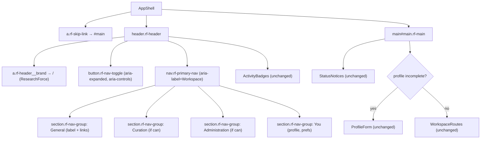
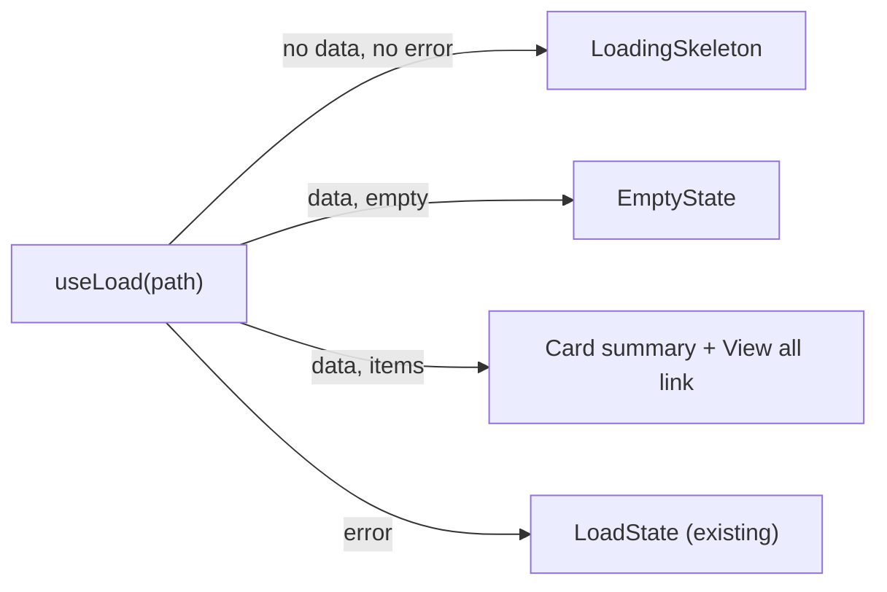

# Design Document

## Overview

This is a presentational, information-architecture (IA), and targeted UX-flow rework of the authenticated Workspace SPA at `apps/app/web/`. It replaces the flat 30-link header with a grouped, role-aware application shell, replaces the stub start page (`StartPage` in `apps/app/web/src/routes.tsx`) with a real dashboard, adds a small set of reusable presentation components on top of the existing `@researchforce/design` tokens, and gives the high-density curator and admin queues scannable tables with client-side filtering and sorting.

### What changes

- **Chrome.** The current `Header` and `Workspace` shell in `apps/app/web/src/routes.tsx` are replaced by a new `AppShell` composed in the app: brand, a grouped `PrimaryNav` driven by a declarative config, the skip link, `StatusNotices`, and the `<main id="main">` region. The flat `<ul className="rf-nav__list">` of ~30 `<li><Link/></li>` entries becomes labelled `Navigation_Group`s filtered by `session.can(...)`, with active state via the current location and `aria-current="page"`, and a responsive collapse toggle.
- **Start page.** `StartPage` becomes a `Dashboard` with regions for the viewer's reviews, drafts, work, and recent activity, plus the existing "submit a new record" controls, each reading from endpoints the Workspace already calls.
- **Component layer.** New components are added to the Design_System (`packages/design/src/components/` + `packages/design/src/components.css`) and composed in the Workspace: `PageHeader` (+ `Breadcrumb`), `PageLayout` (reading-width vs wide/two-column), `Card`, `DataTable`/`Listing`, `Tabs`, `EmptyState`, `LoadingSkeleton`.
- **Queue IA.** The `Curator_Admin_Queue` screens (moderation `apps/app/web/src/moderation/queue.tsx`, review queue `apps/app/web/src/reviews/reviews.tsx`, disclosure `apps/app/web/src/disclosure/records.tsx`, evidence `apps/app/web/src/evidence/queue.tsx`) render their already-loaded rows through `DataTable`, with client-side `Filter_Affordance` and `Sort_Affordance` that narrow and reorder loaded rows only.

### What explicitly does NOT change

- **Routes.** Every `<Route path=.../>` in `WorkspaceRoutes` and the component each route renders are unchanged (R2, R10.4).
- **APIs.** No endpoint path, method, or request shape changes; no endpoint is added (R5.6, R10.2, R10.3).
- **Data model and server.** No change (R10.3).
- **Action behavior.** Every action (save, move, decide, restrict, consent, etc.) does exactly what it does today (R10.1). The rework touches presentation and the arrangement of already-fetched data only.

### Design principles

1. **Tokens only.** Every new style resolves to a `--rf-*` token already defined in `packages/design/src/tokens.ts`/`tokens.css`. No new raw colour, size, or spacing value is introduced except as a derived token where a component genuinely needs one (R7.6, R13.3, R14.2).
2. **No new UI framework.** Components are plain React composing existing `.rf-*` classes; no third-party component library is added (R7.6).
3. **Behavior-preserving.** Presentation wraps existing data flows (`useLoad`, `useApi`, `session.can`) without altering what is requested or what actions do (R10).
4. **Shared code stays public-safe.** Shared tokens and components are extended additively so the Public_Site (`packages/public-render`, `apps/site-shell`) keeps its presentation, privacy, and Lighthouse budgets (R13).

## Research and Grounding

The design is grounded in the current code. Key findings that shape it:

- **Two rendering paths share one stylesheet.** The Design_System emits a neutral element tree (`@researchforce/domain/tree`) that the Public_Site renders to a string (`packages/design/src/render-string.ts`) and the Workspace renders to React via `toReact` (`packages/design/src/react.ts`, used by `apps/app/web/src/editor/RichTextView.tsx`). Interactive Workspace widgets are controlled React counterparts in `apps/app/web/src/ui.tsx` (`Field`, `TextField`, `SelectField`, `CheckboxField`, `Button`, `Notice`) that deliberately reuse the same `.rf-*` classes as the design builders in `packages/design/src/components/controls.ts`. This is the pattern the new components follow: **CSS lives in the shared package; interactive composition lives in the Workspace.**
- **The design package's import boundary is strict.** `.oxlintrc.json` restricts `packages/design/src/**` to importing only `@researchforce/domain` (no React component trees from the app, no other packages). So shared component *logic* in `packages/design/src/components/` must stay as neutral-tree builders + CSS, matching `dataTable`, `navigation`, `siteHeader` today.
- **`apps/app/web` may import `@researchforce/design`.** The app's boundary block in `.oxlintrc.json` forbids `site-shell`, `submit`, `dl`, `ops`, `tools` but not `design` or `domain`, so the Workspace keeps importing Design_System through package entry points only (`@researchforce/design/tokens`, `@researchforce/design/react`, and new `@researchforce/design/components`) (R14.3).
- **The app overrides `.rf-main` to reading width.** `apps/app/web/src/styles.css` sets `.rf-main { max-inline-size: var(--rf-width-reading); }`. The current shell therefore constrains *every* page, including dense queues, to `68ch`. The `Page_Layout` system must introduce an opt-out wide/two-column container rather than widening `.rf-main` globally.
- **Queues already fetch and paginate.** Moderation (`/moderation`), review queue (`/reviews/queue`), unclassified (`/disclosure/unclassified`), public overview (`/disclosure/public-units`), and evidence (`/evidence/queue`) each already call `useLoad`/`useApi` and render `<ul className="rf-list">`. The rework reshapes their rendered output into `DataTable`; the `Filter_Affordance`/`Sort_Affordance` operate on the client array already in state, not the request.
- **The moderation queue filters server-side today.** `ModerationQueueScreen` builds query params (`type`, `state`, `project`, `contactReview`) into the request path. The rework keeps those server-backed filters as they are (they change the request, which is existing behavior) and adds *client-side* `Filter_Affordance`/`Sort_Affordance` on top of the already-loaded rows (R9.5). The two are distinct and both preserved.
- **Permissions are role grants tested by `session.can`.** `session.tsx` resolves the viewer's role from `/me` + `/roles` and exposes `can(permission)` against `role.permissions[permission]`. The permission names come from `@researchforce/domain/permissions` (`PERMISSIONS`), e.g. `moderation.decide`, `disclosure.set`, `review.complete`, `settings.edit`, `policy.edit`, `valueSet.manage`, `import.run`, `export.manage`, `backup.manage`, `project.create`, `consent.request`. These drive `Navigation_Group` visibility.
- **The dashboard data already exists.** `/me/dashboard`, `/reviews/queue`, `/drafts`, `/feed`, and `/me/badges` are already called by `apps/app/web/src/me/dashboard.tsx`, `reviews/reviews.tsx`, `drafts/drafts.tsx`, and `activity/activity.tsx`. The new `Dashboard` composes summaries of these without adding an endpoint (R5.6).
- **The presentation suite targets a served base URL.** `tests/presentation/` runs against `PRESENTATION_BASE_URL` (Public_Site and Workspace as separate jobs), checks WCAG 2.2 AA with axe-core, colour-scheme, print, viewport, privacy, and screenshots components by `.rf-*` selector. Visual-regression snapshots are re-baselined in CI with `--update-snapshots`.

## Architecture

### Where new code lives

```
packages/design/src/
  components.css            # + new component classes (Card, table/listing, tabs, empty state, skeleton,
                            #   page header/breadcrumb, two-column layout). Additive; tokens only.
  components/
    layout.ts               # NEW: pageHeader(), breadcrumb(), pageLayout wrappers, card(), emptyState()
                            #      as neutral-tree builders (string + React via toReact), matching page.ts
    tabs.ts                 # NEW: tablist markup contract + helper (ARIA roles/ids), skeleton markup
    index.ts                # re-export new builders
  tokens.ts / tokens.css    # only if a component needs a derived token (e.g. skeleton colour); additive

apps/app/web/src/
  shell/
    app-shell.tsx           # NEW: AppShell React component (replaces Header + Workspace frame)
    nav-config.ts           # NEW: declarative NAV_GROUPS (groups -> links -> required permission)
    primary-nav.tsx         # NEW: PrimaryNav React component (role filter, active state, collapse toggle)
  dashboard/
    dashboard.tsx           # NEW: Dashboard (regions + skeletons + empty states); replaces StartPage
  ui.tsx                    # + React wrappers that reuse the new .rf-* classes:
                            #   PageHeader, PageLayout, Card, DataTable, Tabs, EmptyState, LoadingSkeleton,
                            #   useClientFilterSort hook
  routes.tsx                # Header/Workspace/StartPage removed or reduced; routes unchanged
```

Rationale: the **reusable styling and static markup contracts** go to the shared Design_System so the Public_Site can adopt them later and so the visual-regression suite captures them by class (R7, R13). The **interactive composition** (role-aware filtering, collapse state, client sort, data loading) is Workspace-only React in `apps/app/web/src/`, because it needs `session`, `react-router`, and `useLoad` — none of which the design package may import. This mirrors the existing split between `packages/design/src/components/controls.ts` (markup) and `apps/app/web/src/ui.tsx` (controlled React).

### App_Shell component tree

The `AppShell` replaces both `Header` and the frame in `Workspace`. The data flow of `Workspace` (loading `/me` and `/roles`, building the `session`, gating on incomplete profile, rendering `WorkspaceRoutes`) is preserved exactly; only the surrounding chrome is reorganized.



The `AppShell` keeps the current gating logic verbatim:

```tsx
export function AppShell() {
  const status = useApiStatus();
  const me = useLoad<Me>('/me');
  const roles = useLoad<{ roles: Role[] }>('/roles');
  const session = useMemo(() => (me.data && roles.data ? sessionFor(me.data, roles.data.roles, me.reload) : null), [me.data, roles.data, me.reload]);
  const gated = session !== null && (session.me.missing.length > 0 || status.profileMissing !== null);
  return (
    <>
      <a className="rf-skip-link" href="#main">Skip to the main content</a>
      <header className="rf-header">
        <div className="rf-header__inner">
          <Link className="rf-header__brand" to="/">ResearchForce</Link>
          {session !== null && <PrimaryNav session={session} />}
          <ActivityBadges />
        </div>
      </header>
      <main className="rf-main" id="main">
        <StatusNotices />
        {session === null ? <LoadState error={me.error ?? roles.error} /> : (
          <SessionContext.Provider value={session}>
            {gated ? <ProfileForm me={session.me} onSaved={me.reload} /> : <WorkspaceRoutes />}
          </SessionContext.Provider>
        )}
      </main>
    </>
  );
}
```

`main.tsx` continues to render `<Workspace />`; `Workspace` becomes a thin alias for `AppShell` (or `main.tsx` is pointed at `AppShell`), keeping the entry wiring untouched. The skip link, `#main` target, and `StatusNotices` placement are preserved (R4.1, R11.1).

## The Role-Aware Navigation Model

### Declarative config

Navigation becomes data: an ordered list of groups, each with a visible label and a list of links, each link carrying its route `to` and an optional required `Permission`. A group with no `can`-permitted links is omitted entirely (R1.4).

```ts
// apps/app/web/src/shell/nav-config.ts
import type { Permission } from '@researchforce/domain/permissions';

export interface NavLink { readonly label: string; readonly to: string; readonly permission?: Permission }
export interface NavGroup { readonly label: string; readonly links: readonly NavLink[] }

export const NAV_GROUPS: readonly NavGroup[] = [ /* see table below */ ];
```

`PrimaryNav` filters with `session.can`:

```tsx
function visibleGroups(session: Session): NavGroup[] {
  return NAV_GROUPS
    .map((group) => ({ ...group, links: group.links.filter((l) => l.permission === undefined || session.can(l.permission)) }))
    .filter((group) => group.links.length > 0);
}
```

### Group → link mapping (every current destination preserved)

Every destination the current `Header` links to is mapped into exactly one group; the route path is unchanged and only labels may be refined (R2.1, R2.2). General destinations have no required permission, so every signed-in Member sees them (R1.2). Curation and Administration links carry a permission so the group appears only for authorized roles (R1.3, R1.4, R1.6).

| Group | Label shown | Link label | Route (unchanged) | Required permission |
|---|---|---|---|---|
| General | General | Projects | `/projects` | — |
| General | General | Project log | `/log` | — |
| General | General | Findings | `/lists/findings` | — |
| General | General | Runs | `/lists/runs` | — |
| General | General | Hypotheses | `/lists/hypotheses` | — |
| General | General | Correspondences | `/lists/correspondences` | — |
| General | General | Archival requests | `/lists/archival-requests` | — |
| General | General | My work | `/me/work` | — |
| General | General | My drafts | `/me/drafts` | — |
| General | General | Saved | `/me/saved` | — |
| General | General | Search | `/search` | — |
| General | General | Members | `/members` | — |
| Curation | Curation | Review queue | `/reviews` | `review.complete` |
| Curation | Curation | Moderation queue | `/moderation` | `moderation.decide` |
| Curation | Curation | Dual approvals | `/dual-approvals` | `dual.approve` |
| Curation | Curation | Unclassified | `/disclosure/unclassified` | `disclosure.set` |
| Curation | Curation | Public overview | `/disclosure/public-units` | `disclosure.set` |
| Curation | Curation | Evidence queue | `/evidence/queue` | `consent.request` |
| Curation | Curation | Consent requests | `/consent-requests` | `consent.request` |
| Administration | Administration | Import a journal | `/imports/journal` | `import.run` |
| Administration | Administration | Import a manifest | `/imports/bulk` | `import.run` |
| Administration | Administration | Releases | `/releases` | `export.manage` |
| Administration | Administration | Exports | `/exports` | `export.manage` |
| Administration | Administration | Backups | `/backups` | `backup.manage` |
| Administration | Administration | Policy pages | `/admin/policy` | `policy.edit` |
| Administration | Administration | Settings | `/admin/settings` | `settings.edit` |
| Administration | Administration | Value sets | `/admin/value-sets` | `valueSet.manage` |
| You | You | Your Profile | `/me/profile` | — |
| You | You | Notification settings | `/me/preferences` | — |

Notes:
- The permission mapping uses the same `Permission` names the corresponding screens already gate on or whose data the screen reads (from `@researchforce/domain/permissions`). The Worker remains the authority on each request; `can` only decides what to *show* (consistent with `session.tsx`'s own comment). A Member who reaches a hidden route directly still gets the page the route renders — nothing about routing changes (R2.3, R2.4).
- The current Contributor role grants `review.complete` (as `eligible`) and `consent.give`/`consent.propose` but not `moderation.decide`, `disclosure.set`, `import.run`, `export.manage`, `backup.manage`, `settings.edit`, `policy.edit`, `valueSet.manage`, or `dual.approve`. So a Contributor sees General + You + the review-queue curation link; an Administrator (all permissions `any`) sees every group. This is exactly the role-filtering R1 asks for.
- Every current header destination appears in the table; none is dropped (R2.1). `ActivityBadges` (notifications/activity) stays in the header beside the brand as today.

### Markup, active state, and ARIA

`PrimaryNav` renders one `<nav aria-label="Workspace">` whose groups are labelled regions. Each group's label is a visible heading and names its list; each link is an `<a>` with `aria-current="page"` when its route matches the current location (R1.5, R3.1, R3.2).

```tsx
function PrimaryNav({ session }: { session: Session }) {
  const { pathname } = useLocation();
  const [open, setOpen] = useState(false);
  const groups = visibleGroups(session);
  return (
    <>
      <button type="button" className="rf-nav-toggle" aria-expanded={open} aria-controls="rf-primary-nav" onClick={() => setOpen((v) => !v)}>Menu</button>
      <nav id="rf-primary-nav" className={open ? 'rf-primary-nav rf-primary-nav--open' : 'rf-primary-nav'} aria-label="Workspace">
        {groups.map((group) => (
          <section key={group.label} className="rf-nav-group" aria-labelledby={`nav-${slug(group.label)}`}>
            <h2 className="rf-nav-group__label" id={`nav-${slug(group.label)}`}>{group.label}</h2>
            <ul className="rf-nav__list">
              {group.links.map((link) => (
                <li key={link.to} className="rf-nav__item">
                  <Link className="rf-nav__link" to={link.to} aria-current={isActive(pathname, link.to) ? 'page' : undefined}>{link.label}</Link>
                </li>
              ))}
            </ul>
          </section>
        ))}
      </nav>
    </>
  );
}
```

- **Active state (R3).** `isActive(pathname, to)` matches the link whose route corresponds to the current location: an exact match for index routes, and a prefix match on the path segment for section roots (e.g. `/items/123` activates no nav link because no nav link targets `/items`; `/projects/9/log` activates `Projects` as the nearest ancestor link). When no link matches, no link is active (R3.3). The existing `.rf-nav__link[aria-current='page']` rule in `components.css` already styles the active link distinctly, so no new CSS is required for active state (R3.1).
- **ARIA current.** Exactly the matched link carries `aria-current="page"` (R3.2); the design `navigation()` builder already demonstrates this contract and a design test asserts it.

### Responsive collapse (R4)

- **Threshold.** The narrow-layout threshold is the existing `md` breakpoint, `48rem`, already used by `components.css` (`@media (min-width: 48rem)` on `.rf-header__inner`) and declared in `tokens.ts` `BREAKPOINTS.md = 48`. Reusing it keeps one source of truth (a token test checks the stylesheet against `BREAKPOINTS`).
- **Above the threshold (≥ 48rem).** The toggle is hidden (`display: none`) and `.rf-primary-nav` is shown expanded without any interaction (R4.6).
- **At or below the threshold (< 48rem).** `.rf-primary-nav` is collapsed by default (`display: none`) and revealed by `.rf-primary-nav--open`; the `.rf-nav-toggle` button is shown with a visible label ("Menu") and `aria-controls="rf-primary-nav"` (R4.2).
- **Toggle behavior.** The button's `aria-expanded` reflects the `open` state (R4.5). Activating it while collapsed sets `open=true` and reveals the nav (R4.3); activating it while revealed sets `open=false` and collapses it (R4.4). CSS drives visibility; the toggle only flips `open`.
- The brand, nav, skip link, status notices, and main region are present on every page in both layouts (R4.1).

## The Dashboard (R5)

`Dashboard` replaces `StartPage` at route `/`. It composes four summary regions plus the existing new-record controls, using the components below. It adds no endpoint and changes no request shape; it reads the same paths the full screens already read and shows a compact summary that links to the full destination (R5.4, R5.6).

### Regions and their existing endpoints

| Region | Existing endpoint(s) read | Full destination linked | Source of truth in code |
|---|---|---|---|
| My reviews | `GET /reviews/queue` | `/reviews` | `reviews/reviews.tsx` (`useLoad('/reviews/queue')`) |
| My drafts | `GET /drafts` | `/me/drafts` | `drafts/drafts.tsx` (`useLoad('/drafts')`) |
| My work | `GET /me/dashboard` | `/me/work` | `me/dashboard.tsx` (`useLoad('/me/dashboard')`) |
| Recent activity | `GET /feed` | `/activity` | `activity/activity.tsx` (`client.get('/feed')`) |
| New record controls | none (links only) | `/items/new/{kind}` | `routes.tsx` `StartPage`, `items/forms/model` `SUBMITTABLE_KINDS` |

Each region is a `Card` with a heading that links to the full destination, a short count/summary of the first few items from the already-returned payload, and a "View all" link to the same route the nav uses (R5.4). The dashboard uses `useLoad` exactly as the existing screens do, so the request path/method/shape are identical (R5.6, R10.2).

### New-record controls (R5.5)

The dashboard keeps the current start-page affordance verbatim: the list of `SUBMITTABLE_KINDS` from `apps/app/web/src/items/forms/model.ts`, each linking to `/items/new/${kind}` with the label `ITEM_KIND_NAMES[kind]`. These are surfaced as an action group within a "Submit a new record" `Card`, preserving the exact routes.

### Loading and empty behavior (R5.2, R5.3)

- **Loading.** While a region's `useLoad` has neither data nor error, the region shows a `LoadingSkeleton` shaped like its content (a few skeleton rows) instead of a bare "Loading…" line (R5.2).
- **Empty.** When a region's request resolves with no items, the region shows an `EmptyState` with a short explanation and, where relevant, a next action (e.g. "No reviews are waiting for you.") (R5.3).
- **Error.** On error, the region reuses the existing `LoadState` presentation so error handling is identical to today.



## Components and Interfaces

This section defines the new Design_System components (R6, R7) and the Workspace shell/dashboard composition, with their token usage, semantic/ARIA structure, and interfaces.

All components are built from existing `--rf-*` tokens and existing `.rf-*` conventions; none introduces a third-party UI library (R7.6). Each new component contributes a CSS class to `packages/design/src/components.css` and, where it has static markup worth sharing, a neutral-tree builder in `packages/design/src/components/`. The Workspace-facing React wrappers live in `apps/app/web/src/ui.tsx`.

Shared token usage summary:

- Surfaces: `--rf-colour-surface`, `--rf-colour-surface-raised`
- Text: `--rf-colour-text`, `--rf-colour-text-muted`, `--rf-colour-on-accent`
- Borders: `--rf-colour-border` (interface, ≥ 3:1), `--rf-colour-border-subtle` (decorative)
- Accent/focus: `--rf-colour-accent`, `--rf-colour-focus` (focus ring is the global `:focus-visible` rule already in `components.css`)
- Spacing: `--rf-space-2xs … --rf-space-3xl`, `--rf-space-page`
- Radii: `--rf-radius-sm`, `--rf-radius-md`
- Type: `--rf-font-ui`, `--rf-font-size-ui/sm/xs/lg`, `--rf-font-weight-*`, `--rf-line-height-ui`
- Measure: `--rf-width-reading` (reading), `--rf-width-page` (wide)
- Motion: `--rf-duration-fast`, suppressed under the existing `prefers-reduced-motion` rule

### Page_Header (+ Breadcrumb) (R6.1, R6.3, R6.4)

A `PageHeader` presents a level-one heading (the page title), an optional description paragraph, an optional `Breadcrumb` region, and an optional actions slot.

- **Heading.** The title renders as the page's single `<h1>` (R6.4), using the existing `h1` rule (`--rf-font-size-3xl`, `--rf-font-heading`).
- **Breadcrumb.** Rendered as `<nav class="rf-breadcrumb" aria-label="Breadcrumb"><ol>…</ol></nav>`; each ancestor is an `<a>` targeting that ancestor's existing route path, and the current page is the last item without a link, marked `aria-current="page"` (R6.3). Breadcrumb links only point at routes that already exist in `routes.tsx`.
- **Actions.** A `.rf-actions` cluster (existing class in `styles.css`) on the trailing side.
- **Builder.** `pageHeader(...)`/`breadcrumb(...)` added to `packages/design/src/components/layout.ts` as neutral-tree markup so the Public_Site can reuse the same classes; the Workspace wraps it in a React `PageHeader` in `ui.tsx` that renders children for the actions slot.

Semantics: `<header class="rf-page-header">` containing the breadcrumb `<nav>`, the `<h1>`, an optional `<p class="rf-page-header__description">`, and the actions cluster.

### Page_Layout: reading-width vs wide/two-column (R6.2, R6.5)

Because `apps/app/web/src/styles.css` constrains `.rf-main` to `--rf-width-reading`, the layout system opts dense pages *out* to a wider measure rather than changing the global default.

- **Reading layout (default).** Reading-focused pages keep the current `.rf-main` reading measure of `--rf-width-reading` (`68ch`), which keeps body text legible (R6.5). No markup change needed for these pages.
- **Wide layout.** `<div class="rf-layout rf-layout--wide">` sets `max-inline-size: var(--rf-width-page)` and negative-margins back out of the reading column, so queues and tables can use the full `--rf-width-page` (`72rem`).
- **Two-column layout.** `<div class="rf-layout rf-layout--split">` is a CSS grid: a primary column and a secondary column (e.g. filters beside a listing, or metadata beside an item body). It collapses to a single column below the `md` (`48rem`) breakpoint. Gaps use `--rf-space-lg`.

React wrapper `PageLayout({ variant: 'reading' | 'wide' | 'split', children })` in `ui.tsx` emits the right class; dense screens choose `wide`/`split`, reading screens leave the default.

### Card (R7.1)

`<section class="rf-card">` (or `<article>` where semantically a self-contained unit) grouping related content with `--rf-colour-surface-raised` background, `--rf-border-width` solid `--rf-colour-border-subtle`, `--rf-radius-md`, and `--rf-space-lg` padding. An optional `.rf-card__header` holds a heading. Used by the dashboard regions and anywhere content needs grouping. Builder `card(...)` in `layout.ts`; React `Card` wrapper in `ui.tsx` for children.

### Data_Table / Listing (R7.2, R8)

The Design_System already ships `dataTable(caption, columns, rows)` in `packages/design/src/components/content.ts`, which emits a semantic `<table class="rf-table">` with `<caption>`, a `<thead>` header row of `<th scope="col">`, and a `<tbody>` of `<td>`, all inside a keyboard-focusable scroll region (`.rf-table-scroll`, `role="region"`, `tabindex="0"`). The rework **reuses this** for the Public_Site-compatible static case and adds a React `DataTable` in `ui.tsx` for the interactive Workspace case.

- **Semantics.** Real `<table>` with a header row and `<th scope="col">` column headers (R7.2, R8.2). Caption names the listing.
- **Columns.** `DataTable<Row>` takes a `columns: { key, header, cell(row), align?, sortBy?(row) }[]` and a `rows: Row[]`, rendering each record as a `<tr>` with its identifying columns, keeping each record's existing actions and links inside cells (R8.2, R8.4).
- **Sort header affordance.** When a column supplies `sortBy`, its `<th>` holds a `<button>` toggling ascending/descending; the active column's `<th>` gets `aria-sort="ascending|descending"` and others `none`.
- **Empty.** When the listing has no rows, the screen renders an `EmptyState` in place of the table (R8.3); when a filter leaves no rows, the empty state message says no records match the active filter (R9.4).

### Tabs (R7.3, R7.7)

`Tabs` presents sibling views and switches between them without navigating. ARIA contract:

- A `<div role="tablist">` of `<button role="tab" id="tab-{k}" aria-controls="panel-{k}" aria-selected={active}>`; the inactive tabs are `tabindex="-1"` and the active one `tabindex="0"`, with Left/Right arrow key roving focus.
- One `<div role="tabpanel" id="panel-{k}" aria-labelledby="tab-{k}">` per view; inactive panels are hidden (R7.7).
- The relationship is complete: each `tab` points at its `tabpanel` via `aria-controls`, each `tabpanel` back at its `tab` via `aria-labelledby` (R7.7).

`Tabs` is interactive, so it is a React component in `ui.tsx`; it uses the roles above and existing tokens (`--rf-colour-accent` for the selected indicator, `--rf-colour-border-subtle` for the rule). It does not change any route — tab switching is local state only.

### Empty_State (R7.4)

`<div class="rf-empty">` with a short explanatory `<p>` and an optional next action (a `.rf-button` link or button). Muted text uses `--rf-colour-text-muted`. Builder `emptyState(message, action?)` in `layout.ts`; React `EmptyState` wrapper in `ui.tsx`. Used by the dashboard regions, queues with no rows, and filters that match nothing (R5.3, R8.3, R9.4).

### Loading_Skeleton (R7.5)

`<div class="rf-skeleton" aria-hidden="true">` placeholder blocks that occupy the expected shape of the content they replace (e.g. a few `.rf-skeleton__row` lines for a listing, a title bar for a card header). The pulse animation uses `--rf-duration-fast` and is suppressed under the existing `@media (prefers-reduced-motion: reduce)` rule in `components.css` (R12.5). The skeleton is `aria-hidden`; the region keeps a visually-hidden "Loading…" status for assistive tech, matching the existing `role="status"` loading convention. A derived token (e.g. `--rf-colour-skeleton`, defined from `--rf-colour-surface-raised`) is added only if needed; it is additive and light/dark-aware so it does not alter any existing token value (R13.3).

### Client-side Filter_Affordance / Sort_Affordance (R9)

A single Workspace hook powers queue filtering and sorting over already-loaded rows:

```tsx
// apps/app/web/src/ui.tsx
export function useClientFilterSort<Row>(rows: readonly Row[], opts: {
  readonly filters?: readonly { key: string; predicate: (row: Row, value: string) => boolean }[];
  readonly sorts?: readonly { key: string; compare: (a: Row, b: Row) => number }[];
}): { visible: Row[]; filterValue: ...; setFilter: ...; sortKey: ...; setSort: ... }
```

- It derives `visible` purely from `rows` already in state via `useMemo`; it never calls `useApi`/`useLoad` and never changes any request (R9.3, R9.5).
- `Filter_Affordance` controls (a `SelectField`/`TextField` from `ui.tsx`) narrow `visible` to rows matching the predicate (R9.1).
- `Sort_Affordance` (the `DataTable` sortable `<th>` buttons, or a `SelectField`) reorders `visible` with the chosen comparator (R9.2).
- When filters leave `visible` empty, the screen shows the "no records match the active filter" `EmptyState` (R9.4).

This is layered *on top of* each queue's existing server interaction. The moderation queue keeps its server-side `type`/`state`/`project`/`contactReview` query params (existing behavior, unchanged request) and gains client-side affordances over the rows already fetched; the review/unclassified/public-overview/evidence queues add client affordances over their already-loaded arrays. No queue's request changes (R9.5, R10.2).

### Queue adoption (R8)

Each `Curator_Admin_Queue` renders its already-loaded rows through `DataTable` inside a `PageLayout variant="wide"`, with a `PageHeader` title and the client filter/sort affordances:

- **Moderation** (`moderation/queue.tsx`): columns reference, type, state, project/general, submitter, received, response target (with the existing overdue `rf-status rf-status--danger` mark). The `<Link to={/moderation/${id}}>` and status marks move into cells; the existing `QueueRow` content is preserved as table cells (R8.4).
- **Review queue** (`reviews/reviews.tsx`, `/reviews/queue`): columns target, requester, addressees, requested-at, with the existing review action/links retained per row.
- **Unclassified** (`disclosure/records.tsx`, `/disclosure/unclassified`): the grouped counts become a table of group label and count linking to the existing destinations.
- **Public overview** (`disclosure/records.tsx`, `/disclosure/public-units`): columns kind, project, root item, rights, effective, last projected.
- **Evidence queue** (`evidence/queue.tsx`, `/evidence/queue`): columns unit, kind, root item, project, reason, retaining links.

All existing actions and links remain reachable from the reworked listing (R8.4); empty queues show an `EmptyState` (R8.3).

## Non-Regression Strategy

### Behavior, routes, APIs (R10)

- **Routes untouched.** `WorkspaceRoutes` is copied forward unchanged; no path and no element mapping is altered (R10.4). The only `routes.tsx` edits are removing `Header`/`StartPage`/the old `Workspace` frame (moved to `shell/` and `dashboard/`) and pointing `/` at `Dashboard`.
- **Requests identical.** New components never issue requests; the dashboard and queues call the same `useLoad`/`useApi` paths with the same shapes (R10.2). Client filter/sort operate only on loaded data (R9.5).
- **Actions identical.** Action handlers (POSTs, navigation) are moved into table cells and cards unchanged; their effects are the same (R10.1). The Design_System and server, API, and data model are not modified (R10.3).
- **Unit suite.** Existing RTL tests under `apps/app/web/test/` (and `test/properties/`) continue to pass; where a test asserts on markup the rework changes (e.g. the header link list), the test is updated to the new grouped structure while preserving its behavioral assertions (R10.5).

### Accessibility (R11)

- The skip link to `#main` is kept verbatim in `AppShell` (R11.1). Every interactive control (nav links, toggle, tabs, sortable headers, filter controls) is a real `<a>`/`<button>`/`<select>`/`<input>`, operable by keyboard with the global `:focus-visible` ring from `components.css` (R11.2, R11.3). Each has an accessible role and name: nav links by text, the toggle by its "Menu" label and `aria-expanded`, tabs by `role="tab"` + label, the table by caption, sort buttons by their header text (R11.4).
- The `accessibility.spec.ts` axe-core run (WCAG 2.2 AA) over the Workspace must report no new violation (R11.5). The design keeps native semantics and avoids ARIA anti-patterns (proper `tablist`/`tab`/`tabpanel`, `<table>`/`<th scope>`, labelled `<nav>` regions) specifically to hold this line.

### Colour scheme, contrast, print, motion (R12)

- Light/dark follow `prefers-color-scheme` because every colour resolves to a `--rf-colour-*` token that already has a light and dark value in `tokens.css` (R12.1). Text on surface uses `--rf-colour-text`/`--rf-colour-text-muted` on `--rf-colour-surface`/`--rf-colour-surface-raised`, which the design's own contrast test holds at ≥ 4.5:1; interface borders use `--rf-colour-border` at ≥ 3:1 (R12.2, R12.3). No new colour pairing is introduced that is not already a validated token combination.
- Print styling is unchanged: no new rule overrides `print.css`; new components fall back to the light scheme in print as all tokens do under `@media print` (R12.4).
- Non-essential motion (skeleton pulse, any transition) is gated by the existing `prefers-reduced-motion` rule, which already zeroes `transition-duration`/`animation-duration` globally (R12.5).
- `colour-scheme.spec.ts`, `print-pdf.spec.ts`, `viewport-sweep.spec.ts`, and `visual-regression.spec.ts` must pass after the rework (R12.6). See the visual-regression note below.

### Privacy and the Public_Site (R13)

- `privacy-crawl.spec.ts` asserts public pages contact only allowed origins and store nothing. The rework touches only the authenticated Workspace and additive shared CSS/markup builders; it adds no script, network call, cookie, or storage to the Public_Site, so the crawl stays green (R13.1).
- Shared changes are additive: new `.rf-*` classes and, if required, one or two new derived tokens. No existing token *value* changes, so the Public_Site's presentation and its Playwright/Lighthouse budgets are unaffected (R13.2, R13.3). New tokens are added only where a new component needs them (R13.3).

### Build, lint, import boundaries, continuous green (R14)

- **Types.** All new modules are typed; `tsc` must report zero errors (R14.1).
- **Lint and copy checks.** oxlint `correctness` must pass, including the import-boundary `no-restricted-imports` rules and copy checks (R14.2).
- **Import boundaries.** New Design_System builders in `packages/design/src/components/` import only `@researchforce/domain` (tree helpers), honoring the design boundary block. The Workspace imports Design_System only through package entry points — `@researchforce/design/tokens`, `@researchforce/design/react`, and a new `@researchforce/design/components` barrel — never by deep relative path (R14.3). The app's boundary block permits `design` and `domain`, which is all the new code needs.
- **Full test command.** The repository's full test command must pass (R14.4).

### Visual-regression re-baselining (explicit)

The rework deliberately changes rendered output (grouped nav, dashboard, tables, cards). `visual-regression.spec.ts` screenshots each Design_System component by its `.rf-*` selector against a stored baseline, and is updated in CI with `npm run test:presentation -- --update-snapshots`. The plan:

1. **Deliberate re-baseline, not silent drift.** When a shared component's rendered form changes (e.g. `.rf-nav` markup) or a new component appears (`.rf-card`, `.rf-table-scroll` on new pages, `.rf-tabs`, `.rf-empty`, `.rf-skeleton`, `.rf-page-header`, `.rf-breadcrumb`), the baseline is regenerated in the same change that introduces the visual change, and the new snapshots are reviewed as part of that change — never accepted blindly.
2. **New component entries.** The `COMPONENTS` list in `visual-regression.spec.ts` gains rows for the new components (name, a page that shows them, selector) so each is captured in both schemes at 320/768/1280.
3. **Public_Site baselines protected.** The Public_Site job's baselines only change if a shared component the Public_Site renders actually changes; additive classes used only by the Workspace leave Public_Site snapshots untouched. Any shared change is verified against the Public_Site job before merge.
4. **Every other presentation assertion stays green.** Accessibility, colour-scheme, print, viewport-sweep, and privacy-crawl are *not* snapshot-based; they must pass unchanged. Only the screenshot baselines are intentionally updated.

## Data Models

This rework introduces no new persisted data and no change to the API response shapes in `apps/app/web/src/types.ts`. The only new data structures are client-side, presentation-level configuration and view-state types that live in the Workspace.

### Navigation configuration (`apps/app/web/src/shell/nav-config.ts`)

```ts
import type { Permission } from '@researchforce/domain/permissions';

/** One navigation destination: a label, an existing route path, and an optional permission that gates it. */
export interface NavLink {
  readonly label: string;
  readonly to: string;            // an existing route path from routes.tsx; never a new route
  readonly permission?: Permission; // from @researchforce/domain/permissions; omitted => visible to all
}

/** A labelled group of related links (General, Curation, Administration, You). */
export interface NavGroup {
  readonly label: string;
  readonly links: readonly NavLink[];
}

export const NAV_GROUPS: readonly NavGroup[]; // the mapping in the group→link table above
```

### Component interfaces (`apps/app/web/src/ui.tsx`)

```ts
// Page header + breadcrumb
interface Crumb { readonly label: string; readonly to?: string } // last crumb has no `to` (current page)
interface PageHeaderProps { readonly title: string; readonly description?: string; readonly breadcrumb?: readonly Crumb[]; readonly actions?: ReactNode }

// Layout
type LayoutVariant = 'reading' | 'wide' | 'split';
interface PageLayoutProps { readonly variant?: LayoutVariant; readonly children: ReactNode }

// Card, empty state, skeleton
interface CardProps { readonly heading?: string; readonly headingHref?: string; readonly children: ReactNode }
interface EmptyStateProps { readonly message: string; readonly action?: { readonly label: string; readonly to?: string; readonly onClick?: () => void } }
interface LoadingSkeletonProps { readonly rows?: number; readonly label?: string } // aria-hidden blocks + visually-hidden status

// Data table / listing
interface Column<Row> {
  readonly key: string;
  readonly header: string;
  readonly cell: (row: Row) => ReactNode;
  readonly align?: 'left' | 'center' | 'right';
  readonly sortBy?: (row: Row) => string | number; // present => sortable header
}
interface DataTableProps<Row> { readonly caption: string; readonly columns: readonly Column<Row>[]; readonly rows: readonly Row[] }

// Tabs
interface TabDef { readonly id: string; readonly label: string; readonly panel: ReactNode }
interface TabsProps { readonly label: string; readonly tabs: readonly TabDef[]; readonly initial?: string }

// Client-side filter/sort view-state (no server interaction)
interface FilterSpec<Row> { readonly key: string; readonly predicate: (row: Row, value: string) => boolean }
interface SortSpec<Row> { readonly key: string; readonly compare: (a: Row, b: Row) => number }
```

All `Row` types are the **existing** response types already defined in `apps/app/web/src/types.ts` (e.g. `QueueEntry`, `ReviewView`, `CurationUnitView`, `PublicUnitView`, `UnclassifiedGroup`). No type in `types.ts` is changed; the components are generic over them.

### Neutral-tree builder signatures (`packages/design/src/components/`)

These follow the existing builder style in `content.ts`/`page.ts` (return `ElementNode`/`FragmentNode`, import only `@researchforce/domain/tree`):

```ts
export function pageHeader(props: { title: string; description?: string; breadcrumb?: readonly { label: string; href?: string }[]; actions?: readonly ViewNode[] }): ElementNode;
export function breadcrumb(items: readonly { label: string; href?: string }[]): ElementNode; // <nav aria-label="Breadcrumb"><ol>…</ol></nav>
export function card(props: { heading?: string; headingHref?: string }, children: readonly ViewNode[]): ElementNode;
export function emptyState(message: string, action?: { label: string; href?: string }): ElementNode;
export function pageLayout(variant: 'wide' | 'split', children: readonly ViewNode[]): ElementNode;
```

The existing `dataTable(caption, columns, rows)` in `content.ts` remains the static/string-rendered table; the Workspace's generic React `DataTable` emits the same `.rf-table`/`.rf-table-scroll` markup for the interactive case.

## Error Handling

- **Data load failures.** Dashboard regions and reworked queues reuse the existing `LoadState` component (`ui.tsx`) for loading and error, so `not_found`, `forbidden`, and generic failures present exactly as today. The rework does not change error semantics.
- **Status notices.** `StatusNotices` (daily-limit and frozen-for-backup warnings) stays in `AppShell`'s main region, shown on every page as today (R4.1).
- **Direct navigation to a hidden route.** Hiding a nav group never blocks a route; a Member who opens a curation/admin URL directly still gets the route's page, and the server remains the authority (the page itself renders `LoadState` with a `forbidden` notice if the Worker refuses). Navigation visibility and route access are independent (R2.4).
- **Empty vs error.** `EmptyState` is shown only for a *successful* empty result; a failed load shows `LoadState`, never an empty state, so "no records" and "could not load" are never conflated.
- **Breadcrumb/active-state safety.** `isActive` and breadcrumb ancestor resolution are total functions over the current pathname; an unmatched location yields no active link and no crash (R3.3).

## Testing Strategy

A dual approach of component/unit tests plus the existing presentation suite. Property-based testing (and a Correctness Properties section) is intentionally omitted: this rework is UI rendering, information architecture, and thin view transforms over data already in memory, with no new pure function carrying a universal input/output relationship. Such work is better verified by component (RTL) tests, snapshot/visual-regression, and the accessibility/colour/print presentation suite. The one small universal invariant — the client filter/sort transform — is covered by a focused unit test (filtering never introduces a foreign row; sorting is a permutation of the filtered set) rather than a full property-based suite, keeping verification proportional to the change.

### Unit / React Testing Library (under `apps/app/web/test/`)

| Design element | Test |
|---|---|
| `nav-config` + `visibleGroups` | For a Contributor session, curation/admin groups with unpermitted links are omitted; General and You always present; for an Administrator, all groups present (R1.2–R1.4, R1.6). |
| Destination coverage | Assert the set of `{to}` across `NAV_GROUPS` equals the set of destinations the old `Header` linked (every route preserved) (R2.1). |
| Active state | Rendering `PrimaryNav` at a given `MemoryRouter` location marks exactly the matching link `aria-current="page"`; an unmatched location marks none (R3.1–R3.3). |
| Collapse toggle | Toggle flips `aria-expanded` and reveals/hides the nav; above threshold the nav is expanded without the toggle (R4.2–R4.6, via class assertions / jsdom). |
| Dashboard | With mocked `useLoad`, each region shows skeleton while loading, empty state when empty, and a summary linking to the correct route when populated; new-record links target `/items/new/{kind}` (R5.1–R5.5). |
| No-new-endpoint | Assert the dashboard's requested paths equal `{/reviews/queue, /drafts, /me/dashboard, /feed}` and match existing shapes (R5.6, R10.2). |
| `DataTable`/`Listing` | Renders a semantic `<table>` with `<caption>`, `<th scope="col">`, and a row per record; retains per-row action links (R7.2, R8.2, R8.4). |
| `Tabs` | Exposes `tablist`/`tab`/`tabpanel` with `aria-controls`/`aria-labelledby`/`aria-selected`; arrow keys move focus; switching shows the right panel without navigation (R7.3, R7.7). |
| `EmptyState` / `LoadingSkeleton` / `Card` / `PageHeader` / `Breadcrumb` / `PageLayout` | Render expected roles/markup: `<h1>` title, breadcrumb `<nav aria-label="Breadcrumb">` with ancestor route links, reading vs wide/split container classes (R6.1–R6.5, R7.1, R7.4, R7.5). |
| `useClientFilterSort` | Filtering returns a subset of input rows and never a foreign row; sorting is a permutation of the filtered set; applying a filter/sort issues no request (mock `useApi` asserted uncalled) (R9.1–R9.5). |
| Queue adoption | Each reworked queue renders its rows via `DataTable`, shows `EmptyState` when empty and when a client filter matches nothing, and keeps existing links/actions (R8.1–R8.4, R9.4). |

### Design-system tests (under `packages/design/test/`)

- Extend `components.test.ts` for the new neutral-tree builders (`pageHeader`, `breadcrumb`, `card`, `emptyState`, and any skeleton/tabs markup helper): assert the rendered string markup, classes, and ARIA attributes, matching the style of the existing `dataTable`/`siteHeader` assertions.
- `tokens.test.ts` continues to assert `tokens.css` equals `tokensCss()`; if a derived token is added, it is added in `tokens.ts` so this test stays green (R13.3, R14.1).

### Presentation suite (`tests/presentation/`, against the Workspace base URL)

- `accessibility.spec.ts` (axe-core, WCAG 2.2 AA, both schemes): no new violation on reworked pages (R11.5).
- `colour-scheme.spec.ts`, `print-pdf.spec.ts`, `viewport-sweep.spec.ts`: pass unchanged (R12.6).
- `visual-regression.spec.ts`: new component rows added; baselines re-generated deliberately with `--update-snapshots` and reviewed (R12.6).
- `privacy-crawl.spec.ts`: Public_Site job stays green; the Workspace change adds no off-origin request or storage (R13.1).

### Build / continuous green

- `tsc` zero errors, oxlint `correctness` + import-boundary + copy checks pass, and the full test command passes (R14.1, R14.2, R14.4).

## Design Decisions and Tradeoffs

1. **Top-grouped nav, not a persistent side-nav.** The current shell is a horizontal header with `ActivityBadges`. Introducing a full left side-nav would change the page's two-column structure site-wide and risk the reading-width and print layouts. Decision: keep the header placement and group within it (labelled `Navigation_Group` regions), collapsing to a toggle below `48rem`. This satisfies R1–R4 with the smallest change to the established layout and the lowest visual-regression blast radius. A side-nav remains possible later via `PageLayout --split` without reworking the shell again.
2. **Shared CSS/markup, Workspace-only interactivity.** Driven by the import boundary (`packages/design/src/**` may import only `@researchforce/domain`) and the existing two-renderer split. Interactive state (collapse, tabs, sort) can't live in the design package, so it lives in `ui.tsx`/`shell/` while the styles and static markup stay shared. Tradeoff: a component's look and behavior are defined in two files; mitigated by mirroring the existing `controls.ts` ↔ `ui.tsx` pairing the codebase already uses.
3. **No new UI framework.** Per R7.6, components are hand-built on tokens. Tradeoff: more component code to maintain vs. zero new dependency, no bundle/Lighthouse cost to the Public_Site, and full control over ARIA and token fidelity.
4. **Opt-in wide layout instead of widening `.rf-main`.** `styles.css` globally constrains `.rf-main` to reading width. Widening it globally would change every page and every snapshot. Decision: add `PageLayout --wide/--split` that opts dense pages out, leaving reading pages (and their baselines) untouched (R6.2, R6.5).
5. **Client filter/sort layered over existing server filters, not replacing them.** The moderation queue already filters server-side via query params. R9 asks specifically for *client-side* narrowing of already-loaded rows. Decision: keep server filters as-is (existing behavior, existing request) and add client affordances on top, rather than converting server filters to client ones (which would change request behavior and violate R9.5/R10.2). Tradeoff: two filtering mechanisms coexist on moderation; this is intentional and matches both the existing behavior and R9.
6. **Queue IA kept moderate.** The reworked queues adopt `DataTable` + client filter/sort but do not add bulk-selection, saved views, or new server query capabilities — those would touch behavior/APIs and exceed the presentational scope (R10). Decision: scannable tables + client affordances only, which fully meets R8–R9 without crossing into behavioral change.
7. **Dashboard summarizes, never re-queries differently.** Each region reuses the exact endpoint its full screen uses, so the dashboard adds no endpoint and no new request shape (R5.6). Tradeoff: the dashboard shows the same first-page payload the full screen fetches (a compact summary of it) rather than a bespoke aggregate; this is the correct tradeoff given the no-new-endpoint constraint.
8. **Permission mapping reflects real role grants.** Group visibility uses `Permission` names from `@researchforce/domain/permissions` that the matching screens already gate on, so a Contributor and an Administrator see appropriately different navigation without any server change, and navigation visibility stays independent of route access (R1, R2.4).
